# 🦞 OpenClaw Cookbook

**English** · [简体中文](README.zh-CN.md)

**20 practical, tested [OpenClaw](https://openclaw.ai) workflows you can run today, from a 3-step "hello world" to AI triage with human approval.** Each recipe is a ready-to-use [Lobster](https://docs.openclaw.ai/tools/lobster) workflow file (`workflow.json`) with a step-by-step guide, real example output and ideas for taking it further.

[](https://github.com/YalinMa/openclaw-cookbook/actions/workflows/validate.yml)


> **New to OpenClaw?** OpenClaw is a personal AI assistant that runs on your machine and talks to you through your chat apps. **Lobster** is its workflow engine: you describe a job as a list of steps, the agent runs it with **one** tool call, and the workflow pauses to ask you before doing anything important. Start with **[Getting Started](docs/getting-started.md)**, then read **[Core Concepts](docs/core-concepts.md)**.

## Recipes

### Part 1 · Foundations

| # | Recipe | Real-world use | You'll learn | Needs | Level |
|---|---|---|---|---|---|
| 01 | [**Hello Lobster**](examples/01-hello-lobster/) | Your first workflow | args, steps, `stdin`/`env`, `$step.json` | — | ⭐ |
| 02 | [**Daily Weather Briefing**](examples/02-daily-weather-briefing/) | Morning message in your chat | HTTP + `retry`, `openclaw message send`, cron | — | ⭐ |
| 03 | [**Website Uptime Monitor**](examples/03-website-uptime-monitor/) | Get pinged when your site goes down / comes back | `for_each`, `diff.last`, `when` | — | ⭐⭐ |
| 04 | [**GitHub Release Watcher**](examples/04-github-release-watcher/) | Know when tools you use ship a new version | `state.get`/`state.set`, first-run baseline | — | ⭐⭐ |
| 05 | [**AI News Digest**](examples/05-ai-news-digest/) | A personal Hacker News digest | `llm.invoke`, JSON schemas, "LLM decides, code formats" | LLM | ⭐⭐ |
| 06 | [**AI Support Ticket Triage**](examples/06-ai-support-ticket-triage/) | Classify tickets, draft replies, save only after approval | LLM per item, enums, **approval gates** | LLM | ⭐⭐⭐ |
| 07 | [**Safe File Cleanup**](examples/07-safe-file-cleanup/) | Tidy Downloads, reversibly | comparisons, branching, undo script | — | ⭐⭐ |
| 08 | [**Meeting Notes → Action Items**](examples/08-meeting-notes-to-action-items/) | Notes in, checklist out, you choose what stays | extraction, **input steps** | LLM | ⭐⭐⭐ |
| 09 | [**Webhook Lead Capture**](examples/09-webhook-lead-capture/) | Website form → validated CSV + team ping | **OpenClaw webhooks**, validation, CSV | — | ⭐⭐ |
| 10 | [**Morning Brief**](examples/10-morning-brief/) | Weather + news + rates + "on this day", written by AI | **`parallel`**, **sub-workflows** | LLM | ⭐⭐⭐ |

### Part 2 · Going further

| # | Recipe | Real-world use | You'll learn | Needs | Level |
|---|---|---|---|---|---|
| 11 | [**RSS Reading List**](examples/11-rss-reading-list/) | New articles from your feeds → a Markdown to-read list | RSS + Atom parsing, dedupe across runs | — | ⭐⭐ |
| 12 | [**Price Threshold Alert**](examples/12-price-threshold-alert/) | Ping me once when BTC > 100k | rules as text, edge-triggered alerts | — | ⭐⭐ |
| 13 | [**Git Daily Standup**](examples/13-git-daily-standup/) | Yesterday's commits → a standup update | calling local programs safely, empty-day branch | LLM | ⭐⭐ |
| 14 | [**System Health Check**](examples/14-system-health-check/) | Disk / memory / load alerts for your OpenClaw machine | system commands, stable alert keys | — | ⭐ |
| 15 | [**Reusable Sub-workflows**](examples/15-reusable-subworkflows/) | Your own `lib/` of building blocks (+ holiday reminder) | `workflow:` with step outputs as args | — | ⭐⭐ |
| 16 | [**Resilient API with Fallback**](examples/16-resilient-api-fallback/) | Keep working when an API is down | retry + jitter, `on_error`, `$step.errorMessage`, data checks | — | ⭐⭐⭐ |
| 17 | [**CSV Contact Cleaner**](examples/17-csv-contact-cleaner/) | Clean and dedupe a contact export | CSV parsing, normalise / validate / merge | — | ⭐⭐ |
| 18 | [**Blog Post → Social Posts**](examples/18-blog-to-social-posts/) | Draft posts per platform, pick, edit, approve | **input + approval** in one run | LLM | ⭐⭐⭐ |
| 19 | [**Batch Geocoder**](examples/19-batch-geocoder/) | Place names → coordinates CSV | `batch_size` + `pause_ms`, HTTP 429 | — | ⭐⭐ |
| 20 | [**Expense Categorizer**](examples/20-expense-categorizer/) | Bank CSV → categories + spending report | batched LLM calls, learned rules, **`cost_limit`** | LLM | ⭐⭐⭐ |

**13 of 20 recipes need no account or API key.** The AI recipes work with OpenClaw's own model, any OpenAI-compatible API (DeepSeek, OpenAI, Qwen, Ollama…) through the [bundled bridge](scripts/llm-adapter.mjs), or a free offline mock.

## Quick start

```bash
git clone https://github.com/YalinMa/openclaw-cookbook.git ~/openclaw-cookbook
```

```bash
cd ~/openclaw-cookbook && npm install
```

```bash
npx lobster run examples/01-hello-lobster/workflow.json
```

**In OpenClaw** (after `openclaw plugins install @openclaw/lobster`, see [Getting Started](docs/getting-started.md#2-install-the-lobster-plugin)), just ask in chat:

> Run the Lobster workflow `~/openclaw-cookbook/examples/02-daily-weather-briefing/workflow.json` with argsJson `{"city":"Shanghai","latitude":"31.23","longitude":"121.47"}`.

Then make it a daily habit:

```bash
openclaw cron add --name "Weather" --cron "30 7 * * *" --session isolated \
  --message "Run the Lobster workflow ~/openclaw-cookbook/examples/02-daily-weather-briefing/workflow.json and reply with its output." \
  --announce --channel telegram --to "<your chat id>"
```

## Suggested learning path

```mermaid
flowchart LR
  01[01 Hello] --> 02[02 APIs + cron] --> 03[03 Loops + memory] --> 04[04 State]
  04 --> 05[05 First LLM step] --> 06[06 Approvals] --> 07[07 Branching]
  07 --> 08[08 Input steps] --> 09[09 Webhooks] --> 10[10 Parallel + sub-workflows]
  10 --> 14[14 Local checks] --> 11[11 Feeds + dedupe] --> 12[12 Rules + edge alerts]
  12 --> 17[17 Data cleaning] --> 19[19 Rate limits] --> 16[16 Resilience]
  16 --> 15[15 Your own library] --> 13[13 Local tools + LLM] --> 18[18 Input + approval] --> 20[20 Cost control]
```



| I want to… | Recipes |
|---|---|
| Get a message on a schedule | 02, 04, 05, 10, 11, 13 |
| Monitor something and alert on change | 03, 04, 12, 14 |
| Use AI safely (draft → human approves → act) | 06, 07, 08, 18 |
| Process files and data | 17, 19, 20 |
| React to events from other systems | 09 |
| Make workflows robust and reusable | 15, 16 |
| Keep AI costs down | 20 (batching, learned rules, `cost_limit`) |
| Learn every Lobster feature | 01 → 10, then the Part 2 path above |

## What's in each recipe

```
examples/NN-recipe-name/
├── README.md         # what it does, how to run it (terminal + chat), real output, step-by-step explanation, ideas, troubleshooting
├── README.zh-CN.md   # the same in Simplified Chinese
└── workflow.json     # the Lobster workflow: run it with OpenClaw or `npx lobster`
```

Recipes 06, 08, 17, 19 and 20 include sample data. Recipe 15 also has a `lib/` folder of reusable sub-workflows.

## Repository layout

```
openclaw-cookbook/
├── README.md / README.zh-CN.md
├── docs/
│   ├── getting-started.md   # install the plugin, connect an LLM, run in chat, schedule
│   ├── core-concepts.md     # the 10 ideas behind every recipe
│   ├── cheatsheet.md        # step fields, references, commands
│   └── validation.md        # how everything is tested + what testing found
├── examples/                # the 20 recipes
├── scripts/
│   ├── validate.mjs         # static checks (no dependencies)
│   ├── test-recipes.mjs     # runs every recipe end to end
│   ├── llm-adapter.mjs      # LLM bridge: any OpenAI-compatible API, or --mock
│   └── test-bin/openclaw    # stub used by tests instead of sending real messages
└── .github/workflows/validate.yml
```

## Validation

- **Static checks** (`npm run validate`): structure, references, declared args, no secrets, and a safety rule: **no data spliced into shell commands**. Runs in CI.
- **End-to-end** (`npm test`): all 20 recipes run on the real Lobster runtime against live public APIs, with approvals and inputs resumed. **40/40 tests pass** on every Lobster engine shipped with OpenClaw since 2026.5.28.
- **Inside OpenClaw**: recipes were run by a real OpenClaw agent: from chat, with approval and input in follow-up messages, as a cron job, and from a webhook, on OpenClaw 2026.6.11 and 2026.10.3.

Testing for real found 14 issues that reading the docs would have missed (plugin version mismatches, a model mistyping resume tokens, webhook template quirks…). See **[docs/validation.md](docs/validation.md)**.

## Contributing

New recipes, fixes and translations are welcome. See [CONTRIBUTING.md](CONTRIBUTING.md).

## License

[MIT](LICENSE). Use these workflows however you like, including commercially.

*OpenClaw and Lobster are projects of their respective authors. This is an independent community cookbook.*
