# 🦞 OpenClaw 实战食谱（OpenClaw Cookbook）

[English](README.md) · **简体中文**

**20 个实用、经过真实测试的 [OpenClaw](https://openclaw.ai) 工作流，今天就能跑起来：从 3 步的 "hello world"，到带人工审批的 AI 工单分拣。** 每个食谱都是一个可直接使用的 [Lobster](https://docs.openclaw.ai/tools/lobster) 工作流文件（`workflow.json`），配有分步说明、真实运行输出和扩展思路。

[](https://github.com/YalinMa/openclaw-cookbook/actions/workflows/validate.yml)


> **第一次接触 OpenClaw？** OpenClaw 是一个运行在你自己电脑上的个人 AI 助手，通过你常用的聊天软件和你对话。**Lobster** 是它的工作流引擎：你把一件事写成一串步骤，Agent 只需**一次**工具调用就能把它跑完，遇到重要操作时工作流会先停下来征求你的同意。建议先看 **[快速上手](docs/getting-started.zh-CN.md)**，再读 **[核心概念](docs/core-concepts.zh-CN.md)**。

## 食谱列表

### 第一部分 · 基础

| # | 食谱 | 实际用途 | 你会学到 | 需要 | 难度 |
|---|---|---|---|---|---|
| 01 | [**Hello Lobster**](examples/01-hello-lobster/README.zh-CN.md) | 第一个工作流 | 参数、步骤、`stdin`/`env`、`$step.json` | — | ⭐ |
| 02 | [**每日天气播报**](examples/02-daily-weather-briefing/README.zh-CN.md) | 每天早上在聊天软件里收到天气 | HTTP + `retry`、`openclaw message send`、定时任务 | — | ⭐ |
| 03 | [**网站可用性监控**](examples/03-website-uptime-monitor/README.zh-CN.md) | 网站挂了 / 恢复时提醒你 | `for_each`、`diff.last`、`when` | — | ⭐⭐ |
| 04 | [**GitHub 新版本提醒**](examples/04-github-release-watcher/README.zh-CN.md) | 你用的工具发新版时通知你 | `state.get`/`state.set`、首次运行建立基线 | — | ⭐⭐ |
| 05 | [**AI 新闻摘要**](examples/05-ai-news-digest/README.zh-CN.md) | 个人定制的 Hacker News 摘要 | `llm.invoke`、JSON Schema、"LLM 做判断，代码做排版" | LLM | ⭐⭐ |
| 06 | [**AI 客服工单分拣**](examples/06-ai-support-ticket-triage/README.zh-CN.md) | 工单分类、起草回复，审批后才保存 | 逐条调用 LLM、枚举、**审批关卡** | LLM | ⭐⭐⭐ |
| 07 | [**安全清理旧文件**](examples/07-safe-file-cleanup/README.zh-CN.md) | 整理"下载"文件夹，随时可撤销 | 比较运算、分支、撤销脚本 | — | ⭐⭐ |
| 08 | [**会议纪要 → 待办清单**](examples/08-meeting-notes-to-action-items/README.zh-CN.md) | 输入纪要，输出清单，由你决定保留哪些 | 信息抽取、**input 步骤** | LLM | ⭐⭐⭐ |
| 09 | [**Webhook 收集销售线索**](examples/09-webhook-lead-capture/README.zh-CN.md) | 网站表单 → 校验后写入 CSV + 通知团队 | **OpenClaw Webhook**、数据校验、CSV | — | ⭐⭐ |
| 10 | [**AI 早报**](examples/10-morning-brief/README.zh-CN.md) | 天气 + 新闻 + 汇率 + "历史上的今天"，由 AI 撰写 | **`parallel` 并行**、**子工作流** | LLM | ⭐⭐⭐ |

### 第二部分 · 进阶

| # | 食谱 | 实际用途 | 你会学到 | 需要 | 难度 |
|---|---|---|---|---|---|
| 11 | [**RSS 稍后阅读清单**](examples/11-rss-reading-list/README.zh-CN.md) | 订阅源的新文章 → Markdown 待读清单 | RSS + Atom 解析、跨运行去重 | — | ⭐⭐ |
| 12 | [**价格阈值提醒**](examples/12-price-threshold-alert/README.zh-CN.md) | BTC 突破 10 万时只提醒一次 | 用文字写规则、状态变化才提醒 | — | ⭐⭐ |
| 13 | [**Git 每日站会汇报**](examples/13-git-daily-standup/README.zh-CN.md) | 昨天的提交 → 站会汇报 | 安全调用本地程序、无事可报分支 | LLM | ⭐⭐ |
| 14 | [**系统健康检查**](examples/14-system-health-check/README.zh-CN.md) | 运行 OpenClaw 的机器的磁盘 / 内存 / 负载报警 | 系统命令、稳定的报警键 | — | ⭐ |
| 15 | [**可复用的子工作流**](examples/15-reusable-subworkflows/README.zh-CN.md) | 你自己的 `lib/` 积木库（+ 假期提醒） | 用步骤输出作为参数调用 `workflow:` | — | ⭐⭐ |
| 16 | [**带备用方案的稳健 API 调用**](examples/16-resilient-api-fallback/README.zh-CN.md) | API 宕机时照样能用 | 重试 + 抖动、`on_error`、`$step.errorMessage`、数据校验 | — | ⭐⭐⭐ |
| 17 | [**CSV 联系人清洗**](examples/17-csv-contact-cleaner/README.zh-CN.md) | 清洗并去重导出的联系人 | CSV 解析、规范化 / 校验 / 合并 | — | ⭐⭐ |
| 18 | [**博客文章 → 社交媒体帖子**](examples/18-blog-to-social-posts/README.zh-CN.md) | 按平台起草帖子，挑选、修改、审批 | 同一次运行中的 **input + 审批** | LLM | ⭐⭐⭐ |
| 19 | [**批量地理编码**](examples/19-batch-geocoder/README.zh-CN.md) | 地名 → 经纬度 CSV | `batch_size` + `pause_ms`、HTTP 429 | — | ⭐⭐ |
| 20 | [**消费记录自动分类**](examples/20-expense-categorizer/README.zh-CN.md) | 银行流水 CSV → 分类 + 消费报告 | 批量调用 LLM、学习规则、**`cost_limit`** | LLM | ⭐⭐⭐ |

**20 个食谱中有 13 个不需要任何账号或 API Key。** AI 类食谱可以使用 OpenClaw 自带的模型，也可以通过[内置桥接脚本](scripts/llm-adapter.mjs)使用任意 OpenAI 兼容接口（DeepSeek、OpenAI、通义千问、Ollama……），或者使用免费的离线模拟模型。

## 快速开始

```bash
git clone https://github.com/YalinMa/openclaw-cookbook.git ~/openclaw-cookbook
```

```bash
cd ~/openclaw-cookbook && npm install
```

```bash
npx lobster run examples/01-hello-lobster/workflow.json
```

**在 OpenClaw 里使用**（先执行 `openclaw plugins install @openclaw/lobster`，详见[快速上手](docs/getting-started.zh-CN.md#2-安装-lobster-插件)），直接在聊天里说：

> 运行 Lobster 工作流 `~/openclaw-cookbook/examples/02-daily-weather-briefing/workflow.json`，argsJson 为 `{"city":"Shanghai","latitude":"31.23","longitude":"121.47"}`。

然后把它变成每天的习惯：

```bash
openclaw cron add --name "Weather" --cron "30 7 * * *" --session isolated \
  --message "Run the Lobster workflow ~/openclaw-cookbook/examples/02-daily-weather-briefing/workflow.json and reply with its output." \
  --announce --channel telegram --to "<你的聊天 ID>"
```

## 推荐学习路线

```mermaid
flowchart LR
  01[01 入门] --> 02[02 API + 定时] --> 03[03 循环 + 记忆] --> 04[04 状态]
  04 --> 05[05 第一个 LLM 步骤] --> 06[06 审批] --> 07[07 分支]
  07 --> 08[08 Input 步骤] --> 09[09 Webhook] --> 10[10 并行 + 子工作流]
  10 --> 14[14 本地检查] --> 11[11 订阅 + 去重] --> 12[12 规则 + 变化提醒]
  12 --> 17[17 数据清洗] --> 19[19 限速] --> 16[16 稳健性]
  16 --> 15[15 自己的积木库] --> 13[13 本地工具 + LLM] --> 18[18 Input + 审批] --> 20[20 成本控制]
```



| 我想要…… | 食谱 |
|---|---|
| 定时收到消息 | 02、04、05、10、11、13 |
| 监控某样东西，变化时提醒 | 03、04、12、14 |
| 安全地使用 AI（起草 → 人工审批 → 执行） | 06、07、08、18 |
| 处理文件和数据 | 17、19、20 |
| 响应其他系统的事件 | 09 |
| 让工作流更稳健、可复用 | 15、16 |
| 降低 AI 成本 | 20（批量调用、学习规则、`cost_limit`） |
| 系统学习 Lobster 的全部功能 | 01 → 10，再按上图第二部分的路线 |

## 每个食谱包含什么

```
examples/NN-recipe-name/
├── README.md         # 英文说明
├── README.zh-CN.md   # 中文说明：功能、运行方法（终端 + 聊天）、真实输出、逐步讲解、扩展思路、常见问题
└── workflow.json     # Lobster 工作流：用 OpenClaw 或 `npx lobster` 运行
```

食谱 06、08、17、19、20 附带示例数据，食谱 15 还有一个可复用子工作流的 `lib/` 文件夹。

## 仓库结构

```
openclaw-cookbook/
├── README.md / README.zh-CN.md
├── docs/
│   ├── getting-started.md   # 安装插件、接入 LLM、在聊天中运行、定时执行
│   ├── core-concepts.md     # 所有食谱背后的 10 个核心概念
│   ├── cheatsheet.md        # 步骤字段、引用语法、常用命令速查
│   └── validation.md        # 测试方法 + 测试中发现的问题
├── examples/                # 20 个食谱
├── scripts/
│   ├── validate.mjs         # 静态检查（无依赖）
│   ├── test-recipes.mjs     # 端到端运行所有食谱
│   ├── llm-adapter.mjs      # LLM 桥接：任意 OpenAI 兼容接口，或 --mock 模拟
│   └── test-bin/openclaw    # 测试用的替身，不会真的发消息
└── .github/workflows/validate.yml
```

## 验证

- **静态检查**（`npm run validate`）：结构、引用、参数声明、不含密钥，以及一条安全规则：**绝不把数据直接拼进 shell 命令**。每次推送都会在 CI 中运行。
- **端到端测试**（`npm test`）：20 个食谱全部在真实的 Lobster 运行时上执行，调用真实的公共 API，并自动完成审批和输入。在 OpenClaw 2026.5.28 以来附带的每个 Lobster 引擎版本上，**40/40 项测试全部通过**。
- **在 OpenClaw 中实测**：由真实的 OpenClaw Agent 运行食谱，包括在聊天中运行（审批和输入在后续消息中完成）、作为定时任务运行、由 Webhook 触发，覆盖 OpenClaw 2026.6.11 和 2026.10.3 两个版本。

真实测试发现了 14 个光看文档发现不了的问题（插件版本不匹配、模型抄错恢复令牌、Webhook 模板的坑……），详见 **[docs/validation.zh-CN.md](docs/validation.zh-CN.md)**。

## 参与贡献

欢迎提交新食谱、修复和翻译，详见 [CONTRIBUTING.zh-CN.md](CONTRIBUTING.zh-CN.md)。

## 许可证

[MIT](LICENSE)。你可以随意使用这些工作流，包括商业用途。

*OpenClaw 和 Lobster 归其各自作者所有。本项目是独立的社区食谱。*
