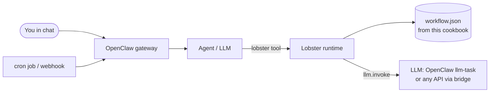

# Getting Started

**English** · [简体中文](getting-started.zh-CN.md)

This guide takes you from zero to running the first recipe, in the terminal and in your OpenClaw chat. Allow about 15 minutes.

- [1. Check your OpenClaw version](#1-check-your-openclaw-version)
- [2. Install the Lobster plugin](#2-install-the-lobster-plugin)
- [3. Get the cookbook](#3-get-the-cookbook)
- [4. Connect an LLM (for AI recipes)](#4-connect-an-llm-for-ai-recipes)
- [5. Run your first recipe](#5-run-your-first-recipe)
- [6. Schedule, trigger and deliver](#6-schedule-trigger-and-deliver)

## What you're setting up



- **OpenClaw** is the personal AI assistant: it runs a *gateway* on your machine and talks to you through chat apps (Telegram, Slack, Feishu, WhatsApp…).
- **Lobster** is OpenClaw's **workflow engine**. A workflow is a JSON (or YAML) file with steps. The agent runs it with **one tool call**, and the steps run deterministically: same input, same actions, no improvising. Workflows can pause for your **approval** or **input**.
- **This cookbook** is a set of those workflow files, plus explanations.

## 1. Check your OpenClaw version

```bash
openclaw --version
```

| Your version | What works |
|---|---|
| **≥ 2026.10.1** (recommended) | Everything: all 10 recipes, inside chat, AI steps through OpenClaw's own model |
| 2026.5.28 – 2026.9.x | All recipes from the terminal. In chat: everything except recipe 08 (input steps), and AI steps need the LLM bridge (option B below) |
| < 2026.5.28 | Only recipes 01, 02, 05, 08 and 09 work, even from the terminal: the engine has no loops, parallel steps, sub-workflows or `>` comparisons. Please update. |

Update with:

```bash
openclaw update
```

> We found these limits by testing every recipe against each Lobster engine version shipped with OpenClaw. See [validation.md](validation.md).

## 2. Install the Lobster plugin

Lobster ships as an optional plugin. Install it and allow the agent to use its tool:

```bash
openclaw plugins install @openclaw/lobster
```

```bash
openclaw config set tools.alsoAllow '["lobster", "llm-task"]' --strict-json
```

```bash
openclaw gateway restart
```

Check it:

```bash
openclaw plugins list | grep -i lobster
```

> ⚠️ **The plugin must match your OpenClaw version.** If you see `lobster failed to load ... Cannot find module .../plugin-sdk/...`, the plugin is newer than your OpenClaw. Either update OpenClaw, or install the matching plugin, e.g. `openclaw plugins install @openclaw/lobster@2026.6.11 --force` for OpenClaw 2026.6.11.

> `tools.alsoAllow` *adds* tools on top of your tool profile. The command above replaces the whole list, so if you already had entries, include them too.

## 3. Get the cookbook

```bash
git clone https://github.com/YalinMa/openclaw-cookbook.git ~/openclaw-cookbook
```

```bash
cd ~/openclaw-cookbook && npm install
```

`npm install` gives you the standalone Lobster CLI (`npx lobster`) for running and testing recipes from the terminal. It needs Node.js 22+. You don't need it for the chat route, only the files.

## 4. Connect an LLM (for AI recipes)

Recipes 05, 06, 08 and 10 call an LLM through Lobster's `llm.invoke`. Recipes 01–04, 07 and 09 don't need one. Choose **one** option:

### Option A: OpenClaw's own model (OpenClaw ≥ 2026.10.1)

`llm.invoke` calls OpenClaw's `llm-task` tool, which uses the model you already configured.

1. Enable the `llm-task` plugin (it's built in):

   ```bash
   openclaw config set plugins.entries.llm-task.enabled true --strict-json
   ```

2. Get your gateway token. This prints it to your terminal only:

   ```bash
   openclaw gateway auth-token --show
   ```

3. Put three lines into `~/.openclaw/.env` so the gateway (and the workflows it runs) can see them:

   ```bash
   LOBSTER_LLM_PROVIDER=openclaw
   OPENCLAW_URL=http://127.0.0.1:18789
   OPENCLAW_TOKEN=<the token from step 2>
   ```

4. `openclaw gateway restart`.

To use option A from the **terminal** too, `export` the same three variables in your shell.

### Option B: any OpenAI-compatible API, through the bundled bridge

[`scripts/llm-adapter.mjs`](../scripts/llm-adapter.mjs) is a tiny, dependency-free server that translates Lobster's requests into an OpenAI-style `chat/completions` call. It works with DeepSeek (default), OpenAI, Qwen, OpenRouter, Ollama, LM Studio and others:

```bash
LLM_API_KEY=sk-... npm run llm
```

```bash
LLM_BASE_URL=http://localhost:11434/v1 LLM_MODEL=llama3.2 npm run llm
```

(The second command is for local Ollama, no key needed.) Then point Lobster at it, in your shell or in `~/.openclaw/.env`:

```bash
LOBSTER_LLM_PROVIDER=http
LOBSTER_LLM_ADAPTER_URL=http://127.0.0.1:18787
```

### Option C: offline mock (free, for learning)

```bash
npm run llm:mock
```

Use the same two variables as option B. The mock returns fake but correctly shaped answers, so every recipe runs end to end. That's how the automated tests work.

## 5. Run your first recipe

**Terminal:**

```bash
npx lobster run examples/01-hello-lobster/workflow.json
```

**Chat:** send your OpenClaw agent:

> Run the Lobster workflow `~/openclaw-cookbook/examples/01-hello-lobster/workflow.json` with argsJson `{"name":"Ada"}` and tell me the message.

The agent calls the `lobster` tool like this:

```json
{ "action": "run", "pipeline": "/Users/me/openclaw-cookbook/examples/01-hello-lobster/workflow.json", "argsJson": "{\"name\":\"Ada\"}" }
```

Tips for chat:

- Use **absolute paths** for files you pass as args (like `tickets_file`). Workflows run in the gateway's working directory, not in the cookbook folder.
- For slow recipes, ask for a longer timeout: *"…with timeoutMs 180000"*. The default is 20 seconds.
- For approvals, ask the agent to resume with the short **`approvalId`**, not the long token.

## 6. Schedule, trigger and deliver

| You want… | Use | Example |
|---|---|---|
| Run every morning | `openclaw cron add --cron "30 7 * * *" --session isolated --message "Run the Lobster workflow …" --announce --channel telegram --to <id>` | [recipe 02](../examples/02-daily-weather-briefing/#run-it-every-morning) |
| Run every N minutes | `--every 10m` | [recipe 03](../examples/03-website-uptime-monitor/#run-it-every-10-minutes) |
| Run once later | `--at "+20m"` or `--at "2026-10-20T09:00:00+08:00"` | |
| Test a job now | `openclaw cron run <job-id>`, then `openclaw cron runs --id <job-id>` | |
| Start from another system | OpenClaw webhooks (`hooks.mappings`) | [recipe 09](../examples/09-webhook-lead-capture/#connect-it-to-a-webhook) |
| Message a chat from a workflow | `openclaw message send --channel … --target … --message …` (the `notify` step in many recipes) | [recipe 02](../examples/02-daily-weather-briefing/) |
| Run without any LLM tokens | System `crontab` + `npx lobster run …` with `notify_channel` | [recipe 03](../examples/03-website-uptime-monitor/#run-it-every-10-minutes) |

On newer OpenClaw versions `openclaw automations add` is the same as `openclaw cron add`.

## Next steps

- Read [Core Concepts](core-concepts.md): the ideas behind every recipe, on one page.
- Keep the [Cheat Sheet](cheatsheet.md) open while you write your own workflows.
