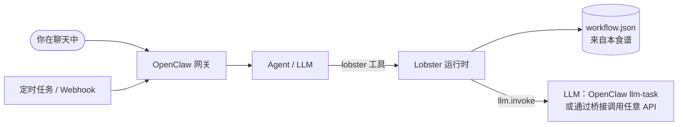

# 快速上手

[English](getting-started.md) · **简体中文**

本指南带你从零开始，在终端和 OpenClaw 聊天中跑通第一个食谱，大约需要 15 分钟。

- [1. 检查 OpenClaw 版本](#1-检查-openclaw-版本)
- [2. 安装 Lobster 插件](#2-安装-lobster-插件)
- [3. 获取本食谱](#3-获取本食谱)
- [4. 接入 LLM（AI 类食谱需要）](#4-接入-llmai-类食谱需要)
- [5. 运行第一个食谱](#5-运行第一个食谱)
- [6. 定时、触发与推送](#6-定时触发与推送)

## 你在搭建什么



- **OpenClaw** 是个人 AI 助手：它在你的电脑上运行一个*网关*，通过聊天软件（Telegram、Slack、飞书、WhatsApp……）和你对话。
- **Lobster** 是 OpenClaw 的**工作流引擎**。一个工作流就是一个包含若干步骤的 JSON（或 YAML）文件。Agent 只需**一次工具调用**就能运行它，步骤按固定方式执行：输入相同，动作就相同，不会临场发挥。工作流还可以暂停下来，等你**审批**或**补充信息**。
- **本食谱**就是一组这样的工作流文件，外加详细讲解。

## 1. 检查 OpenClaw 版本

```bash
openclaw --version
```

| 你的版本 | 能用什么 |
|---|---|
| **≥ 2026.10.1**（推荐） | 全部功能：10 个食谱都能在聊天中运行，AI 步骤可直接使用 OpenClaw 自带的模型 |
| 2026.5.28 – 2026.9.x | 全部食谱都能在终端运行。在聊天中：除食谱 08（input 步骤）外都能用，AI 步骤需要使用 LLM 桥接（见下文方案 B） |
| < 2026.5.28 | 即使在终端也只有食谱 01、02、05、08、09 可用：该引擎不支持循环、并行、子工作流和 `>` 比较。请升级。 |

升级命令：

```bash
openclaw update
```

> 这些限制是我们把每个食谱放到 OpenClaw 附带的每个 Lobster 引擎版本上实测得出的，详见 [validation.zh-CN.md](validation.zh-CN.md)。

## 2. 安装 Lobster 插件

Lobster 以可选插件形式提供。安装插件，并允许 Agent 使用它的工具：

```bash
openclaw plugins install @openclaw/lobster
```

```bash
openclaw config set tools.alsoAllow '["lobster", "llm-task"]' --strict-json
```

```bash
openclaw gateway restart
```

检查是否安装成功：

```bash
openclaw plugins list | grep -i lobster
```

> ⚠️ **插件版本必须和 OpenClaw 版本匹配。** 如果看到 `lobster failed to load ... Cannot find module .../plugin-sdk/...`，说明插件比 OpenClaw 新。要么升级 OpenClaw，要么安装对应版本的插件，例如 OpenClaw 2026.6.11 使用 `openclaw plugins install @openclaw/lobster@2026.6.11 --force`。

> `tools.alsoAllow` 是在当前工具配置之上*追加*工具。上面的命令会覆盖整个列表，如果你之前已经配置过其他条目，请一并写上。

## 3. 获取本食谱

```bash
git clone https://github.com/YalinMa/openclaw-cookbook.git ~/openclaw-cookbook
```

```bash
cd ~/openclaw-cookbook && npm install
```

`npm install` 会安装独立的 Lobster 命令行工具（`npx lobster`），用于在终端运行和测试食谱，需要 Node.js 22 及以上。如果只在聊天中使用，不需要它，有文件就够了。

## 4. 接入 LLM（AI 类食谱需要）

食谱 05、06、08、10 通过 Lobster 的 `llm.invoke` 调用 LLM；01–04、07、09 不需要。**任选一种**方案：

### 方案 A：使用 OpenClaw 自带的模型（OpenClaw ≥ 2026.10.1）

`llm.invoke` 会调用 OpenClaw 的 `llm-task` 工具，使用你已经配置好的模型。

1. 启用内置的 `llm-task` 插件：

   ```bash
   openclaw config set plugins.entries.llm-task.enabled true --strict-json
   ```

2. 获取网关令牌（只会显示在你的终端里）：

   ```bash
   openclaw gateway auth-token --show
   ```

3. 把下面三行写进 `~/.openclaw/.env`，让网关（以及它运行的工作流）能读到：

   ```bash
   LOBSTER_LLM_PROVIDER=openclaw
   OPENCLAW_URL=http://127.0.0.1:18789
   OPENCLAW_TOKEN=<第 2 步得到的令牌>
   ```

4. 执行 `openclaw gateway restart`。

如果也想在**终端**里使用方案 A，在 shell 中 `export` 同样的三个变量即可。

### 方案 B：通过内置桥接使用任意 OpenAI 兼容接口

[`scripts/llm-adapter.mjs`](../scripts/llm-adapter.mjs) 是一个无依赖的小服务，负责把 Lobster 的请求转换成 OpenAI 风格的 `chat/completions` 调用。它支持 DeepSeek（默认）、OpenAI、通义千问、OpenRouter、Ollama、LM Studio 等：

```bash
LLM_API_KEY=sk-... npm run llm
```

```bash
LLM_BASE_URL=http://localhost:11434/v1 LLM_MODEL=llama3.2 npm run llm
```

（第二条命令用于本地 Ollama，不需要 Key。）然后在 shell 或 `~/.openclaw/.env` 中让 Lobster 指向它：

```bash
LOBSTER_LLM_PROVIDER=http
LOBSTER_LLM_ADAPTER_URL=http://127.0.0.1:18787
```

### 方案 C：离线模拟（免费，适合学习）

```bash
npm run llm:mock
```

使用和方案 B 相同的两个变量。模拟模型会返回格式正确的假数据，所有食谱都能完整跑通，自动化测试用的就是它。

## 5. 运行第一个食谱

**终端：**

```bash
npx lobster run examples/01-hello-lobster/workflow.json
```

**聊天：** 给你的 OpenClaw Agent 发送：

> 运行 Lobster 工作流 `~/openclaw-cookbook/examples/01-hello-lobster/workflow.json`，argsJson 为 `{"name":"Ada"}`，然后告诉我 message 的内容。

Agent 会这样调用 `lobster` 工具：

```json
{ "action": "run", "pipeline": "/Users/me/openclaw-cookbook/examples/01-hello-lobster/workflow.json", "argsJson": "{\"name\":\"Ada\"}" }
```

聊天使用小贴士：

- 作为参数传入的文件（如 `tickets_file`）请使用**绝对路径**。工作流运行在网关的工作目录下，而不是食谱文件夹里。
- 运行较慢的食谱时，可以要求更长的超时时间："……timeoutMs 设为 180000"。默认是 20 秒。
- 审批时，让 Agent 用简短的 **`approvalId`** 恢复，不要用很长的令牌。

## 6. 定时、触发与推送

| 你想要…… | 使用 | 示例 |
|---|---|---|
| 每天早上运行 | `openclaw cron add --cron "30 7 * * *" --session isolated --message "Run the Lobster workflow …" --announce --channel telegram --to <id>` | [食谱 02](../examples/02-daily-weather-briefing/README.zh-CN.md#每天早上自动运行) |
| 每隔 N 分钟运行 | `--every 10m` | [食谱 03](../examples/03-website-uptime-monitor/README.zh-CN.md#每-10-分钟运行一次) |
| 稍后运行一次 | `--at "+20m"` 或 `--at "2026-10-20T09:00:00+08:00"` | |
| 立即测试某个任务 | `openclaw cron run <任务ID>`，然后 `openclaw cron runs --id <任务ID>` | |
| 由其他系统触发 | OpenClaw Webhook（`hooks.mappings`） | [食谱 09](../examples/09-webhook-lead-capture/README.zh-CN.md#接入-webhook) |
| 在工作流里给聊天发消息 | `openclaw message send --channel … --target … --message …`（很多食谱里的 `notify` 步骤） | [食谱 02](../examples/02-daily-weather-briefing/README.zh-CN.md) |
| 完全不消耗 LLM token | 系统 `crontab` + `npx lobster run …`，并传入 `notify_channel` | [食谱 03](../examples/03-website-uptime-monitor/README.zh-CN.md#每-10-分钟运行一次) |

在较新的 OpenClaw 版本中，`openclaw automations add` 与 `openclaw cron add` 是同一个命令。

## 下一步

- 阅读 [核心概念](core-concepts.zh-CN.md)：所有食谱背后的思路，一页讲完。
- 自己写工作流时，把 [速查表](cheatsheet.zh-CN.md) 放在手边。
