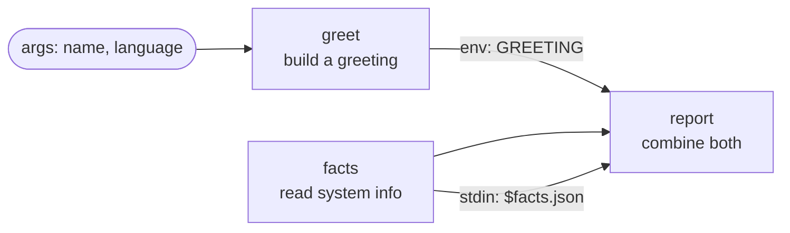

# 01 · Hello Lobster

**English** · [简体中文](README.zh-CN.md)

> Your first OpenClaw workflow: read arguments, run steps in order, and pass JSON from one step to the next.

| Difficulty | Time | Credentials | Features used |
|---|---|---|---|
| ⭐ Beginner | 5 min | None | `args`, `run` steps, `stdin`, `env`, `$step.json` references |



## What you'll learn

- What a **Lobster workflow file** is and how OpenClaw runs it
- Declaring **arguments** with defaults, and reading them as `$LOBSTER_ARG_<NAME>`
- How each step's output becomes `$step.stdout` (text) and `$step.json` (parsed JSON)
- The two safe ways to hand data to a step: **`stdin`** and **`env`**

## Run it

**From a terminal** (after `npm install` in the repo root, see [Getting Started](../../docs/getting-started.md)):

```bash
npx lobster run examples/01-hello-lobster/workflow.json
```

```bash
npx lobster run --file examples/01-hello-lobster/workflow.json --args-json '{"name":"Ada","language":"zh"}'
```

**In OpenClaw**, send your agent a chat message like:

> Run the Lobster workflow `~/openclaw-cookbook/examples/01-hello-lobster/workflow.json` with argsJson `{"name":"Ada","language":"zh"}` and tell me the message.

Under the hood the agent calls the `lobster` tool with `{"action": "run", "pipeline": "<path>", "argsJson": "{...}"}`.

## Example output

```json
[
  {
    "message": "你好, Ada! This workflow ran on darwin (Node v22.22.0, 10 CPUs) at 2026-10-14T02:09:23.533Z.",
    "facts": { "platform": "darwin", "node": "v22.22.0", "cpus": 10, "uptimeHours": 852, "time": "2026-10-14T02:09:23.533Z" }
  }
]
```

The **last step's output** is the workflow's result. Because `report` prints JSON, you get a JSON object back.

## How it works

| Step | What it does |
|---|---|
| `greet` | A tiny Node.js script picks a greeting word for `$LOBSTER_ARG_LANGUAGE` and prints `{"greeting": "..."}`. Every arg is available as an environment variable: `name` → `$LOBSTER_ARG_NAME`. |
| `facts` | Prints a few facts about the machine as JSON. It doesn't depend on `greet`; steps simply run top to bottom. |
| `report` | Gets **two** inputs: `stdin: "$facts.json"` pipes the facts in, and `env: { "GREETING": "$greet.json.greeting" }` passes one field from `greet` as an environment variable. It prints the final JSON. |

Why not write `echo $greet.json.greeting` directly inside the command? Lobster replaces `$step...` references as **plain text**, so quotes or `$` signs in the data could break the command, or worse, run something unintended. Passing data through `stdin` or `env` is always safe. Every recipe in this cookbook follows that rule, and `npm run validate` enforces it.

## Ideas to extend

- Add a third language to the `words` table in `greet`.
- Add an arg `shout` and, in `report`, upper-case the message when it is `"yes"`.
- Run `npx lobster graph --file examples/01-hello-lobster/workflow.json` to see the step graph.

## Troubleshooting

| Symptom | Fix |
|---|---|
| `node: command not found` | Steps run in `/bin/sh` with the gateway's `PATH`. Install Node.js, or use the full path to `node`. |
| `Unexpected token` / JSON errors | A step that should print JSON printed something else. Run the command by hand to see its output. |
| The agent says it has no `lobster` tool | Install and allow the plugin, see [Getting Started](../../docs/getting-started.md#2-install-the-lobster-plugin). |
