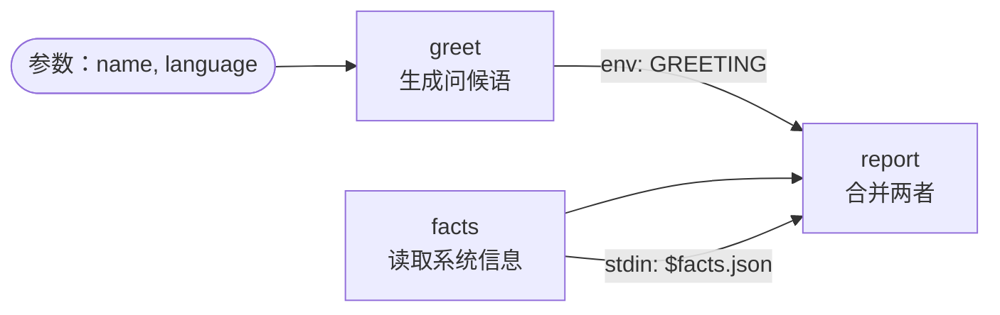

# 01 · Hello Lobster

[English](README.md) · **简体中文**

> 你的第一个 OpenClaw 工作流：读取参数、按顺序执行步骤、把 JSON 从一个步骤传给下一个步骤。

| 难度 | 用时 | 凭证 | 用到的功能 |
|---|---|---|---|
| ⭐ 入门 | 5 分钟 | 无 | `args`、`run` 步骤、`stdin`、`env`、`$step.json` 引用 |



## 你会学到

- 什么是 **Lobster 工作流文件**，OpenClaw 如何运行它
- 声明带默认值的**参数**，并通过 `$LOBSTER_ARG_<NAME>` 读取
- 每个步骤的输出如何变成 `$step.stdout`（文本）和 `$step.json`（解析后的 JSON）
- 把数据交给步骤的两种安全方式：**`stdin`** 和 **`env`**

## 运行

**在终端中**（先在仓库根目录执行 `npm install`，见[快速上手](../../docs/getting-started.zh-CN.md)）：

```bash
npx lobster run examples/01-hello-lobster/workflow.json
```

```bash
npx lobster run --file examples/01-hello-lobster/workflow.json --args-json '{"name":"Ada","language":"zh"}'
```

**在 OpenClaw 中**，给你的 Agent 发一条消息，例如：

> 运行 Lobster 工作流 `~/openclaw-cookbook/examples/01-hello-lobster/workflow.json`，argsJson 为 `{"name":"Ada","language":"zh"}`，然后告诉我 message 的内容。

在背后，Agent 会调用 `lobster` 工具：`{"action": "run", "pipeline": "<路径>", "argsJson": "{...}"}`。

## 示例输出

```json
[
  {
    "message": "你好, Ada! This workflow ran on darwin (Node v22.22.0, 10 CPUs) at 2026-10-14T02:09:23.533Z.",
    "facts": { "platform": "darwin", "node": "v22.22.0", "cpus": 10, "uptimeHours": 852, "time": "2026-10-14T02:09:23.533Z" }
  }
]
```

**最后一个步骤的输出**就是整个工作流的结果。因为 `report` 打印的是 JSON，所以你拿到的是一个 JSON 对象。

## 工作原理

| 步骤 | 作用 |
|---|---|
| `greet` | 一小段 Node.js 脚本根据 `$LOBSTER_ARG_LANGUAGE` 选择问候语，打印 `{"greeting": "..."}`。每个参数都会成为环境变量：`name` → `$LOBSTER_ARG_NAME`。 |
| `facts` | 以 JSON 形式打印几条机器信息。它不依赖 `greet`，步骤只是从上到下依次执行。 |
| `report` | 接收**两个**输入：`stdin: "$facts.json"` 把 facts 通过管道传入，`env: { "GREETING": "$greet.json.greeting" }` 把 `greet` 的一个字段作为环境变量传入。最后打印 JSON 结果。 |

为什么不直接在命令里写 `echo $greet.json.greeting`？因为 Lobster 会把 `$step...` 引用当作**纯文本**替换进命令，数据中的引号或 `$` 可能让命令出错，甚至执行意料之外的操作。通过 `stdin` 或 `env` 传递数据永远是安全的。本食谱中的每个工作流都遵守这条规则，`npm run validate` 也会强制检查。

## 扩展思路

- 在 `greet` 的 `words` 表里加一种语言。
- 加一个参数 `shout`，当它为 `"yes"` 时，在 `report` 中把消息转成大写。
- 运行 `npx lobster graph --file examples/01-hello-lobster/workflow.json` 查看步骤关系图。

## 常见问题

| 现象 | 解决办法 |
|---|---|
| `node: command not found` | 步骤在 `/bin/sh` 中运行，使用网关的 `PATH`。请安装 Node.js，或写 `node` 的完整路径。 |
| `Unexpected token` / JSON 错误 | 某个本该输出 JSON 的步骤输出了别的内容。手动运行那条命令看看实际输出。 |
| Agent 说没有 `lobster` 工具 | 安装并允许该插件，见[快速上手](../../docs/getting-started.zh-CN.md#2-安装-lobster-插件)。 |
