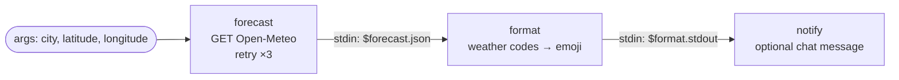

# 02 · Daily Weather Briefing

**English** · [简体中文](README.zh-CN.md)

> Every morning, fetch the forecast from a free public API and turn it into a friendly chat message.

| Difficulty | Time | Credentials | Features used |
|---|---|---|---|
| ⭐ Beginner | 10 min | None (optional chat channel) | HTTP with `curl`, `retry` + `timeout_ms`, `openclaw message send`, `openclaw cron` |



## What you'll learn

- Calling a REST API from a step and getting **parsed JSON** for free (`$forecast.json`)
- Making a flaky network call robust with **`retry`** (exponential backoff) and **`timeout_ms`**
- Sending the result to a chat with **`openclaw message send`**, only when a channel is configured
- Running a workflow **every morning** with an OpenClaw cron job

## Run it

```bash
npx lobster run examples/02-daily-weather-briefing/workflow.json
```

```bash
npx lobster run --file examples/02-daily-weather-briefing/workflow.json \
  --args-json '{"city":"Shanghai","latitude":"31.23","longitude":"121.47"}'
```

Find your coordinates by searching your city on [open-meteo.com](https://open-meteo.com/en/docs).

**In OpenClaw chat:**

> Run the Lobster workflow `~/openclaw-cookbook/examples/02-daily-weather-briefing/workflow.json` with argsJson `{"city":"Shanghai","latitude":"31.23","longitude":"121.47"}` and reply with its output.

## Example output

```
Good morning! Weather for Berlin today (2026-10-14):
🌦️ Light rain
🌡️ 10°C – 16.4°C (now 12.7°C)
☔ Chance of rain: 93%
👉 Take an umbrella!
```

## Run it every morning

The simplest way is an OpenClaw **cron job**: at 07:30 an isolated agent session runs the workflow, and `--announce` delivers the reply to your chat.

```bash
openclaw cron add \
  --name "Weather briefing" \
  --cron "30 7 * * *" --tz "Asia/Shanghai" \
  --session isolated \
  --message "Run the Lobster workflow ~/openclaw-cookbook/examples/02-daily-weather-briefing/workflow.json with argsJson {\"city\":\"Shanghai\",\"latitude\":\"31.23\",\"longitude\":\"121.47\"} and reply with its output text only." \
  --announce --channel telegram --to "<your chat id>"
```

Test it right away with `openclaw cron run <job-id>`, and check the result with `openclaw cron runs --id <job-id>`. On newer OpenClaw versions, `openclaw automations add` is the same command.

**Without an agent turn (no LLM tokens):** pass `notify_channel` and `notify_target`, and the workflow sends the message itself through `openclaw message send`. You can then run it from your system's `crontab`:

```bash
30 7 * * * cd ~/openclaw-cookbook && npx lobster run --file examples/02-daily-weather-briefing/workflow.json --args-json '{"notify_channel":"telegram","notify_target":"<chat id>"}'
```

## How it works

| Step | What it does |
|---|---|
| `forecast` | `curl -fsS` calls Open-Meteo. `-f` makes HTTP errors fail the step, and `retry: { max: 3, backoff: "exponential", delay_ms: 2000 }` tries again after 2 s and 4 s. Because the response is JSON, later steps can use `$forecast.json`. |
| `format` | Reads the forecast from `stdin`, maps [WMO weather codes](https://open-meteo.com/en/docs#weathervariables) to emoji, and prints plain text. |
| `notify` | If `notify_channel` is set, sends the text with `openclaw message send --channel ... --target ...`. Either way it prints the text, so it becomes the workflow result. |

> The coordinates are read from `$LOBSTER_ARG_LATITUDE` inside the shell command, not spliced in with `${latitude}`. Environment variables are passed to the shell safely, while `${...}` is a raw text replacement.

## Ideas to extend

- Only send the message when rain is likely: add a `when: "$check.json.rain >= 50"` condition (see recipe 07 for comparisons).
- Add `"hourly": "temperature_2m"` to the API URL and show the temperature at 08:00, 12:00 and 18:00.
- Recipe [10 · Morning Brief](../10-morning-brief/) reuses this whole workflow as a building block.

## Troubleshooting

| Symptom | Fix |
|---|---|
| `curl: (22) The requested URL returned error: 400` | Check latitude/longitude: they must be numbers like `31.23`. |
| The cron job runs at the wrong time | Add `--tz` with your [IANA timezone](https://en.wikipedia.org/wiki/List_of_tz_database_time_zones); otherwise the gateway host's timezone is used. |
| `openclaw message send` fails | Run `openclaw channels status` and check the channel is connected and the target id is right. |
