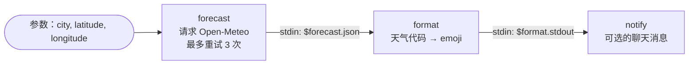

# 02 · 每日天气播报

[English](README.md) · **简体中文**

> 每天早上从免费的公共 API 获取天气预报，并整理成一条友好的聊天消息。

| 难度 | 用时 | 凭证 | 用到的功能 |
|---|---|---|---|
| ⭐ 入门 | 10 分钟 | 无（聊天渠道可选） | 用 `curl` 发 HTTP 请求、`retry` + `timeout_ms`、`openclaw message send`、`openclaw cron` |



## 你会学到

- 在步骤中调用 REST API，并自动得到**解析好的 JSON**（`$forecast.json`）
- 用 **`retry`**（指数退避）和 **`timeout_ms`** 让不稳定的网络请求更可靠
- 只有在配置了渠道时，才用 **`openclaw message send`** 把结果发到聊天中
- 用 OpenClaw 定时任务让工作流**每天早上**自动运行

## 运行

```bash
npx lobster run examples/02-daily-weather-briefing/workflow.json
```

```bash
npx lobster run --file examples/02-daily-weather-briefing/workflow.json \
  --args-json '{"city":"Shanghai","latitude":"31.23","longitude":"121.47"}'
```

在 [open-meteo.com](https://open-meteo.com/en/docs) 搜索你的城市即可查到经纬度。

**在 OpenClaw 聊天中：**

> 运行 Lobster 工作流 `~/openclaw-cookbook/examples/02-daily-weather-briefing/workflow.json`，argsJson 为 `{"city":"Shanghai","latitude":"31.23","longitude":"121.47"}`，并回复它的输出。

## 示例输出

```
Good morning! Weather for Berlin today (2026-10-14):
🌦️ Light rain
🌡️ 10°C – 16.4°C (now 12.7°C)
☔ Chance of rain: 93%
👉 Take an umbrella!
```

## 每天早上自动运行

最简单的方式是 OpenClaw **定时任务**：每天 07:30，一个独立的 Agent 会话运行该工作流，`--announce` 把回复推送到你的聊天中。

```bash
openclaw cron add \
  --name "Weather briefing" \
  --cron "30 7 * * *" --tz "Asia/Shanghai" \
  --session isolated \
  --message "Run the Lobster workflow ~/openclaw-cookbook/examples/02-daily-weather-briefing/workflow.json with argsJson {\"city\":\"Shanghai\",\"latitude\":\"31.23\",\"longitude\":\"121.47\"} and reply with its output text only." \
  --announce --channel telegram --to "<你的聊天 ID>"
```

用 `openclaw cron run <任务ID>` 立即测试，用 `openclaw cron runs --id <任务ID>` 查看结果。在较新的 OpenClaw 版本中，`openclaw automations add` 是同一个命令。

**不经过 Agent（不消耗 LLM token）：** 传入 `notify_channel` 和 `notify_target`，工作流会自己通过 `openclaw message send` 发送消息。这样就可以用系统的 `crontab` 来运行：

```bash
30 7 * * * cd ~/openclaw-cookbook && npx lobster run --file examples/02-daily-weather-briefing/workflow.json --args-json '{"notify_channel":"telegram","notify_target":"<聊天 ID>"}'
```

## 工作原理

| 步骤 | 作用 |
|---|---|
| `forecast` | 用 `curl -fsS` 调用 Open-Meteo。`-f` 让 HTTP 错误使该步骤失败，`retry: { max: 3, backoff: "exponential", delay_ms: 2000 }` 会在 2 秒、4 秒后重试。由于响应是 JSON，后续步骤可以直接用 `$forecast.json`。 |
| `format` | 从 `stdin` 读取天气数据，把 [WMO 天气代码](https://open-meteo.com/en/docs#weathervariables) 转成 emoji，输出纯文本。 |
| `notify` | 如果设置了 `notify_channel`，就用 `openclaw message send --channel ... --target ...` 发送文本。无论是否发送，都会打印文本，使它成为工作流的结果。 |

> 经纬度是在 shell 命令中通过 `$LOBSTER_ARG_LATITUDE` 读取的，而不是用 `${latitude}` 拼进去。环境变量会被安全地传给 shell，而 `${...}` 是原样文本替换。

## 扩展思路

- 只在可能下雨时发送：加上条件 `when: "$check.json.rain >= 50"`（比较运算见食谱 07）。
- 在 API 地址中加上 `"hourly": "temperature_2m"`，显示 08:00、12:00、18:00 的气温。
- 食谱 [10 · AI 早报](../10-morning-brief/README.zh-CN.md)把整个工作流当作一个积木来复用。

## 常见问题

| 现象 | 解决办法 |
|---|---|
| `curl: (22) The requested URL returned error: 400` | 检查经纬度：必须是 `31.23` 这样的数字。 |
| 定时任务运行时间不对 | 加上 `--tz` 和你的 [IANA 时区](https://en.wikipedia.org/wiki/List_of_tz_database_time_zones)；否则使用网关主机的时区。 |
| `openclaw message send` 失败 | 运行 `openclaw channels status`，确认渠道已连接、目标 ID 正确。 |
