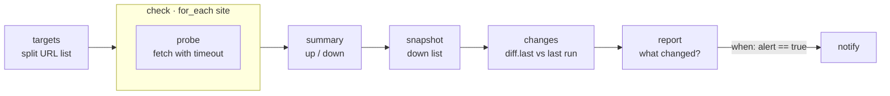

# 03 · Website Uptime Monitor

**English** · [简体中文](README.zh-CN.md)

> Check a list of websites, remember which ones were down last time, and only alert when something **goes down** or **comes back up**.

| Difficulty | Time | Credentials | Features used |
|---|---|---|---|
| ⭐⭐ Intermediate | 15 min | None (optional chat channel) | `for_each` loops, `diff.last` (state between runs), `when` conditions |



## What you'll learn

- Running sub-steps **once per item** with `for_each` (and naming the loop variable with `item_var`)
- Making a step that **never fails**: the probe catches network errors and reports them as data
- Remembering state between runs with the built-in **`diff.last`** command
- Skipping steps with **`when`** conditions, so you only get pinged when something changes

## Run it

```bash
npx lobster run examples/03-website-uptime-monitor/workflow.json
```

```bash
npx lobster run --file examples/03-website-uptime-monitor/workflow.json \
  --args-json '{"urls":"https://your-site.com, https://api.your-site.com/health"}'
```

The default list includes `https://this-site-does-not-exist.invalid` on purpose, so you see an alert on the first run.

## Example output

First run, one site is down, so you get an alert:

```
🔴 DOWN: https://this-site-does-not-exist.invalid (ENOTFOUND)
Checked 3 sites: 2 up, 1 down.
```

Second run, nothing changed, so `notify` is skipped and the result is just the report data (`"alert": false`). Later, when the site is back:

```
✅ RECOVERED: https://this-site-does-not-exist.invalid
Checked 1 sites: 1 up, 0 down.
```

## Run it every 10 minutes

Monitoring doesn't need an LLM, so run the workflow directly and let it send the alert itself:

```bash
*/10 * * * * cd ~/openclaw-cookbook && npx lobster run --file examples/03-website-uptime-monitor/workflow.json --args-json '{"urls":"https://your-site.com","notify_channel":"telegram","notify_target":"<chat id>"}'
```

Or as an OpenClaw job (uses a few LLM tokens per run). The workflow sends the alert itself, so the job delivers nothing:

```bash
openclaw cron add --name "Uptime" --every 10m --session isolated --no-deliver \
  --message "Run the Lobster workflow ~/openclaw-cookbook/examples/03-website-uptime-monitor/workflow.json with argsJson {\"urls\":\"https://your-site.com\",\"notify_channel\":\"telegram\",\"notify_target\":\"<chat id>\"}."
```

## How it works

| Step | What it does |
|---|---|
| `targets` | Turns the comma-separated `urls` arg into a JSON array: `[{"url": "..."}, ...]`. |
| `check` | `for_each: "$targets.json"` runs the `probe` sub-step once per site. Inside the loop the current item is `$site.json` (because `item_var: "site"`). The loop's result is a list like `[{ "site": {...}, "probe": {...} }, ...]`. |
| `probe` | Uses Node's `fetch` with `AbortSignal.timeout(...)`. Errors such as DNS failures or timeouts are **caught** and returned as `{"up": false, "error": "ENOTFOUND"}`, so one dead site doesn't stop the loop. |
| `summary` | Counts up/down sites and keeps a sorted list of the down URLs. |
| `snapshot` | Keeps **only** what should trigger an alert (`{"down": [...]}`). Response times change on every run, so they must not be part of the comparison. |
| `changes` | `diff.last --key cookbook-uptime-monitor` compares the snapshot with the one saved last time, saves the new one, and returns `{changed, before, after}`. State lives in `~/.lobster/state` (or `$LOBSTER_STATE_DIR`). |
| `report` | Works out which sites are *newly* down or recovered, and sets `alert`. |
| `notify` | `when: "$report.json.alert == true"`: runs only when something changed. |

## Ideas to extend

- Treat slow sites as down: add `slow: result.ms > 3000` in `probe` and count it in `summary`.
- Check a keyword on the page (for example "Sign in") to catch broken pages that still return HTTP 200.
- Use a different `state_key` per monitor so several monitors don't overwrite each other's memory.

## Troubleshooting

| Symptom | Fix |
|---|---|
| Every run alerts again | Something in the snapshot changes each time. Keep only stable fields in `snapshot`. |
| You want to reset the memory | Delete `~/.lobster/state/cookbook-uptime-monitor.json`, or use a new `state_key`. |
| `for_each: expected array` | The `targets` step printed something that isn't a JSON array. Run it on its own to check. |
