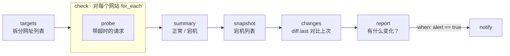

# 03 · 网站可用性监控

[English](README.md) · **简体中文**

> 检查一组网站，记住上次哪些网站挂了，只在有网站**宕机**或**恢复**时才提醒你。

| 难度 | 用时 | 凭证 | 用到的功能 |
|---|---|---|---|
| ⭐⭐ 进阶 | 15 分钟 | 无（聊天渠道可选） | `for_each` 循环、`diff.last`（跨运行保存状态）、`when` 条件 |



## 你会学到

- 用 `for_each` 对**每个元素**执行一遍子步骤（并用 `item_var` 给循环变量命名）
- 写一个**永不失败**的步骤：探测步骤会捕获网络错误，并把它作为数据返回
- 用内置的 **`diff.last`** 命令在多次运行之间记住状态
- 用 **`when`** 条件跳过步骤，只在有变化时才通知你

## 运行

```bash
npx lobster run examples/03-website-uptime-monitor/workflow.json
```

```bash
npx lobster run --file examples/03-website-uptime-monitor/workflow.json \
  --args-json '{"urls":"https://your-site.com, https://api.your-site.com/health"}'
```

默认列表里特意放了 `https://this-site-does-not-exist.invalid`，这样第一次运行就能看到报警效果。

## 示例输出

第一次运行，有一个网站宕机，于是报警：

```
🔴 DOWN: https://this-site-does-not-exist.invalid (ENOTFOUND)
Checked 3 sites: 2 up, 1 down.
```

第二次运行，没有变化，`notify` 被跳过，结果只是报告数据（`"alert": false`）。之后网站恢复时：

```
✅ RECOVERED: https://this-site-does-not-exist.invalid
Checked 1 sites: 1 up, 0 down.
```

## 每 10 分钟运行一次

监控不需要 LLM，所以可以直接运行工作流，让它自己发送报警：

```bash
*/10 * * * * cd ~/openclaw-cookbook && npx lobster run --file examples/03-website-uptime-monitor/workflow.json --args-json '{"urls":"https://your-site.com","notify_channel":"telegram","notify_target":"<聊天 ID>"}'
```

也可以作为 OpenClaw 定时任务（每次运行消耗少量 LLM token）。报警由工作流自己发送，所以任务本身不推送任何内容：

```bash
openclaw cron add --name "Uptime" --every 10m --session isolated --no-deliver \
  --message "Run the Lobster workflow ~/openclaw-cookbook/examples/03-website-uptime-monitor/workflow.json with argsJson {\"urls\":\"https://your-site.com\",\"notify_channel\":\"telegram\",\"notify_target\":\"<chat id>\"}."
```

## 工作原理

| 步骤 | 作用 |
|---|---|
| `targets` | 把逗号分隔的 `urls` 参数转成 JSON 数组：`[{"url": "..."}, ...]`。 |
| `check` | `for_each: "$targets.json"` 对每个网站运行一次 `probe` 子步骤。循环内当前元素是 `$site.json`（因为设置了 `item_var: "site"`）。循环的结果是 `[{ "site": {...}, "probe": {...} }, ...]` 这样的列表。 |
| `probe` | 使用 Node 的 `fetch` 和 `AbortSignal.timeout(...)`。DNS 失败、超时等错误会被**捕获**，返回 `{"up": false, "error": "ENOTFOUND"}`，一个网站挂了不会中断整个循环。 |
| `summary` | 统计正常/宕机数量，并保存排好序的宕机网址列表。 |
| `snapshot` | **只**保留应该触发报警的信息（`{"down": [...]}`）。响应时间每次都会变，不能参与比较。 |
| `changes` | `diff.last --key cookbook-uptime-monitor` 把快照和上次保存的进行比较，保存新快照，返回 `{changed, before, after}`。状态保存在 `~/.lobster/state`（或 `$LOBSTER_STATE_DIR`）。 |
| `report` | 计算哪些网站是*新*宕机的、哪些恢复了，并设置 `alert`。 |
| `notify` | `when: "$report.json.alert == true"`：只有发生变化时才运行。 |

## 扩展思路

- 把响应慢的网站也算作宕机：在 `probe` 中加上 `slow: result.ms > 3000`，并在 `summary` 中统计。
- 检查页面上是否有某个关键词（例如"登录"），发现那些虽然返回 HTTP 200 但实际已经坏掉的页面。
- 每个监控使用不同的 `state_key`，避免多个监控互相覆盖记忆。

## 常见问题

| 现象 | 解决办法 |
|---|---|
| 每次运行都报警 | 快照里有每次都会变化的内容。`snapshot` 只保留稳定的字段。 |
| 想清空记忆 | 删除 `~/.lobster/state/cookbook-uptime-monitor.json`，或换一个新的 `state_key`。 |
| `for_each: expected array` | `targets` 步骤输出的不是 JSON 数组。单独运行它检查一下。 |
