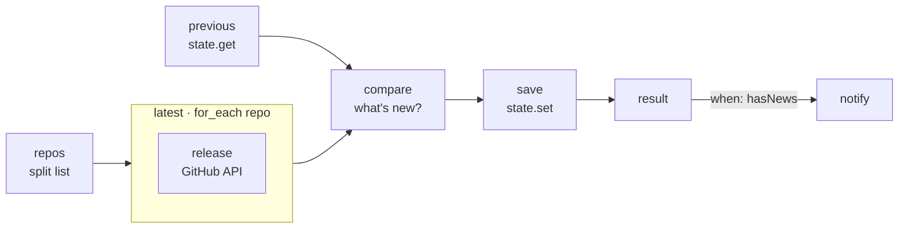

# 04 · GitHub Release Watcher

**English** · [简体中文](README.zh-CN.md)

> Watch your favourite GitHub repositories and get a message only when a **new release** comes out.

| Difficulty | Time | Credentials | Features used |
|---|---|---|---|
| ⭐⭐ Intermediate | 15 min | None (optional `GITHUB_TOKEN`) | `for_each` with `pause_ms`, `state.get` / `state.set`, first-run handling |



## What you'll learn

- Calling an API **once per item**, politely, with `pause_ms` between calls
- Reading and writing your own saved data with **`state.get`** and **`state.set`**
- Handling the **first run** differently (record a baseline instead of reporting everything as new)
- Reporting per-item errors (like a misspelled repo) without failing the whole run

## Run it

```bash
npx lobster run examples/04-github-release-watcher/workflow.json
```

```bash
npx lobster run --file examples/04-github-release-watcher/workflow.json \
  --args-json '{"repos":"openclaw/openclaw, n8n-io/n8n, ollama/ollama"}'
```

## Example output

First run, it records what it sees:

```
👀 Now watching 3 repositories. Current versions:
• openclaw/openclaw v2026.10.3
• nodejs/node v26.11.1
• microsoft/vscode 1.141.1
```

Later runs report only what changed (and mistakes in the list):

```
🚀 nodejs/node released v26.11.1 (was v26.10.0)
   https://github.com/nodejs/node/releases/tag/v26.11.1
⚠️ nobody/no-such-repo-xyz: HTTP 404: Not Found
```

When nothing changed, `notify` is skipped and the result is `{"hasNews": false, "message": "No new releases.", ...}`.

## Run it on a schedule

Let the workflow do the messaging, so you're only pinged when there is news. The cron job itself delivers nothing (`--no-deliver`):

```bash
openclaw cron add --name "Release watcher" --cron "0 9 * * *" --session isolated --no-deliver \
  --message "Run the Lobster workflow ~/openclaw-cookbook/examples/04-github-release-watcher/workflow.json with argsJson {\"notify_channel\":\"telegram\",\"notify_target\":\"<chat id>\"}."
```

Or skip the agent entirely and run it from `crontab` with the same args (see [recipe 02](../02-daily-weather-briefing/#run-it-every-morning)).

## How it works

| Step | What it does |
|---|---|
| `repos` | Turns `"a/b, c/d"` into `[{"repo":"a/b"}, {"repo":"c/d"}]`. |
| `latest` | `for_each` over the repos, waiting `pause_ms: 500` between calls. Each `release` sub-step calls `GET /repos/{repo}/releases/latest` and returns `{repo, tag, url}` or `{repo, error}`. If `GITHUB_TOKEN` is set in the environment it is used (5,000 requests/hour instead of 60). |
| `previous` | `state.get cookbook-github-releases` loads what was saved last time (`null` on the first run). |
| `compare` | Gets both through `env`, finds repos whose tag changed, and builds the message. It also produces `seen`, the updated map to save. |
| `save` | `state.set cookbook-github-releases` stores `seen` (from `stdin: "$compare.json.seen"`). |
| `result` | Re-emits the comparison so it becomes the workflow result when there is nothing to send. |
| `notify` | Runs only when `hasNews` is true. |

## Ideas to extend

- Include pre-releases: call `/releases?per_page=1` instead of `/releases/latest`.
- Add the release notes: pass `b.body` through an LLM step (like recipe 05) to get a 2-line summary.
- Watch tags instead of releases for projects that don't publish releases: `/repos/{repo}/tags`.

## Troubleshooting

| Symptom | Fix |
|---|---|
| `HTTP 403: API rate limit exceeded` | Without a token GitHub allows 60 requests/hour per IP. Export `GITHUB_TOKEN` (a token with no scopes is enough for public repos). |
| `HTTP 404` | The repo name is wrong, or the repo has no releases (only tags). |
| Want to start over | Delete `~/.lobster/state/cookbook-github-releases.json`. |
