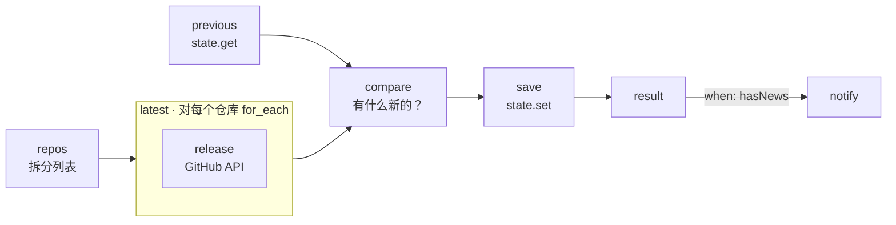

# 04 · GitHub 新版本提醒

[English](README.md) · **简体中文**

> 关注你喜欢的 GitHub 仓库，只在**发布新版本**时给你发消息。

| 难度 | 用时 | 凭证 | 用到的功能 |
|---|---|---|---|
| ⭐⭐ 进阶 | 15 分钟 | 无（`GITHUB_TOKEN` 可选） | 带 `pause_ms` 的 `for_each`、`state.get` / `state.set`、首次运行处理 |



## 你会学到

- **对每个元素调用一次 API**，并用 `pause_ms` 控制调用间隔，避免请求过快
- 用 **`state.get`** 和 **`state.set`** 读写自己保存的数据
- 对**首次运行**做特殊处理（建立基线，而不是把所有版本都当成新版本报告）
- 报告单个元素的错误（比如仓库名拼错），而不让整个运行失败

## 运行

```bash
npx lobster run examples/04-github-release-watcher/workflow.json
```

```bash
npx lobster run --file examples/04-github-release-watcher/workflow.json \
  --args-json '{"repos":"openclaw/openclaw, n8n-io/n8n, ollama/ollama"}'
```

## 示例输出

第一次运行，记录当前看到的版本：

```
👀 Now watching 3 repositories. Current versions:
• openclaw/openclaw v2026.10.3
• nodejs/node v26.11.1
• microsoft/vscode 1.141.1
```

之后的运行只报告变化（以及列表里的错误）：

```
🚀 nodejs/node released v26.11.1 (was v26.10.0)
   https://github.com/nodejs/node/releases/tag/v26.11.1
⚠️ nobody/no-such-repo-xyz: HTTP 404: Not Found
```

没有变化时，`notify` 被跳过，结果是 `{"hasNews": false, "message": "No new releases.", ...}`。

## 定时运行

让工作流自己负责发消息，这样只有有新版本时你才会收到通知。定时任务本身不推送任何内容（`--no-deliver`）：

```bash
openclaw cron add --name "Release watcher" --cron "0 9 * * *" --session isolated --no-deliver \
  --message "Run the Lobster workflow ~/openclaw-cookbook/examples/04-github-release-watcher/workflow.json with argsJson {\"notify_channel\":\"telegram\",\"notify_target\":\"<chat id>\"}."
```

也可以完全不经过 Agent，用 `crontab` 加上同样的参数运行（见[食谱 02](../02-daily-weather-briefing/README.zh-CN.md#每天早上自动运行)）。

## 工作原理

| 步骤 | 作用 |
|---|---|
| `repos` | 把 `"a/b, c/d"` 转成 `[{"repo":"a/b"}, {"repo":"c/d"}]`。 |
| `latest` | 对每个仓库 `for_each`，调用之间等待 `pause_ms: 500`。每个 `release` 子步骤调用 `GET /repos/{repo}/releases/latest`，返回 `{repo, tag, url}` 或 `{repo, error}`。如果环境中设置了 `GITHUB_TOKEN` 就会使用它（每小时 5000 次请求，而不是 60 次）。 |
| `previous` | `state.get cookbook-github-releases` 读取上次保存的内容（首次运行为 `null`）。 |
| `compare` | 通过 `env` 拿到两份数据，找出 tag 有变化的仓库并生成消息。同时输出 `seen`，也就是要保存的最新映射。 |
| `save` | `state.set cookbook-github-releases` 保存 `seen`（来自 `stdin: "$compare.json.seen"`）。 |
| `result` | 再输出一次比较结果，这样在无需通知时它就是工作流的结果。 |
| `notify` | 只有 `hasNews` 为 true 时才运行。 |

## 扩展思路

- 包含预发布版本：把 `/releases/latest` 换成 `/releases?per_page=1`。
- 附上更新说明：把 `b.body` 交给一个 LLM 步骤（参考食谱 05），生成两行摘要。
- 对不发布 Release 的项目改为关注 tag：`/repos/{repo}/tags`。

## 常见问题

| 现象 | 解决办法 |
|---|---|
| `HTTP 403: API rate limit exceeded` | 不带令牌时 GitHub 每个 IP 每小时只允许 60 次请求。导出 `GITHUB_TOKEN`（访问公开仓库，无需任何权限范围的令牌就够了）。 |
| `HTTP 404` | 仓库名写错了，或者该仓库没有 Release（只有 tag）。 |
| 想重新开始 | 删除 `~/.lobster/state/cookbook-github-releases.json`。 |
