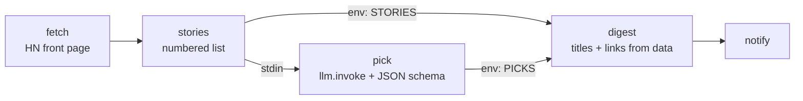

# 05 · AI News Digest

**English** · [简体中文](README.zh-CN.md)

> Fetch today's Hacker News front page, let an LLM pick and explain the stories you'd care about, and get a digest with **real** links.

| Difficulty | Time | Credentials | Features used |
|---|---|---|---|
| ⭐⭐ Intermediate | 15 min | An LLM (OpenClaw's own model, or any OpenAI-compatible API) | `llm.invoke`, `--output-schema`, "LLM decides, code formats" |



## What you'll learn

- Calling an LLM from a workflow with the built-in **`llm.invoke`** command
- Getting **structured JSON** back with `--output-schema`. Lobster validates the answer and retries if it doesn't match.
- A pattern that keeps AI output trustworthy: the LLM only returns **indexes and opinions**, and code adds titles and URLs from the original data, so links can't be made up.

## Before you start: connect an LLM

`llm.invoke` needs to know which model to call. Pick one option (details in [Getting Started](../../docs/getting-started.md#4-connect-an-llm-for-ai-recipes)):

| Option | Set these environment variables |
|---|---|
| **A. OpenClaw's own model** (OpenClaw ≥ 2026.10.1, `llm-task` enabled) | `LOBSTER_LLM_PROVIDER=openclaw`, `OPENCLAW_URL=http://127.0.0.1:18789`, `OPENCLAW_TOKEN=<gateway token>` |
| **B. Any OpenAI-compatible API** through the bundled bridge | Start `LLM_API_KEY=sk-... npm run llm`, then set `LOBSTER_LLM_PROVIDER=http`, `LOBSTER_LLM_ADAPTER_URL=http://127.0.0.1:18787` |
| **C. Offline mock** (free, for trying things out) | Start `npm run llm:mock`, then set the same two variables as B |

## Run it

```bash
npx lobster run examples/05-ai-news-digest/workflow.json
```

```bash
npx lobster run --file examples/05-ai-news-digest/workflow.json \
  --args-json '{"count":"20","interests":"databases, Rust, security"}'
```

**In OpenClaw chat:** *"Run the Lobster workflow `~/openclaw-cookbook/examples/05-ai-news-digest/workflow.json` and send me the digest."*

## Example output

Real output (DeepSeek `deepseek-flash`, 14 Oct 2026):

```
📰 Your Hacker News digest — 2026-10-14

A big-model release and some deep developer-tooling drama dominate a day otherwise split between Apple hardware news and cautionary tales from the AI industry.

1. Gemini 4 Argon (1029 points, 766 comments)
   A flagship Gemini model launch is the day's biggest AI story and likely to shape what builders target next.
   https://deepmind.google/models/gemini/
2. 11 year old unsoundness bugs found in Rust borrow checker (688 points, 381 comments)
   Eleven-year-old soundness bugs in Rust's borrow checker are a must-read for anyone relying on the language's core safety guarantees.
   https://github.com/rust-lang/rust/issues/164250
3. Redesigning source control at Anthropic (561 points, 532 comments)
   ...
```

## How it works

| Step | What it does |
|---|---|
| `fetch` | One call to the free [HN Algolia API](https://hn.algolia.com/api) with `retry`. |
| `stories` | Keeps only what matters (title, url, points, comments) and **numbers** the stories 1…N. |
| `pick` | `llm.invoke --prompt '...' --output-schema '{...}'` with the stories as input (`stdin`). The schema asks for `{ overview, picks: [{ index, why }] }` with 3–5 picks. If the model returns something that doesn't match, Lobster asks again (up to `--max-validation-retries`, default 1). |
| `digest` | Looks up each picked `index` in the original list, skips unknown or duplicate indexes, and prints title, points, the LLM's "why", and the **real** URL. |
| `notify` | Optional chat message, as in recipe 02. |

The LLM answer is at `$pick.json.output.data`. `llm.invoke` wraps it with metadata such as the model, a cache key and usage.

**Caching:** `llm.invoke` caches answers by prompt + input (in `~/.lobster/cache`), so re-running with the same stories doesn't cost anything. Set `LOBSTER_LLM_FORCE_REFRESH=1` to force a new answer.

## Ideas to extend

- Change the source: any RSS/JSON feed works, as long as `stories` produces a numbered list.
- Translate the digest: add "Write `why` in Chinese" to the prompt.
- Cap spending with a workflow-level `"cost_limit"` (see the [Lobster docs](https://github.com/openclaw/lobster#calling-llms-from-workflows)).

## Troubleshooting

| Symptom | Fix |
|---|---|
| `llm.invoke could not resolve a provider` | No LLM is configured. Set the variables from the table above. |
| `llm.invoke received invalid response envelope` | You are using `LOBSTER_LLM_PROVIDER=openclaw` with an older Lobster plugin. Update OpenClaw to ≥ 2026.10.1, or use option B. |
| `401 Unauthorized` | `OPENCLAW_TOKEN` is wrong. Get the current one with `openclaw gateway auth-token --show`. |
| Prompt contains `'` and breaks | Args are pasted into the prompt as text. Avoid single quotes in `interests`. |
