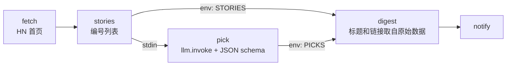

# 05 · AI 新闻摘要

[English](README.md) · **简体中文**

> 获取今天的 Hacker News 首页，让 LLM 挑出并解读你可能感兴趣的新闻，生成一份带**真实**链接的摘要。

| 难度 | 用时 | 凭证 | 用到的功能 |
|---|---|---|---|
| ⭐⭐ 进阶 | 15 分钟 | 一个 LLM（OpenClaw 自带模型，或任意 OpenAI 兼容接口） | `llm.invoke`、`--output-schema`、"LLM 做判断，代码做排版" |



## 你会学到

- 用内置的 **`llm.invoke`** 命令在工作流中调用 LLM
- 用 `--output-schema` 获取**结构化 JSON**，Lobster 会校验答案，不符合就重试
- 一个让 AI 输出更可信的模式：LLM 只返回**编号和观点**，标题和链接由代码从原始数据中补上，所以链接不可能是编造的

## 开始之前：接入 LLM

`llm.invoke` 需要知道调用哪个模型。任选一种方案（详见[快速上手](../../docs/getting-started.zh-CN.md#4-接入-llmai-类食谱需要)）：

| 方案 | 需要设置的环境变量 |
|---|---|
| **A. OpenClaw 自带模型**（OpenClaw ≥ 2026.10.1，已启用 `llm-task`） | `LOBSTER_LLM_PROVIDER=openclaw`、`OPENCLAW_URL=http://127.0.0.1:18789`、`OPENCLAW_TOKEN=<网关令牌>` |
| **B. 任意 OpenAI 兼容接口**，通过内置桥接 | 先启动 `LLM_API_KEY=sk-... npm run llm`，再设置 `LOBSTER_LLM_PROVIDER=http`、`LOBSTER_LLM_ADAPTER_URL=http://127.0.0.1:18787` |
| **C. 离线模拟**（免费，适合试用） | 先启动 `npm run llm:mock`，再设置与 B 相同的两个变量 |

## 运行

```bash
npx lobster run examples/05-ai-news-digest/workflow.json
```

```bash
npx lobster run --file examples/05-ai-news-digest/workflow.json \
  --args-json '{"count":"20","interests":"databases, Rust, security"}'
```

**在 OpenClaw 聊天中：** *"运行 Lobster 工作流 `~/openclaw-cookbook/examples/05-ai-news-digest/workflow.json`，把摘要发给我。"*

## 示例输出

真实输出（DeepSeek `deepseek-flash`，2026 年 10 月 14 日）：

```
📰 Your Hacker News digest — 2026-10-14

A big-model release and some deep developer-tooling drama dominate a day otherwise split between Apple hardware news and cautionary tales from the AI industry.

1. Gemini 4 Argon (1029 points, 766 comments)
   A flagship Gemini model launch is the day's biggest AI story and likely to shape what builders target next.
   https://deepmind.google/models/gemini/
2. 11 year old unsoundness bugs found in Rust borrow checker (688 points, 381 comments)
   Eleven-year-old soundness bugs in Rust's borrow checker are a must-read for anyone relying on the language's core safety guarantees.
   https://github.com/rust-lang/rust/issues/164250
3. Redesigning source control at Anthropic (561 points, 532 comments)
   ...
```

想要中文摘要？在提示词里加一句 "Write overview and why in Chinese" 即可。

## 工作原理

| 步骤 | 作用 |
|---|---|
| `fetch` | 调用一次免费的 [HN Algolia API](https://hn.algolia.com/api)，带 `retry`。 |
| `stories` | 只保留有用的字段（标题、链接、分数、评论数），并给新闻**编号** 1…N。 |
| `pick` | `llm.invoke --prompt '...' --output-schema '{...}'`，新闻列表作为输入（`stdin`）。schema 要求返回 `{ overview, picks: [{ index, why }] }`，挑选 3–5 条。如果模型返回的格式不对，Lobster 会再问一次（由 `--max-validation-retries` 控制，默认 1 次）。 |
| `digest` | 按 LLM 选出的 `index` 在原始列表中查找新闻，跳过不存在或重复的编号，输出标题、分数、LLM 给出的理由以及**真实**链接。 |
| `notify` | 可选的聊天消息，同食谱 02。 |

LLM 的答案在 `$pick.json.output.data`。`llm.invoke` 会把它和模型名、缓存键、用量等元数据包装在一起。

**缓存：** `llm.invoke` 按"提示词 + 输入"缓存答案（在 `~/.lobster/cache`），用相同的新闻重复运行不会产生费用。设置 `LOBSTER_LLM_FORCE_REFRESH=1` 可以强制重新生成。

## 扩展思路

- 换一个数据源：任何 RSS/JSON 源都可以，只要 `stories` 输出编号列表即可。
- 翻译摘要：在提示词中加上 "Write `why` in Chinese"。
- 用工作流级别的 `"cost_limit"` 限制花费（见 [Lobster 文档](https://github.com/openclaw/lobster#calling-llms-from-workflows)）。

## 常见问题

| 现象 | 解决办法 |
|---|---|
| `llm.invoke could not resolve a provider` | 没有配置 LLM，按上表设置环境变量。 |
| `llm.invoke received invalid response envelope` | 你在旧版 Lobster 插件上使用了 `LOBSTER_LLM_PROVIDER=openclaw`。把 OpenClaw 升级到 ≥ 2026.10.1，或改用方案 B。 |
| `401 Unauthorized` | `OPENCLAW_TOKEN` 不对。用 `openclaw gateway auth-token --show` 获取当前令牌。 |
| 提示词中包含 `'` 导致出错 | 参数会以文本形式拼进提示词，`interests` 中不要使用单引号。 |
