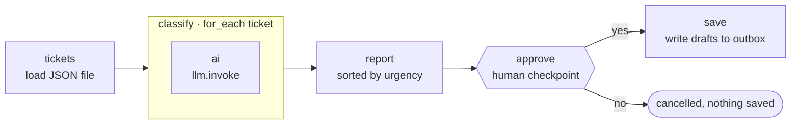

# 06 · AI Support Ticket Triage

**English** · [简体中文](README.zh-CN.md)

> Classify support tickets with an LLM (category, urgency, summary, draft reply), show a triage report, and only save the draft replies **after a human approves**.

| Difficulty | Time | Credentials | Features used |
|---|---|---|---|
| ⭐⭐⭐ Advanced | 20 min | An LLM (see [recipe 05](../05-ai-news-digest/#before-you-start-connect-an-llm)) | `for_each` + `llm.invoke`, enum schemas, **approval gates**, resume tokens |



## What you'll learn

- Running an **LLM call per item** inside a `for_each` loop
- Forcing answers into fixed buckets with **`enum`** in the JSON schema
- Pausing a workflow for a **human decision** with an `approval` step, and resuming it later
- "Draft automatically, act only after approval", the safe pattern for anything that sends, posts or deletes

## Run it

From the repo root (the default `tickets_file` is a relative path):

```bash
npx lobster run examples/06-ai-support-ticket-triage/workflow.json
```

The run **stops** at the approval step. In an interactive terminal, Lobster asks you directly. In tool mode (`--mode tool`, which is what OpenClaw uses, and what you get in scripts) it returns a JSON envelope and saves the paused run to disk:

```json
{
  "status": "needs_approval",
  "requiresApproval": {
    "prompt": "Save the draft replies listed in this triage report to the outbox?",
    "items": ["Triage report: 5 tickets", "🔴 T-1001 [billing] Charged twice this month — ...", "..."],
    "resumeToken": "eyJwcm90b2NvbFZlcnNpb24iOjEs...",
    "approvalId": "5db7ce6c"
  }
}
```

Resume with `npx lobster resume --token <resumeToken> --approve yes` (or `no`).

**In OpenClaw chat** (use absolute paths, because the gateway runs in a different folder):

> Run `~/openclaw-cookbook/examples/06-ai-support-ticket-triage/workflow.json` with argsJson `{"tickets_file": "/Users/me/openclaw-cookbook/examples/06-ai-support-ticket-triage/tickets.json"}`. If it pauses for approval, show me the report and wait.

The agent shows you the report and asks. Answer "approve" and it calls the `lobster` tool with `{"action": "resume", "approvalId": "5db7ce6c", "approve": true}`.

> 💡 **Tip:** ask the agent to resume with the short **`approvalId`**. In our tests, a model re-typing the 150-character `resumeToken` got it wrong once, and the resume failed.

## Example output

The triage report the approver sees (real DeepSeek output for the sample tickets):

```
Triage report: 5 tickets

🔴 T-1001 [billing] Charged twice this month — Customer was charged twice for the Pro plan in October and requests a refund of the duplicate charge (Order #88412).
🔴 T-1002 [bug] App crashes when I upload a photo — iOS app crashes on profile photo upload after latest update, blocking team onboarding.
🟢 T-1003 [how_to] How do I export my data? — Customer asks how to export all projects to CSV.
🟢 T-1004 [spam] BEST PRICES!!! Click now — Unsolicited marketing email advertising discounted pills and a prize link.
🟢 T-1005 [feature_request] Feature idea: dark mode — Customer requests a dark mode option for late-night work.

4 draft replies ready (spam is skipped):

✉️ To anna@example.com — Re: Charged twice this month
Hi Anna, thanks for flagging this — I'm sorry about the double charge. ...
```

After approval: `✅ Saved 4 draft replies to /Users/me/openclaw-cookbook-output/support-outbox`, one `T-xxxx.md` file per reply. If you reject, the run ends with `status: "cancelled"` and **nothing** is written.

## How it works

| Step | What it does |
|---|---|
| `tickets` | Reads the JSON file (`~` is expanded) and fails clearly if it's empty. |
| `classify` | `for_each` ticket → `ai` sub-step: `llm.invoke` with `stdin: "$ticket.json"` and a schema whose `category` and `urgency` are **enums**, so the model can't invent new labels. |
| `report` | Merges each ticket with its classification, sorts by urgency, drops spam from the replies, and builds the report both as text and as a list of lines. |
| `approve` | An `approval` step. Its `stdin` (the report lines) becomes the approval's `items`, which is what OpenClaw shows the agent and the agent shows you. The run is saved to disk and the workflow stops here. |
| `save` | `when: "$approve.approved"`. Only after approval are the drafts written to the outbox folder. |

## Ideas to extend

- Actually send the replies: replace `save` with `openclaw message send`, or an email tool such as `gog.gmail.send` (Lobster has Gmail helpers).
- Require a specific approver: `"approval": { "prompt": "...", "required_approver": "lead@company.com" }`.
- Auto-approve low-risk categories: split replies into `how_to` (save directly) and everything else (needs approval).
- Pull real tickets from your helpdesk API instead of `tickets.json`.

## Troubleshooting

| Symptom | Fix |
|---|---|
| `ENOENT ... tickets.json` | Run from the repo root, or pass an absolute `tickets_file`. |
| `Workflow resume state not found` | The token was wrong (often mistyped by a model) or already used, because tokens are single-use. Use the `approvalId`, or start a new run. |
| Categories look random with the mock LLM | The mock picks labels pseudo-randomly. Use a real model to see real triage. |
