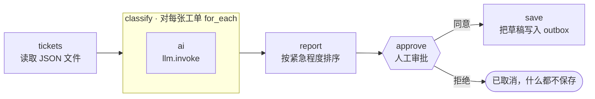

# 06 · AI 客服工单分拣

[English](README.md) · **简体中文**

> 用 LLM 给客服工单分类（类别、紧急程度、摘要、回复草稿），生成分拣报告，**经人工审批后**才保存回复草稿。

| 难度 | 用时 | 凭证 | 用到的功能 |
|---|---|---|---|
| ⭐⭐⭐ 高级 | 20 分钟 | 一个 LLM（见[食谱 05](../05-ai-news-digest/README.zh-CN.md#开始之前接入-llm)） | `for_each` + `llm.invoke`、枚举 schema、**审批关卡**、恢复令牌 |



## 你会学到

- 在 `for_each` 循环中**逐条调用 LLM**
- 用 JSON schema 中的 **`enum`** 把答案限定在固定类别里
- 用 `approval` 步骤让工作流暂停、等待**人工决定**，之后再恢复
- "自动起草，审批后才执行"：任何会发送、发布或删除内容的操作，都应采用这种安全模式

## 运行

在仓库根目录运行（默认的 `tickets_file` 是相对路径）：

```bash
npx lobster run examples/06-ai-support-ticket-triage/workflow.json
```

运行会在审批步骤**停下**。在交互式终端中，Lobster 会直接询问你。在 tool 模式下（`--mode tool`，OpenClaw 使用的就是这种模式，脚本中也是如此），它会返回一个 JSON 信封，并把暂停的运行保存到磁盘：

```json
{
  "status": "needs_approval",
  "requiresApproval": {
    "prompt": "Save the draft replies listed in this triage report to the outbox?",
    "items": ["Triage report: 5 tickets", "🔴 T-1001 [billing] Charged twice this month — ...", "..."],
    "resumeToken": "eyJwcm90b2NvbFZlcnNpb24iOjEs...",
    "approvalId": "5db7ce6c"
  }
}
```

用 `npx lobster resume --token <resumeToken> --approve yes`（或 `no`）恢复运行。

**在 OpenClaw 聊天中**（请使用绝对路径，因为网关运行在其他目录）：

> 运行 `~/openclaw-cookbook/examples/06-ai-support-ticket-triage/workflow.json`，argsJson 为 `{"tickets_file": "/Users/me/openclaw-cookbook/examples/06-ai-support-ticket-triage/tickets.json"}`。如果它暂停等待审批，把报告给我看，然后等我决定。

Agent 会把报告展示给你并询问。你回复"同意"后，它会调用 `lobster` 工具：`{"action": "resume", "approvalId": "5db7ce6c", "approve": true}`。

> 💡 **小贴士：** 让 Agent 用简短的 **`approvalId`** 来恢复。我们测试时，模型在重新输入 150 个字符的 `resumeToken` 时抄错过一次，导致恢复失败。

## 示例输出

审批人看到的分拣报告（示例工单的真实 DeepSeek 输出）：

```
Triage report: 5 tickets

🔴 T-1001 [billing] Charged twice this month — Customer was charged twice for the Pro plan in October and requests a refund of the duplicate charge (Order #88412).
🔴 T-1002 [bug] App crashes when I upload a photo — iOS app crashes on profile photo upload after latest update, blocking team onboarding.
🟢 T-1003 [how_to] How do I export my data? — Customer asks how to export all projects to CSV.
🟢 T-1004 [spam] BEST PRICES!!! Click now — Unsolicited marketing email advertising discounted pills and a prize link.
🟢 T-1005 [feature_request] Feature idea: dark mode — Customer requests a dark mode option for late-night work.

4 draft replies ready (spam is skipped):

✉️ To anna@example.com — Re: Charged twice this month
Hi Anna, thanks for flagging this — I'm sorry about the double charge. ...
```

批准后：`✅ Saved 4 draft replies to /Users/me/openclaw-cookbook-output/support-outbox`，每条回复一个 `T-xxxx.md` 文件。如果拒绝，运行以 `status: "cancelled"` 结束，**什么都不会写入**。

## 工作原理

| 步骤 | 作用 |
|---|---|
| `tickets` | 读取 JSON 文件（支持 `~`），如果为空会给出明确的错误。 |
| `classify` | 对每张工单 `for_each` → `ai` 子步骤：`llm.invoke`，`stdin: "$ticket.json"`，schema 中的 `category` 和 `urgency` 都是**枚举**，模型无法自创新标签。 |
| `report` | 把工单和分类结果合并，按紧急程度排序，去掉垃圾邮件的回复，并同时生成文本和逐行列表两种形式的报告。 |
| `approve` | 一个 `approval` 步骤。它的 `stdin`（报告的每一行）会成为审批的 `items`，OpenClaw 会把它展示给 Agent，Agent 再展示给你。运行状态被保存到磁盘，工作流在此停止。 |
| `save` | `when: "$approve.approved"`：只有批准后才把草稿写入 outbox 文件夹。 |

## 扩展思路

- 真正发送回复：把 `save` 换成 `openclaw message send`，或邮件工具（例如 `gog.gmail.send`，Lobster 内置了 Gmail 相关命令）。
- 指定审批人：`"approval": { "prompt": "...", "required_approver": "lead@company.com" }`。
- 低风险类别自动通过：把回复分成 `how_to`（直接保存）和其他（需要审批）两组。
- 从你的客服系统 API 拉取真实工单，代替 `tickets.json`。

## 常见问题

| 现象 | 解决办法 |
|---|---|
| `ENOENT ... tickets.json` | 在仓库根目录运行，或传入 `tickets_file` 的绝对路径。 |
| `Workflow resume state not found` | 令牌不对（常常是模型抄错了），或已经用过：令牌只能用一次。改用 `approvalId`，或重新运行。 |
| 用模拟模型时分类看起来很随机 | 模拟模型是伪随机选择标签的。换成真实模型才能看到真正的分拣效果。 |
