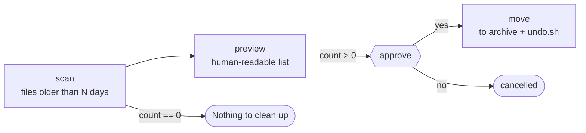

# 07 · Safe File Cleanup

**English** · [简体中文](README.zh-CN.md)

> Find old files in a folder (like Downloads), show what would be cleaned up, and only after you approve **move** them to an archive. Nothing is deleted, and an undo script is written.

| Difficulty | Time | Credentials | Features used |
|---|---|---|---|
| ⭐⭐ Intermediate | 10 min | None | approval gates, numeric conditions (`>`, `==`), branching, reversible actions |



## What you'll learn

- Using **comparisons** in conditions: `$scan.json.count > 0`, `$scan.json.count == 0`
- **Branching**: different steps run depending on the data
- Designing automations an AI agent can safely run: **preview → approve → reversible action → undo**

## Run it

Try it on a test folder first:

```bash
mkdir -p /tmp/messy && touch -t 202501010000 /tmp/messy/old-report.pdf /tmp/messy/old-installer.dmg && touch /tmp/messy/new.txt
npx lobster run --mode tool --file examples/07-safe-file-cleanup/workflow.json --args-json '{"folder":"/tmp/messy"}'
```

You get `needs_approval` with the list of files. Approve with the token from the output:

```bash
npx lobster resume --token <resumeToken> --approve yes
```

Then for real (your Downloads, files untouched for 60+ days):

```bash
npx lobster run --file examples/07-safe-file-cleanup/workflow.json --args-json '{"folder":"~/Downloads","older_than_days":"60"}'
```

**In OpenClaw chat:** *"Run the Lobster workflow `~/openclaw-cookbook/examples/07-safe-file-cleanup/workflow.json` on `~/Downloads` with older_than_days 60, show me the list and wait for my OK."*

## Example output

The approval request lists the files:

```
3 files in /Users/me/Downloads are older than 30 days (2.86 MB):
• big-old.dmg  2.86 MB, 651 days old
• it's old.zip  <0.01 MB, 651 days old
• old report.pdf  <0.01 MB, 651 days old
They will be MOVED (not deleted) to an archive folder.
```

After approval:

```
📦 Moved 3 files (2.86 MB) to /Users/me/openclaw-cookbook-output/archive/2026-10-14T02-14-05
Changed your mind? Run: sh '/Users/me/openclaw-cookbook-output/archive/2026-10-14T02-14-05/undo.sh'
```

## How it works

| Step | What it does |
|---|---|
| `scan` | Lists **top-level, non-hidden files** (subfolders are ignored) whose modification time is older than `older_than_days`, biggest first. Prints `{folder, count, totalMb, files}`. |
| `preview` | Turns the scan into readable lines (max 30 shown) as a JSON array, so they appear as the approval's `items`. |
| `nothing` | `when: "$scan.json.count == 0"`: friendly message, and the workflow ends without asking anything. |
| `approve` | `when: "$scan.json.count > 0"`: pauses for your decision. |
| `move` | `when: "$approve.approved"`. Moves each file into `archive/<timestamp>/` (copying and then removing if it's on another disk), skips files that disappeared meanwhile, and writes `undo.sh` with safely quoted `mv -n` commands. |

Why move instead of delete? An agent can misunderstand you. When the action is reversible and approved first, a mistake costs you one command to undo.

## Ideas to extend

- Only clean certain types: filter `e.name` by extension (`.dmg`, `.zip`, `.pkg`).
- Add a size threshold arg (`min_mb`) to target the big space wasters.
- Run it monthly with `openclaw cron add --cron "0 10 1 * *" ...`. The approval then arrives in your chat, and you answer there.

## Troubleshooting

| Symptom | Fix |
|---|---|
| `ENOENT: no such file or directory, scandir` | The folder doesn't exist. Check the path (`~` is supported). |
| `EACCES` / `EPERM` on macOS | The gateway or terminal needs Full Disk Access for some folders (*System Settings → Privacy & Security*). |
| Undo didn't restore a file | `mv -n` never overwrites: a file with the same name already exists in the original folder. Rename one of them and move it by hand. |
