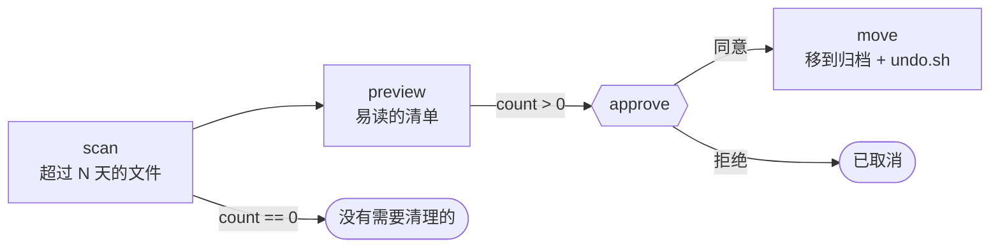

# 07 · 安全清理旧文件

[English](README.md) · **简体中文**

> 找出某个文件夹（比如"下载"）里的旧文件，先展示将要清理的内容，经你批准后再把它们**移动**到归档文件夹。不会删除任何文件，并且会生成撤销脚本。

| 难度 | 用时 | 凭证 | 用到的功能 |
|---|---|---|---|
| ⭐⭐ 进阶 | 10 分钟 | 无 | 审批关卡、数值条件（`>`、`==`）、分支、可撤销的操作 |



## 你会学到

- 在条件中使用**比较运算**：`$scan.json.count > 0`、`$scan.json.count == 0`
- **分支**：根据数据执行不同的步骤
- 设计能让 AI Agent 安全执行的自动化：**预览 → 审批 → 可撤销的操作 → 撤销**

## 运行

先在一个测试文件夹上试试：

```bash
mkdir -p /tmp/messy && touch -t 202501010000 /tmp/messy/old-report.pdf /tmp/messy/old-installer.dmg && touch /tmp/messy/new.txt
npx lobster run --mode tool --file examples/07-safe-file-cleanup/workflow.json --args-json '{"folder":"/tmp/messy"}'
```

你会得到 `needs_approval` 和文件清单。用输出中的令牌批准：

```bash
npx lobster resume --token <resumeToken> --approve yes
```

然后对真实文件夹运行（"下载"文件夹中 60 天以上没修改过的文件）：

```bash
npx lobster run --file examples/07-safe-file-cleanup/workflow.json --args-json '{"folder":"~/Downloads","older_than_days":"60"}'
```

**在 OpenClaw 聊天中：** *"对 `~/Downloads` 运行 Lobster 工作流 `~/openclaw-cookbook/examples/07-safe-file-cleanup/workflow.json`，older_than_days 设为 60，把清单给我看，等我确认。"*

## 示例输出

审批请求会列出文件：

```
3 files in /Users/me/Downloads are older than 30 days (2.86 MB):
• big-old.dmg  2.86 MB, 651 days old
• it's old.zip  <0.01 MB, 651 days old
• old report.pdf  <0.01 MB, 651 days old
They will be MOVED (not deleted) to an archive folder.
```

批准后：

```
📦 Moved 3 files (2.86 MB) to /Users/me/openclaw-cookbook-output/archive/2026-10-14T02-14-05
Changed your mind? Run: sh '/Users/me/openclaw-cookbook-output/archive/2026-10-14T02-14-05/undo.sh'
```

## 工作原理

| 步骤 | 作用 |
|---|---|
| `scan` | 列出**顶层、非隐藏的文件**（忽略子文件夹）中，修改时间早于 `older_than_days` 的文件，按大小从大到小排序。输出 `{folder, count, totalMb, files}`。 |
| `preview` | 把扫描结果转成易读的文本行（最多显示 30 个），以 JSON 数组形式输出，作为审批的 `items`。 |
| `nothing` | `when: "$scan.json.count == 0"`：给出友好提示，工作流不提任何问题直接结束。 |
| `approve` | `when: "$scan.json.count > 0"`：暂停，等你决定。 |
| `move` | `when: "$approve.approved"`：把每个文件移到 `archive/<时间戳>/`（如果在另一个磁盘上，就先复制再删除原文件），跳过期间已经不存在的文件，并生成用安全引号包裹的 `mv -n` 命令组成的 `undo.sh`。 |

为什么是移动而不是删除？Agent 可能误解你的意思。如果操作可撤销、并且事先经过审批，即使出错，也只需要一条命令就能还原。

## 扩展思路

- 只清理特定类型：按扩展名（`.dmg`、`.zip`、`.pkg`）过滤 `e.name`。
- 加一个大小阈值参数（`min_mb`），专门清理占空间的大文件。
- 用 `openclaw cron add --cron "0 10 1 * *" ...` 每月运行一次。审批请求会发到你的聊天里，直接在聊天中回复即可。

## 常见问题

| 现象 | 解决办法 |
|---|---|
| `ENOENT: no such file or directory, scandir` | 文件夹不存在，检查路径（支持 `~`）。 |
| macOS 上出现 `EACCES` / `EPERM` | 某些文件夹需要给网关或终端"完全磁盘访问权限"（*系统设置 → 隐私与安全性*）。 |
| 撤销后某个文件没回来 | `mv -n` 从不覆盖：原文件夹里已经有同名文件了。把其中一个改名后手动移回。 |
