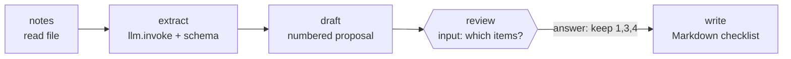

# 08 · Meeting Notes → Action Items

**English** · [简体中文](README.zh-CN.md)

> Turn messy meeting notes into a summary, a list of decisions and an action-item checklist. The workflow **asks you** which items to keep before writing the file.

| Difficulty | Time | Credentials | Features used |
|---|---|---|---|
| ⭐⭐⭐ Advanced | 15 min | An LLM (see [recipe 05](../05-ai-news-digest/#before-you-start-connect-an-llm)) | LLM extraction, **`input` steps** (structured questions), `responseSchema`, resuming with an answer |



## What you'll learn

- **Structured extraction**: turning free text into JSON (`title`, `summary`, `decisions[]`, `action_items[]`) with a schema
- The **`input`** step: unlike a yes/no approval, it asks a question and expects an answer that matches a **JSON Schema**
- Combining an AI draft with a human edit before anything is saved

## Run it

```bash
npx lobster run --mode tool --file examples/08-meeting-notes-to-action-items/workflow.json
```

The run pauses with `status: "needs_input"`:

```json
{
  "status": "needs_input",
  "requiresInput": {
    "prompt": "Which action items should go on the list? Answer \"all\" or item numbers like \"1,3,4\". ...",
    "responseSchema": { "type": "object", "properties": { "keep": {...}, "note": {...} }, "required": ["keep"] },
    "defaults": { "keep": "all" },
    "subject": "Weekly product sync\n\n...\nProposed action items:\n1. Add pagination to the CSV export endpoint — Raj, due before Friday [medium]\n...",
    "resumeToken": "eyJwcm90..."
  }
}
```

Answer it:

```bash
npx lobster resume --token <resumeToken> --response-json '{"keep":"1,3,4","note":"Reviewed by Sam"}'
```

If your answer doesn't match the schema (for example, `keep` is missing), Lobster rejects it and keeps the question open, so you can answer again.

**In OpenClaw chat** (needs OpenClaw ≥ 2026.10.1, since older Lobster plugins reject `input` steps):

> Run `~/openclaw-cookbook/examples/08-meeting-notes-to-action-items/workflow.json` with argsJson `{"notes_file": "/path/to/my-notes.md"}`. When it asks which items to keep, show me the proposal and wait.

Then just reply in chat, e.g. *"Keep 1, 3 and 4. Note: reviewed by Sam"*. The agent resumes with `{"action": "resume", "token": "...", "responseJson": "{\"keep\":\"1,3,4\",\"note\":\"Reviewed by Sam\"}"}`.

## Example output

The proposal (real output from the sample [`notes.md`](notes.md)):

```
Weekly product sync

The team reviewed progress on v2.4, CSV export performance, onboarding designs, and support tickets. ...

Proposed action items:
1. Add pagination to the CSV export endpoint — Raj, due before Friday [medium]
2. Share the Figma link with the team — Mei, due today [medium]
3. Look into the payment webhook retries — Raj, due tomorrow morning [high]
4. Write the release notes for v2.4 and send them to Tom — Lena, due by Thursday [medium]
5. Update the help-center article on exports — Tom, due once pagination ships [low]
```

The file written after answering `{"keep":"1,3,4","note":"Reviewed by Sam"}`:

```markdown
# Weekly product sync

> Reviewed by Sam

## Summary
...
## Decisions

- Postpone dark mode to next quarter.
- Make the double-charge bug the top priority.

## Action items

- [ ] **Add pagination to the CSV export endpoint** — Raj · due before Friday · medium
- [ ] **Look into the payment webhook retries** — Raj · due tomorrow morning · high
- [ ] **Write the release notes for v2.4 and send them to Tom** — Lena · due by Thursday · medium
```

## How it works

| Step | What it does |
|---|---|
| `notes` | Prints the notes file as plain text (`~` supported). |
| `extract` | `llm.invoke` with the notes as input and a schema for title, summary, decisions and action items (owner, due, priority enum). The prompt tells the model not to invent tasks. |
| `draft` | Formats a numbered proposal. This becomes the `subject` of the question. |
| `review` | An `input` step with a `prompt`, a `responseSchema` and `defaults`. The workflow is saved and stops. When resumed, the answer is available as `$review.response`. |
| `write` | Reads the extraction and the answer via `env`, keeps the chosen items, and writes a Markdown checklist to `output_file`. |

## Ideas to extend

- Create real tasks: after `write`, add a step that posts each item to Todoist, Linear or GitHub Issues with `curl`.
- Send each owner their items with `openclaw message send`.
- Let the reviewer edit wording: add an `edits` field (object of `{number: "new text"}`) to the response schema.

## Troubleshooting

| Symptom | Fix |
|---|---|
| `Lobster input requests are not supported by the OpenClaw Lobster tool yet` | Your OpenClaw / Lobster plugin is older than 2026.10.1. Update, or run this recipe from the terminal. |
| The answer is rejected | It must be a JSON object with at least `keep`, e.g. `{"keep":"all"}`. |
| Action items are invented or missing | Use a stronger model, or add examples to the prompt. With the mock LLM you get placeholder text. |
