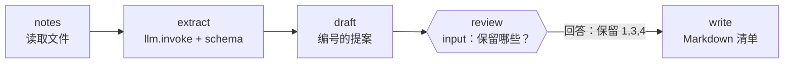

# 08 · 会议纪要 → 待办清单

[English](README.md) · **简体中文**

> 把杂乱的会议纪要整理成摘要、决议和待办清单。写入文件之前，工作流会**先问你**要保留哪些事项。

| 难度 | 用时 | 凭证 | 用到的功能 |
|---|---|---|---|
| ⭐⭐⭐ 高级 | 15 分钟 | 一个 LLM（见[食谱 05](../05-ai-news-digest/README.zh-CN.md#开始之前接入-llm)） | LLM 信息抽取、**`input` 步骤**（结构化提问）、`responseSchema`、带答案恢复运行 |



## 你会学到

- **结构化抽取**：用 schema 把自由文本变成 JSON（`title`、`summary`、`decisions[]`、`action_items[]`）
- **`input`** 步骤：与"是/否"审批不同，它会提出一个问题，并要求答案符合 **JSON Schema**
- 先由 AI 起草，再由人修改，然后才保存

## 运行

```bash
npx lobster run --mode tool --file examples/08-meeting-notes-to-action-items/workflow.json
```

运行会以 `status: "needs_input"` 暂停：

```json
{
  "status": "needs_input",
  "requiresInput": {
    "prompt": "Which action items should go on the list? Answer \"all\" or item numbers like \"1,3,4\". ...",
    "responseSchema": { "type": "object", "properties": { "keep": {...}, "note": {...} }, "required": ["keep"] },
    "defaults": { "keep": "all" },
    "subject": "Weekly product sync\n\n...\nProposed action items:\n1. Add pagination to the CSV export endpoint — Raj, due before Friday [medium]\n...",
    "resumeToken": "eyJwcm90..."
  }
}
```

回答它：

```bash
npx lobster resume --token <resumeToken> --response-json '{"keep":"1,3,4","note":"Reviewed by Sam"}'
```

如果答案不符合 schema（例如缺少 `keep`），Lobster 会拒绝它并保持问题未关闭，你可以重新回答。

**在 OpenClaw 聊天中**（需要 OpenClaw ≥ 2026.10.1，更早的 Lobster 插件不支持 `input` 步骤）：

> 运行 `~/openclaw-cookbook/examples/08-meeting-notes-to-action-items/workflow.json`，argsJson 为 `{"notes_file": "/path/to/my-notes.md"}`。当它问要保留哪些事项时，把提案给我看，然后等我回复。

然后直接在聊天中回复，例如 *"保留 1、3、4。备注：Sam 已审阅"*。Agent 会用 `{"action": "resume", "token": "...", "responseJson": "{\"keep\":\"1,3,4\",\"note\":\"...\"}"}` 恢复运行。

## 示例输出

提案（示例 [`notes.md`](notes.md) 的真实输出）：

```
Weekly product sync

The team reviewed progress on v2.4, CSV export performance, onboarding designs, and support tickets. ...

Proposed action items:
1. Add pagination to the CSV export endpoint — Raj, due before Friday [medium]
2. Share the Figma link with the team — Mei, due today [medium]
3. Look into the payment webhook retries — Raj, due tomorrow morning [high]
4. Write the release notes for v2.4 and send them to Tom — Lena, due by Thursday [medium]
5. Update the help-center article on exports — Tom, due once pagination ships [low]
```

回答 `{"keep":"1,3,4","note":"Reviewed by Sam"}` 后写入的文件：

```markdown
# Weekly product sync

> Reviewed by Sam

## Summary
...
## Decisions

- Postpone dark mode to next quarter.
- Make the double-charge bug the top priority.

## Action items

- [ ] **Add pagination to the CSV export endpoint** — Raj · due before Friday · medium
- [ ] **Look into the payment webhook retries** — Raj · due tomorrow morning · high
- [ ] **Write the release notes for v2.4 and send them to Tom** — Lena · due by Thursday · medium
```

纪要是中文的？没问题，LLM 会按原文抽取；也可以在提示词里要求用中文输出。

## 工作原理

| 步骤 | 作用 |
|---|---|
| `notes` | 以纯文本输出纪要文件（支持 `~`）。 |
| `extract` | `llm.invoke`，以纪要为输入，schema 包含标题、摘要、决议和待办（负责人、截止时间、优先级枚举）。提示词要求模型不要编造任务。 |
| `draft` | 生成编号的提案，它会成为问题的 `subject`。 |
| `review` | 一个 `input` 步骤，包含 `prompt`、`responseSchema` 和 `defaults`。工作流保存状态后停止。恢复后，答案可以通过 `$review.response` 读取。 |
| `write` | 通过 `env` 读取抽取结果和答案，保留选中的事项，把 Markdown 清单写入 `output_file`。 |

## 扩展思路

- 创建真实任务：在 `write` 之后加一个步骤，用 `curl` 把每个事项提交到 Todoist、Linear 或 GitHub Issues。
- 用 `openclaw message send` 把各自的待办发给每位负责人。
- 允许审阅人修改措辞：在 response schema 中加一个 `edits` 字段（`{编号: "新文字"}` 形式的对象）。

## 常见问题

| 现象 | 解决办法 |
|---|---|
| `Lobster input requests are not supported by the OpenClaw Lobster tool yet` | 你的 OpenClaw / Lobster 插件早于 2026.10.1。请升级，或在终端中运行这个食谱。 |
| 答案被拒绝 | 必须是至少包含 `keep` 的 JSON 对象，例如 `{"keep":"all"}`。 |
| 待办被编造或有遗漏 | 换用更强的模型，或在提示词里加上示例。使用模拟模型时只会得到占位文本。 |
