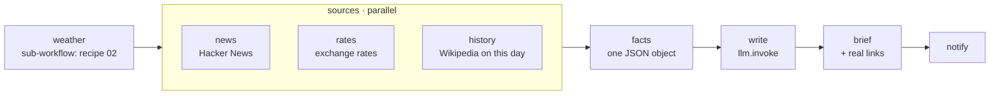

# 10 · Morning Brief

**English** · [简体中文](README.zh-CN.md)

> Your personal morning brief: weather (reusing recipe 02), top tech news, exchange rates and "on this day", all fetched **in parallel**, then written up by an LLM and delivered to your chat at 7:30.

| Difficulty | Time | Credentials | Features used |
|---|---|---|---|
| ⭐⭐⭐ Advanced | 20 min | An LLM (see [recipe 05](../05-ai-news-digest/#before-you-start-connect-an-llm)) | **sub-workflows** (`workflow:`), **`parallel`** branches, `llm.invoke` free text, cron delivery |



## What you'll learn

- **Reusing a whole workflow** as one step with `workflow:` + `workflow_args`
- Running independent API calls **at the same time** with `parallel`, and keeping one failing source from breaking the others
- Shrinking big API responses right where they're fetched, so later steps stay small
- Letting the LLM write free text while code adds the facts it must not get wrong (links)

## Run it

```bash
npx lobster run examples/10-morning-brief/workflow.json
```

```bash
npx lobster run --file examples/10-morning-brief/workflow.json \
  --args-json '{"city":"Shanghai","latitude":"31.23","longitude":"121.47","currencies":"CNY,EUR,JPY"}'
```

**Every morning in your chat:**

```bash
openclaw cron add --name "Morning brief" --cron "30 7 * * 1-5" --tz "Asia/Shanghai" \
  --session isolated \
  --message "Run the Lobster workflow ~/openclaw-cookbook/examples/10-morning-brief/workflow.json with argsJson {\"city\":\"Shanghai\",\"latitude\":\"31.23\",\"longitude\":\"121.47\"} and reply with its output text only." \
  --announce --channel telegram --to "<chat id>"
```

## Example output

Real output (DeepSeek `deepseek-flash`, 14 Oct 2026):

```
Good morning! ☀️ Wed Oct 14, 2026

Weather — Shanghai: light drizzle, 17.8–23.9°C (now 22.8°C), 0% chance of rain. No umbrella needed—enjoy the day! 🌦️

Tech headlines:
• Gemini 4 Argon
• 11 year old unsoundness bugs found in Rust borrow checker
• Apple HomeView

Exchange rates (USD): CNY 6.705025, EUR 0.893421, JPY 158.307574 💱

On this day: In 2012, Felix Baumgartner jumped from a helium balloon in the stratosphere, becoming the first person to break the sound barrier without vehicular power. 🎈

🔗 Links
1. Gemini 4 Argon
   https://deepmind.google/models/gemini/
2. 11 year old unsoundness bugs found in Rust borrow checker
   https://github.com/rust-lang/rust/issues/164250
3. Apple HomeView
   https://www.apple.com/apple-homeview/
```

## How it works

| Step | What it does |
|---|---|
| `weather` | `"workflow": "../02-daily-weather-briefing/workflow.json"` runs recipe 02 as a sub-workflow (the path is relative to **this** file). `workflow_args` passes `${city}` etc. down. Its output text is `$weather.stdout`. |
| `sources` | A `parallel` step with three `branches` that run at the same time (`wait: "all"`, `timeout_ms: 45000`). Each branch pipes `curl` into a tiny Node script that keeps only what's needed, and ends with `\|\| echo '[]'` so an outage returns empty data instead of failing the workflow. The result is `{ "news": [...], "rates": {...}, "history": [...] }`. |
| `facts` | Merges weather + sources into one compact JSON object. |
| `write` | `llm.invoke` **without** a schema, so the answer is free text at `$write.json.output.text`. The prompt says to use only the given facts. |
| `brief` | Appends the top 3 links from the data, never from the LLM. |
| `notify` | Optional chat message. |

> **Size matters:** the Wikipedia "on this day" feed is several hundred KB. Passing it whole through `env` could hit the OS limit for environment size, so each branch trims its own response first.

## Ideas to extend

- Add your calendar: a branch that calls `gog calendar` or your calendar's API.
- Add stock prices or crypto with another free API branch.
- Make it bilingual: ask the LLM to write in Chinese and English.
- Replace the weather sub-workflow with recipe 04 (release watcher) for a developer-focused brief.

## Troubleshooting

| Symptom | Fix |
|---|---|
| `Workflow step weather requires run, command, pipeline, approval, or input` | Your Lobster is too old for `workflow:` / `parallel` steps. Update OpenClaw (≥ 2026.5.28; ≥ 2026.10.1 recommended). |
| `sub-workflow ... not found` | Keep the folder structure: recipe 10 needs recipe 02 next to it. |
| A section is missing from the brief | That source was unreachable (its branch returned empty data). The prompt tells the LLM to skip missing sections. |
