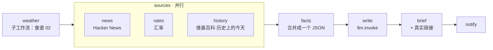

# 10 · AI 早报

[English](README.md) · **简体中文**

> 你的个人早报：天气（复用食谱 02）、科技新闻、汇率和"历史上的今天"，全部**并行**获取，再由 LLM 写成一篇早报，每天 7:30 推送到你的聊天中。

| 难度 | 用时 | 凭证 | 用到的功能 |
|---|---|---|---|
| ⭐⭐⭐ 高级 | 20 分钟 | 一个 LLM（见[食谱 05](../05-ai-news-digest/README.zh-CN.md#开始之前接入-llm)） | **子工作流**（`workflow:`）、**`parallel`** 并行分支、`llm.invoke` 自由文本、定时推送 |



## 你会学到

- 用 `workflow:` + `workflow_args` 把**整个工作流**当作一个步骤复用
- 用 `parallel` **同时**发起多个互不依赖的 API 请求，并且不让某一个数据源的失败影响其他数据源
- 在获取数据的地方就把庞大的 API 响应精简掉，让后续步骤保持轻量
- 让 LLM 自由写作，而把它不能出错的事实（链接）交给代码补充

## 运行

```bash
npx lobster run examples/10-morning-brief/workflow.json
```

```bash
npx lobster run --file examples/10-morning-brief/workflow.json \
  --args-json '{"city":"Shanghai","latitude":"31.23","longitude":"121.47","currencies":"CNY,EUR,JPY"}'
```

**每个工作日早上推送到聊天：**

```bash
openclaw cron add --name "Morning brief" --cron "30 7 * * 1-5" --tz "Asia/Shanghai" \
  --session isolated \
  --message "Run the Lobster workflow ~/openclaw-cookbook/examples/10-morning-brief/workflow.json with argsJson {\"city\":\"Shanghai\",\"latitude\":\"31.23\",\"longitude\":\"121.47\"} and reply with its output text only." \
  --announce --channel telegram --to "<聊天 ID>"
```

## 示例输出

真实输出（DeepSeek `deepseek-flash`，2026 年 10 月 14 日）：

```
Good morning! ☀️ Wed Oct 14, 2026

Weather — Shanghai: light drizzle, 17.8–23.9°C (now 22.8°C), 0% chance of rain. No umbrella needed—enjoy the day! 🌦️

Tech headlines:
• Gemini 4 Argon
• 11 year old unsoundness bugs found in Rust borrow checker
• Apple HomeView

Exchange rates (USD): CNY 6.705025, EUR 0.893421, JPY 158.307574 💱

On this day: In 2012, Felix Baumgartner jumped from a helium balloon in the stratosphere, becoming the first person to break the sound barrier without vehicular power. 🎈

🔗 Links
1. Gemini 4 Argon
   https://deepmind.google/models/gemini/
2. 11 year old unsoundness bugs found in Rust borrow checker
   https://github.com/rust-lang/rust/issues/164250
3. Apple HomeView
   https://www.apple.com/apple-homeview/
```

想要中文早报？在 `write` 步骤的提示词里加一句 "Write in Chinese" 即可。

## 工作原理

| 步骤 | 作用 |
|---|---|
| `weather` | `"workflow": "../02-daily-weather-briefing/workflow.json"` 把食谱 02 作为子工作流运行（路径相对于**当前**文件）。`workflow_args` 把 `${city}` 等参数传下去。它的输出文本是 `$weather.stdout`。 |
| `sources` | 一个 `parallel` 步骤，三个 `branches` 同时运行（`wait: "all"`、`timeout_ms: 45000`）。每个分支把 `curl` 的结果交给一小段 Node 脚本，只保留需要的字段，并以 `\|\| echo '[]'` 结尾，这样某个服务宕机时只会返回空数据，而不会让整个工作流失败。结果是 `{ "news": [...], "rates": {...}, "history": [...] }`。 |
| `facts` | 把天气和各数据源合并成一个精简的 JSON 对象。 |
| `write` | **不带** schema 的 `llm.invoke`，答案是自由文本，位于 `$write.json.output.text`。提示词要求只使用给定的事实。 |
| `brief` | 从原始数据（而不是 LLM）中取前 3 条链接，附在末尾。 |
| `notify` | 可选的聊天消息。 |

> **注意数据大小：** 维基百科"历史上的今天"的数据有几百 KB。如果整个通过 `env` 传递，可能超出操作系统对环境变量大小的限制，所以每个分支都会先精简自己的响应。

## 扩展思路

- 加入日历：增加一个调用 `gog calendar` 或你的日历 API 的分支。
- 再加一个免费 API 分支，显示股价或加密货币价格。
- 中英双语：让 LLM 同时用中文和英文撰写。
- 把天气子工作流换成食谱 04（新版本提醒），做一份面向开发者的早报。

## 常见问题

| 现象 | 解决办法 |
|---|---|
| `Workflow step weather requires run, command, pipeline, approval, or input` | 你的 Lobster 太旧，不支持 `workflow:` / `parallel` 步骤。请升级 OpenClaw（≥ 2026.5.28，推荐 ≥ 2026.10.1）。 |
| `sub-workflow ... not found` | 保持文件夹结构：食谱 10 需要食谱 02 在它旁边。 |
| 早报缺少某个板块 | 那个数据源无法访问（分支返回了空数据）。提示词会让 LLM 跳过缺失的板块。 |
