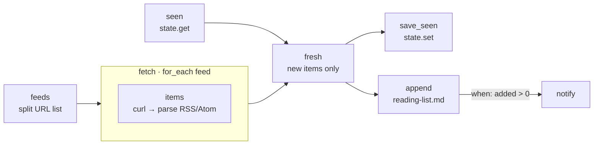

# 11 · RSS Reading List

**English** · [简体中文](README.zh-CN.md)

> Check several RSS or Atom feeds, keep only the articles you haven't seen before, and append them to a Markdown reading list you can tick off.

| Difficulty | Time | Credentials | Features used |
|---|---|---|---|
| ⭐⭐ Intermediate | 10 min | None (optional chat channel) | `for_each`, parsing XML in a step, `state.get`/`state.set` dedupe, appending to files |



## What you'll learn

- Reading **both RSS and Atom** feeds with a small parser, without extra dependencies
- Shrinking big downloads **inside the loop** (`curl | node`), so only compact data moves between steps
- **Deduplicating across runs**: remember article IDs with `state.set` and skip them next time
- Appending to a Markdown file you can use as a to-read checklist

## Run it

```bash
npx lobster run examples/11-rss-reading-list/workflow.json
```

```bash
npx lobster run --file examples/11-rss-reading-list/workflow.json \
  --args-json '{"feeds":"https://hnrss.org/best, https://www.ruanyifeng.com/blog/atom.xml","max_items":"10"}'
```

Run it twice: the second time you get `No new articles since last time.` The list lives in `~/openclaw-cookbook-output/reading-list.md`.

## Example output

```
📚 5 new articles added to /Users/me/openclaw-cookbook-output/reading-list.md (56 more skipped by max_items)
• How long will humans be needed for translation?
• OpenAI engineer arrested in bugging of executive conference room
• Show HN: Guitoro, a virtual guitar you strum with your keyboard
• Announcing Rust 1.99.0
⚠️ Could not read https://this-site-does-not-exist.invalid/feed
```

`reading-list.md`:

```markdown
# Reading list

## 2026-10-14 (5 new)

- [ ] [How long will humans be needed for translation?](https://www.bbc.co.uk/news/articles/...) — *BBC News*
- [ ] [Show HN: Guitoro, a virtual guitar you strum with your keyboard](https://guitoro.com/) — *Hacker News: Best*
- [ ] [Announcing Rust 1.98.1](https://blog.rust-lang.org/2026/09/03/Rust-1.98.1/) — *Rust Blog*
```

## How it works

| Step | What it does |
|---|---|
| `feeds` | Splits the `feeds` arg into `[{"url": ...}]`. |
| `fetch` → `items` | For each feed, `curl` downloads it and a Node one-liner finds `<item>` (RSS) or `<entry>` (Atom) blocks and pulls out id, title, link (Atom uses `<link href=...>`) and date. HTML entities and `CDATA` are decoded. A feed that fails returns `ok: false` instead of stopping the run. |
| `seen` | `state.get` loads the IDs remembered from earlier runs. |
| `fresh` | Removes duplicates and already-seen items, sorts newest first, keeps `max_items`. It also builds the updated "seen" list (capped at 2,000 IDs). |
| `save_seen` | `state.set` stores `{ "ids": [...] }`. Storing an **object** rather than a bare list avoids a Lobster quirk where a one-item list is saved as a single value. |
| `append` | Adds a dated section of checkboxes to the Markdown file and builds a short summary. |
| `notify` | Optional chat message, only when something was added. |

All articles seen in a run are remembered, including those cut off by `max_items`. So a busy feed doesn't flood you later with old articles.

## Schedule it

```bash
openclaw cron add --name "Reading list" --cron "0 8,18 * * *" --session isolated --no-deliver \
  --message "Run the Lobster workflow ~/openclaw-cookbook/examples/11-rss-reading-list/workflow.json with argsJson {\"notify_channel\":\"telegram\",\"notify_target\":\"<chat id>\"}."
```

## Ideas to extend

- Add `llm.invoke` after `fresh` to give each article a one-line summary or to drop off-topic ones (see recipe 05).
- Filter by keywords: keep only titles matching `/rust|database|ai/i`.
- Write to Obsidian or Logseq: point `output_file` at a note in your vault.

## Troubleshooting

| Symptom | Fix |
|---|---|
| `⚠️ Could not read <url>` | The feed is down, blocks bots, or isn't RSS/Atom. Open the URL in a browser to check. |
| Every run adds the same articles | The feed changes its item IDs. Report it, or switch to deduping by `link` in `fresh`. |
| Start over | Delete `~/.lobster/state/cookbook-rss-seen.json`, or use a new `state_key`. |
