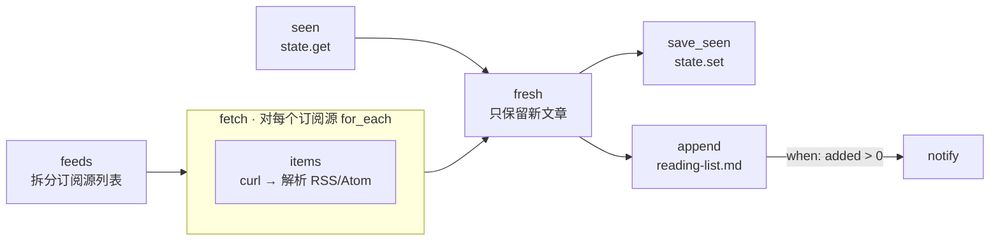

# 11 · RSS 稍后阅读清单

[English](README.md) · **简体中文**

> 检查多个 RSS 或 Atom 订阅源，只保留你还没见过的文章，并追加到一个可以逐项勾选的 Markdown 阅读清单里。

| 难度 | 用时 | 凭证 | 用到的功能 |
|---|---|---|---|
| ⭐⭐ 进阶 | 10 分钟 | 无（聊天渠道可选） | `for_each`、在步骤中解析 XML、用 `state.get`/`state.set` 跨运行去重、追加写文件 |



## 你会学到

- 用一个小解析器同时读取 **RSS 和 Atom** 两种格式，不需要额外依赖
- **在循环内部**就把大体积下载精简掉（`curl | node`），步骤之间只传递精简后的数据
- **跨运行去重**：用 `state.set` 记住文章 ID，下次跳过
- 追加到一个 Markdown 文件，当作待读清单使用

## 运行

```bash
npx lobster run examples/11-rss-reading-list/workflow.json
```

```bash
npx lobster run --file examples/11-rss-reading-list/workflow.json \
  --args-json '{"feeds":"https://hnrss.org/best, https://www.ruanyifeng.com/blog/atom.xml","max_items":"10"}'
```

运行两次：第二次会得到 `No new articles since last time.`。清单保存在 `~/openclaw-cookbook-output/reading-list.md`。

## 示例输出

```
📚 5 new articles added to /Users/me/openclaw-cookbook-output/reading-list.md (56 more skipped by max_items)
• How long will humans be needed for translation?
• OpenAI engineer arrested in bugging of executive conference room
• Show HN: Guitoro, a virtual guitar you strum with your keyboard
• Announcing Rust 1.99.0
⚠️ Could not read https://this-site-does-not-exist.invalid/feed
```

`reading-list.md`：

```markdown
# Reading list

## 2026-10-14 (5 new)

- [ ] [How long will humans be needed for translation?](https://www.bbc.co.uk/news/articles/...) — *BBC News*
- [ ] [Show HN: Guitoro, a virtual guitar you strum with your keyboard](https://guitoro.com/) — *Hacker News: Best*
- [ ] [Announcing Rust 1.98.1](https://blog.rust-lang.org/2026/09/03/Rust-1.98.1/) — *Rust Blog*
```

## 工作原理

| 步骤 | 作用 |
|---|---|
| `feeds` | 把 `feeds` 参数拆成 `[{"url": ...}]`。 |
| `fetch` → `items` | 对每个订阅源，用 `curl` 下载，再用一行 Node 代码找出 `<item>`（RSS）或 `<entry>`（Atom）块，提取 id、标题、链接（Atom 用 `<link href=...>`）和日期，并解码 HTML 实体和 `CDATA`。某个订阅源失败时返回 `ok: false`，不会中断运行。 |
| `seen` | `state.get` 读取以前运行记住的 ID。 |
| `fresh` | 去掉重复和已读的文章，按时间从新到旧排序，最多保留 `max_items` 篇；同时生成更新后的"已读"列表（最多 2000 个 ID）。 |
| `save_seen` | `state.set` 保存 `{ "ids": [...] }`。之所以存**对象**而不是单纯的列表，是为了避开 Lobster 的一个特性：只有一项的列表会被存成单个值。 |
| `append` | 在 Markdown 文件中追加一个带日期的勾选列表，并生成简短的摘要。 |
| `notify` | 可选的聊天消息，只在有新增时发送。 |

一次运行中看到的所有文章都会被记住，包括因为 `max_items` 没有写入的那些，所以更新频繁的订阅源不会在之后用旧文章刷屏。

## 定时运行

```bash
openclaw cron add --name "Reading list" --cron "0 8,18 * * *" --session isolated --no-deliver \
  --message "Run the Lobster workflow ~/openclaw-cookbook/examples/11-rss-reading-list/workflow.json with argsJson {\"notify_channel\":\"telegram\",\"notify_target\":\"<chat id>\"}."
```

## 扩展思路

- 在 `fresh` 之后加一个 `llm.invoke`，给每篇文章写一句话摘要，或过滤掉不相关的文章（参考食谱 05）。
- 按关键词过滤：只保留标题匹配 `/rust|database|ai/i` 的文章。
- 写入 Obsidian 或 Logseq：把 `output_file` 指向你笔记库中的某个笔记。

## 常见问题

| 现象 | 解决办法 |
|---|---|
| `⚠️ Could not read <url>` | 订阅源宕机、拦截了程序访问，或者不是 RSS/Atom。用浏览器打开该地址检查。 |
| 每次运行都添加同样的文章 | 这个订阅源会改变文章 ID。可以在 `fresh` 中改为按 `link` 去重。 |
| 想重新开始 | 删除 `~/.lobster/state/cookbook-rss-seen.json`，或换一个新的 `state_key`。 |
