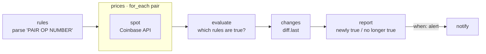

# 12 · Price Threshold Alert

**English** · [简体中文](README.zh-CN.md)

> Watch prices (crypto and currency pairs via Coinbase's free API) and get **one** alert when a rule like `BTC-USD > 100000` becomes true, not a message every time you check.

| Difficulty | Time | Credentials | Features used |
|---|---|---|---|
| ⭐⭐ Intermediate | 10 min | None (optional chat channel) | rules as args, parsing user input, `for_each` + `pause_ms`, edge-triggered alerts with `diff.last` |



## What you'll learn

- Letting users write **simple rules** as text, parsing them safely and reporting bad ones
- Fetching each **unique** pair once, even when several rules use it
- **Edge-triggered alerts**: notify when a rule *becomes* true, stay quiet while it stays true, and say when it's no longer true

## Run it

The default rules are set up so you see an alert on the first run (`BTC-USD > 1` is always true):

```bash
npx lobster run examples/12-price-threshold-alert/workflow.json
```

Your own rules:

```bash
npx lobster run --file examples/12-price-threshold-alert/workflow.json \
  --args-json '{"rules":"BTC-USD > 100000, ETH-EUR < 2000, USDC-USD < 0.99","state_key":"my-prices"}'
```

Pairs use Coinbase names: `BTC-USD`, `ETH-EUR`, `SOL-USD` and so on, plus fiat pairs like `EUR-USD`.

## Example output

First run:

```
🔔 BTC-EUR is 74,664.01 EUR, rule “BTC-EUR >= 1” is now true
🔔 BTC-USD is 83,669.08 USD, rule “BTC-USD > 1” is now true

✅ BTC-USD > 1 (now 83,669.08)
▫️ ETH-USD < 1 (now 2,509.31)
✅ BTC-EUR >= 1 (now 74,664.01)
```

Second run: nothing changed, so `alert: false` and no message. After you change the rules:

```
↩️ “BTC-USD > 1” is no longer true

▫️ ETH-USD < 1 (now 2,507.49)
⚠️ FOO-BAR > 5 (HTTP 404)
⚠️ Could not understand rule: nonsense
```

## Run it every 5 minutes

No LLM needed, so run it from `crontab` and let it send the alert itself:

```bash
*/5 * * * * cd ~/openclaw-cookbook && npx lobster run --file examples/12-price-threshold-alert/workflow.json --args-json '{"rules":"BTC-USD > 100000","notify_channel":"telegram","notify_target":"<chat id>"}'
```

## How it works

| Step | What it does |
|---|---|
| `rules` | Parses each rule with a regular expression (`PAIR (>, <, >=, <=) NUMBER`), upper-cases pairs, collects invalid rules, and makes a list of unique pairs. |
| `prices` → `spot` | For each pair, calls `https://api.coinbase.com/v2/prices/<PAIR>/spot`, with a short pause between calls. Errors (unknown pair, network) become data: `{pair, error}`. |
| `evaluate` | Checks every rule against the prices and builds a snapshot: the sorted list of rules that are true right now. |
| `changes` | `diff.last` compares the snapshot with the previous run's and saves the new one. |
| `report` | Newly true rules → 🔔. Rules true last time but not now → ↩️. Then a status line per rule. `alert` is true only when something *became* true. |
| `notify` | Sends the message only when `alert` is true. |

> This is a technical alerting example, not financial advice.

## Ideas to extend

- Percent-change rules, e.g. `BTC-USD moved 5%`: save the last price with `state.set` and compare.
- Use a different price source: change the URL in `spot` (for stocks, many APIs need a free key; pass it via an environment variable).
- Add a cooldown: remember when each rule last fired, and don't re-alert within 6 hours even if it flips back and forth.

## Troubleshooting

| Symptom | Fix |
|---|---|
| `⚠️ X-Y (HTTP 404)` | Coinbase doesn't know that pair. Check spelling, e.g. `BTC-USD`, not `BTCUSD`. |
| `No valid rules` | Use the format `PAIR > NUMBER`, with commas between rules. |
| Too many alerts when the price hovers around the limit | Add a margin: one rule to alert above 100,000, and reset only below 98,000 (two rules + a small change in `report`). |
