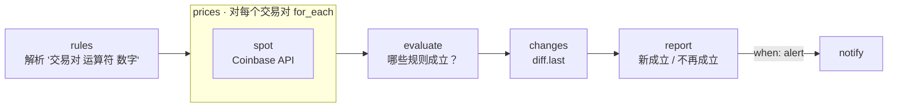

# 12 · 价格阈值提醒

[English](README.md) · **简体中文**

> 监控价格（通过 Coinbase 免费 API 获取加密货币和货币对价格），当 `BTC-USD > 100000` 这样的规则**变为成立**时只提醒**一次**，而不是每次检查都发消息。

| 难度 | 用时 | 凭证 | 用到的功能 |
|---|---|---|---|
| ⭐⭐ 进阶 | 10 分钟 | 无（聊天渠道可选） | 用参数写规则、解析用户输入、`for_each` + `pause_ms`、用 `diff.last` 实现"状态变化才提醒" |



## 你会学到

- 让用户用文字写**简单规则**，安全地解析，并报告写错的规则
- 即使多条规则用到同一个交易对，也只请求**一次**
- **边沿触发的提醒**：规则*变为*成立时通知，持续成立时保持安静，不再成立时告诉你

## 运行

默认规则的设置能让你第一次运行就看到提醒（`BTC-USD > 1` 永远成立）：

```bash
npx lobster run examples/12-price-threshold-alert/workflow.json
```

使用你自己的规则：

```bash
npx lobster run --file examples/12-price-threshold-alert/workflow.json \
  --args-json '{"rules":"BTC-USD > 100000, ETH-EUR < 2000, USDC-USD < 0.99","state_key":"my-prices"}'
```

交易对使用 Coinbase 的名称：`BTC-USD`、`ETH-EUR`、`SOL-USD` 等，也支持 `EUR-USD` 这样的法币货币对。

## 示例输出

第一次运行：

```
🔔 BTC-EUR is 74,664.01 EUR, rule “BTC-EUR >= 1” is now true
🔔 BTC-USD is 83,669.08 USD, rule “BTC-USD > 1” is now true

✅ BTC-USD > 1 (now 83,669.08)
▫️ ETH-USD < 1 (now 2,509.31)
✅ BTC-EUR >= 1 (now 74,664.01)
```

第二次运行：没有变化，所以 `alert: false`，不发消息。修改规则之后：

```
↩️ “BTC-USD > 1” is no longer true

▫️ ETH-USD < 1 (now 2,507.49)
⚠️ FOO-BAR > 5 (HTTP 404)
⚠️ Could not understand rule: nonsense
```

## 每 5 分钟运行一次

不需要 LLM，所以可以用 `crontab` 运行，让工作流自己发送提醒：

```bash
*/5 * * * * cd ~/openclaw-cookbook && npx lobster run --file examples/12-price-threshold-alert/workflow.json --args-json '{"rules":"BTC-USD > 100000","notify_channel":"telegram","notify_target":"<聊天 ID>"}'
```

## 工作原理

| 步骤 | 作用 |
|---|---|
| `rules` | 用正则表达式解析每条规则（`交易对 (>, <, >=, <=) 数字`），把交易对转为大写，收集无法识别的规则，并整理出不重复的交易对列表。 |
| `prices` → `spot` | 对每个交易对调用 `https://api.coinbase.com/v2/prices/<交易对>/spot`，调用之间稍作停顿。错误（未知交易对、网络问题）会变成数据：`{pair, error}`。 |
| `evaluate` | 用价格检查每条规则，生成一个快照：当前成立的规则（排好序的列表）。 |
| `changes` | `diff.last` 把快照和上次运行的进行比较，并保存新快照。 |
| `report` | 新成立的规则 → 🔔；上次成立、这次不成立 → ↩️；然后每条规则一行状态。只有规则*变为*成立时 `alert` 才为 true。 |
| `notify` | 只在 `alert` 为 true 时发送。 |

> 这是一个技术性的提醒示例，不构成任何投资建议。

## 扩展思路

- 涨跌幅规则，例如 `BTC-USD 波动 5%`：用 `state.set` 保存上次价格并比较。
- 换一个价格来源：修改 `spot` 中的地址（股票数据的很多 API 需要免费 Key，请通过环境变量传入）。
- 加冷却时间：记住每条规则上次触发的时间，6 小时内即使来回变化也不重复提醒。

## 常见问题

| 现象 | 解决办法 |
|---|---|
| `⚠️ X-Y (HTTP 404)` | Coinbase 不认识这个交易对。检查拼写，例如是 `BTC-USD` 而不是 `BTCUSD`。 |
| `No valid rules` | 请使用 `交易对 > 数字` 的格式，多条规则用逗号分隔。 |
| 价格在阈值附近徘徊时提醒太多 | 加一个缓冲区：高于 100000 时提醒，低于 98000 才重置（两条规则 + 对 `report` 做少量修改）。 |
