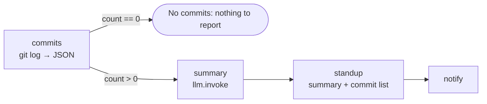

# 13 · Git Daily Standup

**English** · [简体中文](README.zh-CN.md)

> Read your recent commits from a local Git repository and let an LLM turn them into a short standup update ("Done / Next"), with the commit list attached.

| Difficulty | Time | Credentials | Features used |
|---|---|---|---|
| ⭐⭐ Intermediate | 10 min | An LLM (see [recipe 05](../05-ai-news-digest/#before-you-start-connect-an-llm)) | local commands (`git`) called safely, "nothing to report" branches, LLM summary + facts from code |



## What you'll learn

- Calling a **local program** (`git`) from Node with `execFileSync` and an argument list, so paths and author names with spaces or quotes are safe
- Parsing `git log` output reliably with **separator characters** (`%x1e`, `%x1f`) instead of guessing
- Handling the **empty case** first, so you don't pay for an LLM call when there's nothing to summarise
- Turning a clear error ("Not a git repository") into a helpful message

## Run it

From inside a repository (the default `repo` is the current folder):

```bash
npx lobster run examples/13-git-daily-standup/workflow.json
```

For a specific project, a longer window and only your commits:

```bash
npx lobster run --file examples/13-git-daily-standup/workflow.json \
  --args-json '{"repo":"~/code/my-app","since":"last friday","author":"you@example.com"}'
```

**In OpenClaw chat:** *"Run the Lobster workflow `~/openclaw-cookbook/examples/13-git-daily-standup/workflow.json` with argsJson `{"repo": "/Users/me/code/my-app"}` and send me the standup."* Use an absolute path, because the gateway runs in a different folder.

## Example output

Real output (DeepSeek `deepseek-flash`, run on this cookbook's own repository):

```
🧑‍💻 Standup — openclaw-cookbook (main)

Done:
- Added 10 practical, tested Lobster workflow recipes to the OpenClaw Cookbook.
- Upgraded CI to newer checkout/setup-node actions and Node 24.
Next: Run the updated CI against the new recipes and fix any failures.

Commits since 2 days ago: 2 · +4891 / -2 lines
• 4b3137e CI: use actions/checkout and setup-node v5 (Node 24 runtime) (YalinMa, Wed 11:09)
• bc1ba5f OpenClaw Cookbook: 10 practical, tested Lobster workflow recipes (YalinMa, Wed 11:08)
```

## Every weekday at 9:00

```bash
openclaw cron add --name "Standup" --cron "0 9 * * 1-5" --session isolated \
  --message "Run the Lobster workflow ~/openclaw-cookbook/examples/13-git-daily-standup/workflow.json with argsJson {\"repo\":\"/Users/me/code/my-app\",\"since\":\"1 day ago\"} and reply with its output only." \
  --announce --channel slack --to "channel:<your standup channel>"
```

On Mondays, use `"since": "last friday"`, or schedule a second job for Mondays.

## How it works

| Step | What it does |
|---|---|
| `commits` | Runs `git rev-parse` (repo name, branch) and `git log --all --no-merges --since=… --shortstat` with a custom format that separates commits with `\x1e` and fields with `\x1f`. It turns everything into JSON, including files changed and lines added/removed per commit. |
| `nothing` | `when: "$commits.json.count == 0"`: a friendly message, and no LLM call. |
| `summary` | `when: … > 0`: `llm.invoke` writes the "Done / Next" text from the commits (free text, no schema). |
| `standup` | Adds the facts from git: totals and up to 15 commits with hash, author and time. |
| `notify` | Optional chat message. |

## Ideas to extend

- Several repositories: wrap `commits` in a `for_each` over a list of repo paths, then summarise all of them together.
- Add open pull requests: `gh pr list --author @me --json title,url` (needs the GitHub CLI).
- Weekly report: `since: "1 week ago"`, and ask the LLM for themes instead of bullet points.

## Troubleshooting

| Symptom | Fix |
|---|---|
| `Not a git repository: …` | Set `repo` to your project folder (absolute path from chat). |
| `No commits … since …` | Nothing was committed in that window, or your `author` filter doesn't match (it matches the name or email). |
| Commits from other branches are missing | `--all` is already used. Make sure you've pulled (`git fetch`) if teammates' work matters. |
