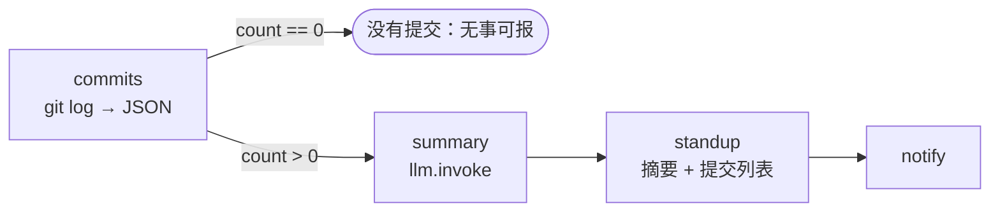

# 13 · Git 每日站会汇报

[English](README.md) · **简体中文**

> 从本地 Git 仓库读取你最近的提交，让 LLM 把它们整理成简短的站会汇报（"已完成 / 下一步"），并附上提交列表。

| 难度 | 用时 | 凭证 | 用到的功能 |
|---|---|---|---|
| ⭐⭐ 进阶 | 10 分钟 | 一个 LLM（见[食谱 05](../05-ai-news-digest/README.zh-CN.md#开始之前接入-llm)） | 安全地调用本地命令（`git`）、"无事可报"分支、LLM 摘要 + 代码补充事实 |



## 你会学到

- 在 Node 中用 `execFileSync` 加参数列表调用**本地程序**（`git`），即使路径或作者名中有空格或引号也安全
- 用**分隔字符**（`%x1e`、`%x1f`）可靠地解析 `git log` 的输出，而不是靠猜
- 先处理**空的情况**，没有内容需要总结时就不花钱调用 LLM
- 把错误（"不是 Git 仓库"）转换成有帮助的提示

## 运行

在某个仓库目录里运行（默认的 `repo` 是当前文件夹）：

```bash
npx lobster run examples/13-git-daily-standup/workflow.json
```

指定项目、更长的时间范围、只看你自己的提交：

```bash
npx lobster run --file examples/13-git-daily-standup/workflow.json \
  --args-json '{"repo":"~/code/my-app","since":"last friday","author":"you@example.com"}'
```

**在 OpenClaw 聊天中：** *"运行 Lobster 工作流 `~/openclaw-cookbook/examples/13-git-daily-standup/workflow.json`，argsJson 为 `{"repo": "/Users/me/code/my-app"}`，把站会汇报发给我。"* 请使用绝对路径，因为网关运行在其他目录。

## 示例输出

真实输出（DeepSeek `deepseek-flash`，对本食谱自己的仓库运行）：

```
🧑‍💻 Standup — openclaw-cookbook (main)

Done:
- Added 10 practical, tested Lobster workflow recipes to the OpenClaw Cookbook.
- Upgraded CI to newer checkout/setup-node actions and Node 24.
Next: Run the updated CI against the new recipes and fix any failures.

Commits since 2 days ago: 2 · +4891 / -2 lines
• 4b3137e CI: use actions/checkout and setup-node v5 (Node 24 runtime) (YalinMa, Wed 11:09)
• bc1ba5f OpenClaw Cookbook: 10 practical, tested Lobster workflow recipes (YalinMa, Wed 11:08)
```

想要中文汇报？在 `summary` 的提示词里加一句 "Write in Chinese" 即可。

## 每个工作日 9:00

```bash
openclaw cron add --name "Standup" --cron "0 9 * * 1-5" --session isolated \
  --message "Run the Lobster workflow ~/openclaw-cookbook/examples/13-git-daily-standup/workflow.json with argsJson {\"repo\":\"/Users/me/code/my-app\",\"since\":\"1 day ago\"} and reply with its output only." \
  --announce --channel slack --to "channel:<你的站会频道>"
```

周一可以用 `"since": "last friday"`，或者为周一单独建一个定时任务。

## 工作原理

| 步骤 | 作用 |
|---|---|
| `commits` | 运行 `git rev-parse`（仓库名、分支）和 `git log --all --no-merges --since=… --shortstat`，自定义格式用 `\x1e` 分隔提交、`\x1f` 分隔字段，全部转成 JSON，包括每个提交改动的文件数和增删行数。 |
| `nothing` | `when: "$commits.json.count == 0"`：友好提示，不调用 LLM。 |
| `summary` | `when: … > 0`：`llm.invoke` 根据提交写出"已完成 / 下一步"（自由文本，不带 schema）。 |
| `standup` | 补上来自 git 的事实：总计数据和最多 15 个提交（哈希、作者、时间）。 |
| `notify` | 可选的聊天消息。 |

## 扩展思路

- 多个仓库：把 `commits` 放进对仓库路径列表的 `for_each` 中，再一起总结。
- 加上未合并的 PR：`gh pr list --author @me --json title,url`（需要 GitHub CLI）。
- 周报：`since: "1 week ago"`，并让 LLM 按主题归纳，而不是逐条列出。

## 常见问题

| 现象 | 解决办法 |
|---|---|
| `Not a git repository: …` | 把 `repo` 设为你的项目文件夹（在聊天中使用绝对路径）。 |
| `No commits … since …` | 这段时间没有提交，或者你的 `author` 过滤条件不匹配（会匹配姓名或邮箱）。 |
| 缺少其他分支的提交 | 已经使用了 `--all`。如果需要同事的提交，请先 `git fetch`。 |
