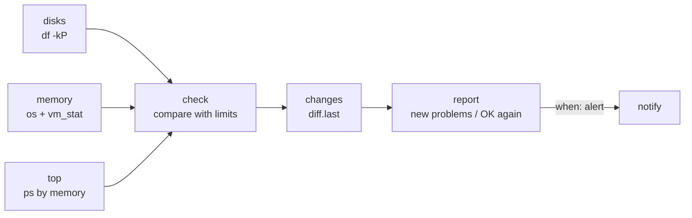

# 14 · System Health Check

**English** · [简体中文](README.zh-CN.md)

> Check disk space, memory and CPU load on the machine OpenClaw runs on, list the biggest memory users, and alert when a limit is crossed or recovers.

| Difficulty | Time | Credentials | Features used |
|---|---|---|---|
| ⭐ Beginner | 5 min | None | system commands (`df`, `ps`, `vm_stat`), thresholds as args, stable alert keys with `diff.last` |



## What you'll learn

- Workflows don't need the internet: **local system checks** that work on macOS and Linux
- Handling OS differences: on macOS, "free memory" excludes the file cache, so the recipe reads `vm_stat` for a realistic number
- Using **stable keys** (`disk /`, `memory`, `cpu`) for change detection, so an alert doesn't re-fire just because 91% became 92%

## Run it

```bash
npx lobster run examples/14-system-health-check/workflow.json
```

See what an alert looks like by setting impossible limits:

```bash
npx lobster run --file examples/14-system-health-check/workflow.json \
  --args-json '{"disk_pct":"1","memory_pct":"1","load_per_cpu":"0","state_key":"demo"}'
```

## Example output

All fine (`alert: false`, so `notify` is skipped and you get the report data):

```
All checks within limits.

💾 Disks: / 2.7% used, 425.1 GB free
🧠 Memory: 62.3% of 32 GB used
⚙️ Load (5 min): 8.81 on 10 cores (0.88 per core)
🔝 Top memory: mds_stores 978 MB, node 923 MB, Codex (Renderer) 841 MB, ...
```

When limits are crossed (first time only):

```
🔴 disk / is 2.7% full (425.1 GB free)
🔴 memory is 62.4% used
🔴 CPU load is 0.9 per core
Still over the limit: 3 check(s).
```

When they recover: `✅ OK again: memory`.

## Run it every 15 minutes

```bash
*/15 * * * * cd ~/openclaw-cookbook && npx lobster run --file examples/14-system-health-check/workflow.json --args-json '{"notify_channel":"telegram","notify_target":"<chat id>"}'
```

This is a good fit for a server or always-on Mac running the OpenClaw gateway.

## How it works

| Step | What it does |
|---|---|
| `disks` | Runs `df -kP <mount>` for each mount (POSIX format, same on macOS and Linux) and computes % used and GB free. Unknown mounts are reported, not fatal. |
| `memory` | Uses Node's `os` module for total memory, load average and CPU count. On macOS it adds free + inactive + speculative + purgeable pages from `vm_stat`, since `os.freemem()` would make memory look almost full. |
| `top` | `ps -A -o rss=,comm= \| sort -rn \| head -5`: the five processes using the most memory. |
| `check` | Compares everything with `disk_pct`, `memory_pct` and `load_per_cpu`. Each problem gets a stable `key` and a readable `text`. |
| `changes` | `diff.last` on the list of problem keys. |
| `report` | New problems → 🔴, solved ones → ✅, plus the full report. |
| `notify` | Only when something changed. |

## Ideas to extend

- Check that important processes are running (e.g. `pgrep -f "openclaw.*gateway"`) and alert when one is missing.
- Add a "big folders" step: `du -sh ~/Downloads ~/Library/Caches`.
- Ask the agent to suggest fixes: send the report to `llm.invoke` when there is a problem.

## Troubleshooting

| Symptom | Fix |
|---|---|
| Memory looks too high on Linux | Compare with `free -m` (the "available" column). Inside a container, the numbers may be the host's rather than the container's limit. |
| `/Volumes/X (not found)` | The disk isn't mounted. Check with `df -h`. |
| Load alerts during normal work | Raise `load_per_cpu` (1.0 means every core is fully busy on average). |
