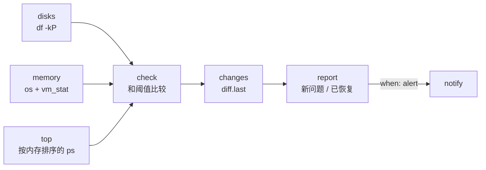

# 14 · 系统健康检查

[English](README.md) · **简体中文**

> 检查运行 OpenClaw 的这台机器的磁盘空间、内存和 CPU 负载，列出最占内存的进程，在超过阈值或恢复正常时提醒你。

| 难度 | 用时 | 凭证 | 用到的功能 |
|---|---|---|---|
| ⭐ 入门 | 5 分钟 | 无 | 系统命令（`df`、`ps`、`vm_stat`）、用参数设置阈值、用稳定的键配合 `diff.last` 判断变化 |



## 你会学到

- 工作流不一定需要联网：可以在 macOS 和 Linux 上运行的**本地系统检查**
- 处理操作系统差异：macOS 上的"空闲内存"不包含文件缓存，所以本食谱读取 `vm_stat` 来得到更真实的数字
- 用**稳定的键**（`disk /`、`memory`、`cpu`）做变化检测，避免 91% 变成 92% 就重复报警

## 运行

```bash
npx lobster run examples/14-system-health-check/workflow.json
```

把阈值设得不可能达到，看看报警是什么样子：

```bash
npx lobster run --file examples/14-system-health-check/workflow.json \
  --args-json '{"disk_pct":"1","memory_pct":"1","load_per_cpu":"0","state_key":"demo"}'
```

## 示例输出

一切正常（`alert: false`，`notify` 被跳过，你会得到报告数据）：

```
All checks within limits.

💾 Disks: / 2.7% used, 425.1 GB free
🧠 Memory: 62.3% of 32 GB used
⚙️ Load (5 min): 8.81 on 10 cores (0.88 per core)
🔝 Top memory: mds_stores 978 MB, node 923 MB, Codex (Renderer) 841 MB, ...
```

超过阈值时（只在第一次提醒）：

```
🔴 disk / is 2.7% full (425.1 GB free)
🔴 memory is 62.4% used
🔴 CPU load is 0.9 per core
Still over the limit: 3 check(s).
```

恢复正常时：`✅ OK again: memory`。

## 每 15 分钟运行一次

```bash
*/15 * * * * cd ~/openclaw-cookbook && npx lobster run --file examples/14-system-health-check/workflow.json --args-json '{"notify_channel":"telegram","notify_target":"<聊天 ID>"}'
```

很适合运行 OpenClaw 网关的服务器或常开的 Mac。

## 工作原理

| 步骤 | 作用 |
|---|---|
| `disks` | 对每个挂载点运行 `df -kP <挂载点>`（POSIX 格式，macOS 和 Linux 一致），计算使用率和剩余 GB。不存在的挂载点会被报告，但不会导致失败。 |
| `memory` | 用 Node 的 `os` 模块获取总内存、平均负载和 CPU 核数。在 macOS 上，把 `vm_stat` 中的 free + inactive + speculative + purgeable 页面加起来作为可用内存，否则 `os.freemem()` 会让内存看起来几乎被占满。 |
| `top` | `ps -A -o rss=,comm= \| sort -rn \| head -5`：占用内存最多的 5 个进程。 |
| `check` | 把各项数据和 `disk_pct`、`memory_pct`、`load_per_cpu` 比较。每个问题有一个稳定的 `key` 和一段易读的 `text`。 |
| `changes` | 对问题键列表做 `diff.last`。 |
| `report` | 新问题 → 🔴，已解决 → ✅，再附上完整报告。 |
| `notify` | 只在有变化时发送。 |

## 扩展思路

- 检查重要进程是否在运行（例如 `pgrep -f "openclaw.*gateway"`），缺失时报警。
- 加一个"大文件夹"步骤：`du -sh ~/Downloads ~/Library/Caches`。
- 让 AI 给出处理建议：出现问题时把报告交给 `llm.invoke`。

## 常见问题

| 现象 | 解决办法 |
|---|---|
| Linux 上内存使用率看起来偏高 | 和 `free -m` 的 available 列对比。在容器中运行时，看到的可能是宿主机的数据，而不是容器的限制。 |
| `/Volumes/X (not found)` | 磁盘没有挂载，用 `df -h` 检查。 |
| 正常工作时也触发负载报警 | 调高 `load_per_cpu`（1.0 表示平均每个核心都满负荷）。 |
