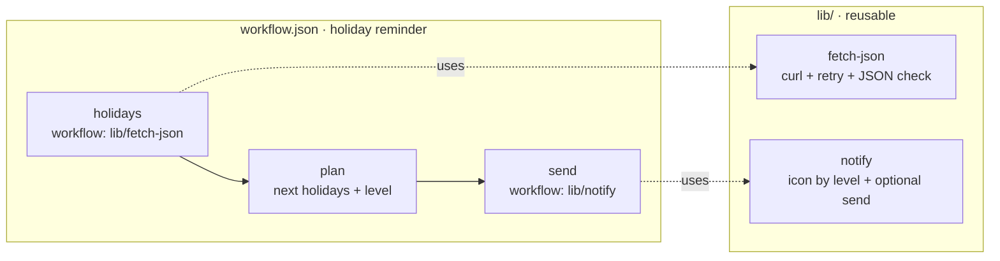

# 15 · Reusable Sub-workflows

**English** · [简体中文](README.zh-CN.md)

> Build your own toolkit of small workflows (`lib/fetch-json.json`, `lib/notify.json`) and combine them into new automations. The example is a public-holiday reminder for your country.

| Difficulty | Time | Credentials | Features used |
|---|---|---|---|
| ⭐⭐ Intermediate | 15 min | None (optional chat channel) | `workflow:` steps, `workflow_args` with step outputs, designing reusable building blocks |



## What you'll learn

- Splitting work into **building blocks** with clear inputs (args) and one output
- Calling a sub-workflow with `workflow:` and passing **step outputs** as arguments: `"title": "$plan.json.title"`
- Keeping retry, error-checking and formatting in **one place**, so every workflow that uses them gets the improvements

## Run it

```bash
npx lobster run examples/15-reusable-subworkflows/workflow.json
```

```bash
npx lobster run --file examples/15-reusable-subworkflows/workflow.json --args-json '{"country":"DE","remind_days":"30"}'
```

Each building block also runs on its own:

```bash
npx lobster run --file examples/15-reusable-subworkflows/lib/notify.json --args-json '{"title":"Deploy done","body":"v1.2 is live","level":"success"}'
```

```bash
npx lobster run --file examples/15-reusable-subworkflows/lib/fetch-json.json --args-json '{"url":"https://date.nager.at/api/v3/AvailableCountries"}'
```

## Example output

```
ℹ️ Next public holiday in CN: New Year's Day in 79 days
• New Year's Day (元旦) — 2027-01-01, in 79 days
• Chinese New Year (Spring Festival) (春节) — 2027-02-06, in 115 days
• Labour Day (劳动节) — 2027-05-01, in 199 days
```

Closer to the date the level becomes `warning`, and on the day itself `success`:

```
⚠️ Next public holiday in US: Veterans Day in 28 days, time to plan!
```

## How it works

**`lib/fetch-json.json`** (args: `url`, `timeout_seconds`)

| Step | What it does |
|---|---|
| `get` | `curl -fsSL` with `retry: { max: 3, backoff: "exponential" }`. |
| `check` | Fails with a clear message if the answer isn't JSON, otherwise prints it. |

**`lib/notify.json`** (args: `title`, `body`, `level`, `notify_channel`, `notify_target`)

| Step | What it does |
|---|---|
| `format` | Icon by level (ℹ️ ✅ ⚠️ 🚨) + title + body. |
| `send` | Sends with `openclaw message send` if a channel is given, and always returns the text. |

**`workflow.json`**: the reminder

| Step | What it does |
|---|---|
| `holidays` | `"workflow": "lib/fetch-json.json"` with `"url": "https://date.nager.at/api/v3/NextPublicHolidays/${country}"`. The sub-workflow's last output is `$holidays.json`. |
| `plan` | Keeps public holidays, merges consecutive days with the same name into one range, counts days until each, and picks the level. |
| `send` | `"workflow": "lib/notify.json"` with `workflow_args` filled from `$plan.json.*` and the parent's `${notify_channel}`. |

**Good to know:**

- Paths in `workflow:` are relative to the file that contains the step, so `lib/` travels with the recipe.
- Values passed through `workflow_args` arrive in the sub-workflow as normal args (`$LOBSTER_ARG_TITLE`…), so they are safe to use in shell steps even if they contain quotes.
- A sub-workflow **can't pause** for approval or input; Lobster rejects that. Keep approvals in the top-level workflow.

## Ideas to extend

- Use `lib/notify.json` from your other workflows (recipes 02, 03, 12…) instead of their own notify steps.
- Add more blocks: `lib/llm-summary.json` (text in, 3 bullet points out), `lib/save-markdown.json` (append a section to a file).
- Add a calendar entry for the next holiday with your calendar's API.

## Troubleshooting

| Symptom | Fix |
|---|---|
| `curl: (56) … error: 500` after 3 retries | The country code isn't supported. See `https://date.nager.at/api/v3/AvailableCountries`. |
| `sub-workflow … not found` | Keep the `lib/` folder next to `workflow.json`. |
| `Sub-workflow approval/input halts are rejected` | Move the approval step into the parent workflow. |
