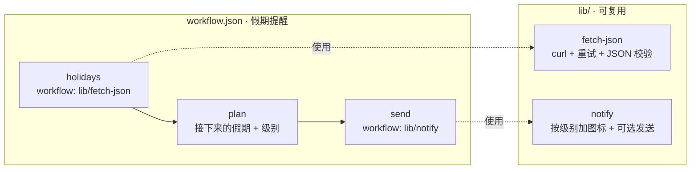

# 15 · 可复用的子工作流

[English](README.md) · **简体中文**

> 搭建你自己的小工作流工具箱（`lib/fetch-json.json`、`lib/notify.json`），再把它们组合成新的自动化。示例是一个"本国公共假期提醒"。

| 难度 | 用时 | 凭证 | 用到的功能 |
|---|---|---|---|
| ⭐⭐ 进阶 | 15 分钟 | 无（聊天渠道可选） | `workflow:` 步骤、用步骤输出填充 `workflow_args`、设计可复用的积木 |



## 你会学到

- 把工作拆成输入（参数）清晰、只有一个输出的**积木**
- 用 `workflow:` 调用子工作流，并把**步骤输出**作为参数传进去：`"title": "$plan.json.title"`
- 把重试、错误检查、格式化放在**一个地方**，所有用到它们的工作流都能同步受益

## 运行

```bash
npx lobster run examples/15-reusable-subworkflows/workflow.json
```

```bash
npx lobster run --file examples/15-reusable-subworkflows/workflow.json --args-json '{"country":"DE","remind_days":"30"}'
```

每块积木也可以单独运行：

```bash
npx lobster run --file examples/15-reusable-subworkflows/lib/notify.json --args-json '{"title":"Deploy done","body":"v1.2 is live","level":"success"}'
```

```bash
npx lobster run --file examples/15-reusable-subworkflows/lib/fetch-json.json --args-json '{"url":"https://date.nager.at/api/v3/AvailableCountries"}'
```

## 示例输出

```
ℹ️ Next public holiday in CN: New Year's Day in 79 days
• New Year's Day (元旦) — 2027-01-01, in 79 days
• Chinese New Year (Spring Festival) (春节) — 2027-02-06, in 115 days
• Labour Day (劳动节) — 2027-05-01, in 199 days
```

离假期越近，级别会变成 `warning`，当天则是 `success`：

```
⚠️ Next public holiday in US: Veterans Day in 28 days, time to plan!
```

## 工作原理

**`lib/fetch-json.json`**（参数：`url`、`timeout_seconds`）

| 步骤 | 作用 |
|---|---|
| `get` | `curl -fsSL`，带 `retry: { max: 3, backoff: "exponential" }`。 |
| `check` | 如果返回的不是 JSON，就给出明确的错误；否则原样输出。 |

**`lib/notify.json`**（参数：`title`、`body`、`level`、`notify_channel`、`notify_target`）

| 步骤 | 作用 |
|---|---|
| `format` | 按级别加图标（ℹ️ ✅ ⚠️ 🚨）+ 标题 + 正文。 |
| `send` | 如果指定了渠道就用 `openclaw message send` 发送，并始终返回文本。 |

**`workflow.json`**：假期提醒

| 步骤 | 作用 |
|---|---|
| `holidays` | `"workflow": "lib/fetch-json.json"`，参数 `"url": "https://date.nager.at/api/v3/NextPublicHolidays/${country}"`。子工作流最后的输出就是 `$holidays.json`。 |
| `plan` | 只保留公共假期，把名称相同的连续几天合并成一个时间段，计算距离每个假期的天数，并决定级别。 |
| `send` | `"workflow": "lib/notify.json"`，`workflow_args` 来自 `$plan.json.*` 和父工作流的 `${notify_channel}`。 |

**需要知道的：**

- `workflow:` 中的路径是相对于包含该步骤的文件的，所以 `lib/` 会跟着食谱一起走。
- 通过 `workflow_args` 传入的值在子工作流中就是普通参数（`$LOBSTER_ARG_TITLE`……），即使包含引号，在 shell 步骤中使用也是安全的。
- 子工作流**不能暂停**等待审批或输入，Lobster 会拒绝。审批步骤请放在顶层工作流中。

## 扩展思路

- 在你的其他工作流（食谱 02、03、12……）中使用 `lib/notify.json`，代替它们各自的 notify 步骤。
- 增加更多积木：`lib/llm-summary.json`（输入文本，输出 3 个要点）、`lib/save-markdown.json`（向文件追加一节内容）。
- 用你的日历 API 为下一个假期添加日程。

## 常见问题

| 现象 | 解决办法 |
|---|---|
| 重试 3 次后出现 `curl: (56) … error: 500` | 不支持这个国家代码。完整列表见 `https://date.nager.at/api/v3/AvailableCountries`。 |
| `sub-workflow … not found` | 保持 `lib/` 文件夹和 `workflow.json` 放在一起。 |
| `Sub-workflow approval/input halts are rejected` | 把审批步骤移到父工作流中。 |
