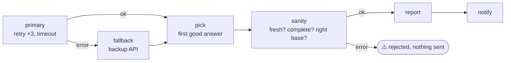

# 16 · Resilient API with Fallback

**English** · [简体中文](README.zh-CN.md)

> Get exchange rates from a primary API with retries and a timeout; if it's still down, switch to a backup API; and sanity-check the data before anyone sees it.

| Difficulty | Time | Credentials | Features used |
|---|---|---|---|
| ⭐⭐⭐ Advanced | 15 min | None | `retry` (exponential + jitter), `timeout_ms`, `on_error: "continue"`, `$step.error` / `$step.errorMessage`, data validation |



## What you'll learn

- The three layers of resilience: **retry** (temporary hiccups), **timeout** (hanging servers), **fallback** (real outages)
- Letting a step fail **without failing the workflow** (`on_error: "continue"`), then branching on `$step.error`
- Showing the user **why** something failed, using `$step.errorMessage`
- **Validating data** before acting on it: an API that answers isn't necessarily an API that's right

## Run it

```bash
npx lobster run examples/16-resilient-api-fallback/workflow.json
```

Break the primary API and watch the fallback take over:

```bash
npx lobster run --file examples/16-resilient-api-fallback/workflow.json \
  --args-json '{"primary_url":"https://this-site-does-not-exist.invalid/"}'
```

Ask for a currency that doesn't exist and watch the sanity check stop it:

```bash
npx lobster run --file examples/16-resilient-api-fallback/workflow.json --args-json '{"symbols":"EUR,XYZ"}'
```

## Example output

Normal:

```
💱 1 USD = 0.8934 EUR · 6.705 CNY · 158.3076 JPY · 0.7547 GBP
Source: open.er-api.com, 2026-10-14
```

Primary down (you'll see `[RETRY]` lines on stderr first):

```
💱 1 USD = 0.8938 EUR · 6.6938 CNY · 158.12 JPY · 0.7549 GBP
Source: frankfurter.dev, 2026-10-13 (backup API used, primary failed: no response (network or HTTP error))
```

Bad data:

```
⚠️ Exchange-rate data failed the sanity check, nothing was sent: missing or invalid rates for XYZ
```

Both APIs down: the workflow **fails** with `Both APIs failed. Primary: no response … Backup: no response …`, so OpenClaw (or cron) sees a failed run.

## How it works

| Step | What it does |
|---|---|
| `primary` | `curl … \| node` normalises the answer to `{source, base, date, rates}`. `retry: { max: 3, backoff: "exponential", delay_ms: 1000, jitter: true }` waits about 1 s, then 2 s between attempts (jitter adds randomness so many clients don't retry at the same moment). `timeout_ms: 30000` caps the whole step. `on_error: "continue"` means: if all attempts fail, mark the step `error: true` and carry on. |
| `fallback` | `when: "$primary.error == true"`: same idea against Frankfurter (ECB rates). |
| `pick` | Takes whichever answer exists. If neither does, it **fails on purpose** with both reasons. |
| `sanity` | Checks every requested currency is present and positive, the base is right, and the data isn't older than `max_age_days`. On a problem it exits with an error, again with `on_error: "continue"`. |
| `rejected` | `when: "$sanity.error == true"`: explains the problem using `$sanity.errorMessage`. |
| `report` / `notify` | `when: "$sanity.error != true"`: the normal path. |

> **`on_error` options:** `"stop"` (default) fails the run; `"continue"` records the error and goes on; `"skip_rest"` silently skips all remaining steps and ends the run successfully. This recipe uses `continue` + `when` so it can explain what happened.

## Ideas to extend

- Use this pattern for any important data source: weather (two providers), LLMs (primary model → cheaper backup model), webhooks (retry → dead-letter file).
- Cache the last good answer with `state.set`, and fall back to it (marked "stale") when both APIs are down.
- Turn the primary + fallback into a reusable `lib/` sub-workflow (see recipe 15).

## Troubleshooting

| Symptom | Fix |
|---|---|
| `data is N days old` on Mondays | Frankfurter publishes on working days only. Raise `max_age_days`. |
| Fallback is always used | The primary URL is wrong or blocked on your network. Try it with `curl`. |
| Runs take long when the primary is down | That's the retries working. Lower `retry.max` or `delay_ms` if you prefer a faster switch. |
