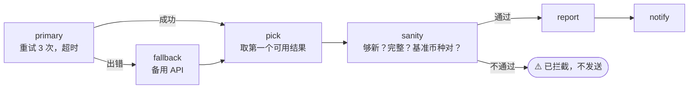

# 16 · 带备用方案的稳健 API 调用

[English](README.md) · **简体中文**

> 从主 API 获取汇率，带重试和超时；如果仍然失败，就切换到备用 API；在任何人看到数据之前先做合理性检查。

| 难度 | 用时 | 凭证 | 用到的功能 |
|---|---|---|---|
| ⭐⭐⭐ 高级 | 15 分钟 | 无 | `retry`（指数退避 + 抖动）、`timeout_ms`、`on_error: "continue"`、`$step.error` / `$step.errorMessage`、数据校验 |



## 你会学到

- 稳健性的三层：**重试**（临时故障）、**超时**（服务器卡住）、**备用方案**（真正的宕机）
- 让某个步骤失败**但不让整个工作流失败**（`on_error: "continue"`），再根据 `$step.error` 分支
- 用 `$step.errorMessage` 告诉用户**为什么**失败
- 在使用数据前**先校验**：API 有响应，不代表数据是对的

## 运行

```bash
npx lobster run examples/16-resilient-api-fallback/workflow.json
```

把主 API 弄坏，看备用方案接管：

```bash
npx lobster run --file examples/16-resilient-api-fallback/workflow.json \
  --args-json '{"primary_url":"https://this-site-does-not-exist.invalid/"}'
```

请求一个不存在的币种，看合理性检查把它拦下：

```bash
npx lobster run --file examples/16-resilient-api-fallback/workflow.json --args-json '{"symbols":"EUR,XYZ"}'
```

## 示例输出

正常情况：

```
💱 1 USD = 0.8934 EUR · 6.705 CNY · 158.3076 JPY · 0.7547 GBP
Source: open.er-api.com, 2026-10-14
```

主 API 宕机（会先在 stderr 中看到 `[RETRY]` 行）：

```
💱 1 USD = 0.8938 EUR · 6.6938 CNY · 158.12 JPY · 0.7549 GBP
Source: frankfurter.dev, 2026-10-13 (backup API used, primary failed: no response (network or HTTP error))
```

数据有问题：

```
⚠️ Exchange-rate data failed the sanity check, nothing was sent: missing or invalid rates for XYZ
```

两个 API 都宕机时，工作流会**失败**并显示 `Both APIs failed. Primary: no response … Backup: no response …`，这样 OpenClaw（或定时任务）能看到这次运行失败了。

## 工作原理

| 步骤 | 作用 |
|---|---|
| `primary` | `curl … \| node` 把响应统一成 `{source, base, date, rates}`。`retry: { max: 3, backoff: "exponential", delay_ms: 1000, jitter: true }` 在两次尝试之间大约等待 1 秒、2 秒（抖动会加入随机性，避免大量客户端在同一时刻重试）。`timeout_ms: 30000` 限制整个步骤的时长。`on_error: "continue"` 的意思是：如果所有尝试都失败，就把这一步标记为 `error: true`，然后继续。 |
| `fallback` | `when: "$primary.error == true"`：用同样的方式请求 Frankfurter（欧洲央行汇率）。 |
| `pick` | 取存在的那个结果。如果两个都没有，就**故意失败**，并给出两边的原因。 |
| `sanity` | 检查每个请求的币种都存在且为正数、基准币种正确、数据不超过 `max_age_days` 天。有问题时以错误退出，同样使用 `on_error: "continue"`。 |
| `rejected` | `when: "$sanity.error == true"`：用 `$sanity.errorMessage` 说明问题。 |
| `report` / `notify` | `when: "$sanity.error != true"`：正常路径。 |

> **`on_error` 的选项：** `"stop"`（默认）让运行失败；`"continue"` 记录错误并继续；`"skip_rest"` 静默跳过剩余所有步骤，并以成功结束运行。本食谱使用 `continue` + `when`，这样能说明发生了什么。

## 扩展思路

- 把这个模式用在任何重要的数据源上：天气（两家服务商）、LLM（主模型 → 更便宜的备用模型）、Webhook（重试 → 写入失败记录文件）。
- 用 `state.set` 缓存上一次正确的结果，两个 API 都宕机时退回到它（并标记为"可能过时"）。
- 把主 API + 备用 API 做成一个可复用的 `lib/` 子工作流（见食谱 15）。

## 常见问题

| 现象 | 解决办法 |
|---|---|
| 周一出现 `data is N days old` | Frankfurter 只在工作日发布数据。调高 `max_age_days`。 |
| 总是使用备用 API | 主 API 地址错误，或在你的网络中被屏蔽了。用 `curl` 试一下。 |
| 主 API 宕机时运行很慢 | 这是重试在起作用。如果希望更快切换，减小 `retry.max` 或 `delay_ms`。 |
