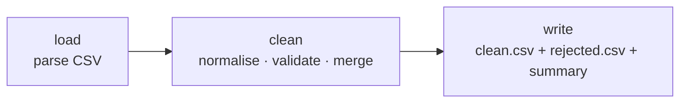

# 17 · CSV Contact Cleaner

**English** · [简体中文](README.zh-CN.md)

> Clean a messy contacts CSV: fix spacing and capitalisation, normalise emails and phone numbers, merge duplicates, and write a clean file plus a list of rejected rows with reasons.

| Difficulty | Time | Credentials | Features used |
|---|---|---|---|
| ⭐⭐ Intermediate | 10 min | None | file processing, a real CSV parser, normalising + validating + deduplicating, two output files |



## What you'll learn

- Parsing CSV **correctly**: quoted fields with commas, escaped quotes (`""`), Windows line endings, an Excel BOM and blank lines
- Recognising columns by **meaning**, not exact header text (`E-mail`, `email`, `Email Address` all work)
- The data-cleaning trio: **normalise** (same format), **validate** (reject with a reason), **deduplicate** (merge, don't lose data)
- Never silently dropping data: rejected rows go to their own file

## Run it

With the messy sample file [`contacts.csv`](contacts.csv):

```bash
npx lobster run examples/17-csv-contact-cleaner/workflow.json
```

With your own export (from Gmail, Outlook, a CRM…):

```bash
npx lobster run --file examples/17-csv-contact-cleaner/workflow.json \
  --args-json '{"input_file":"~/Downloads/contacts.csv","output_dir":"~/Desktop/cleaned"}'
```

## Example output

```
🧹 Cleaned 10 rows → 6 contacts
• merged 2 duplicate(s) by email
• fixed 3 names, 2 emails, 6 phone numbers
• rejected 2 row(s):
   line 5: invalid email “alan.turing@bletchley”
   line 7: missing name

Clean file: /Users/me/openclaw-cookbook-output/contacts/contacts.clean.csv
Rejected:   /Users/me/openclaw-cookbook-output/contacts/contacts.rejected.csv
```

`contacts.clean.csv`:

```csv
name,email,phone,company,city,notes
Ada Lovelace,ada@example.com,+442079460958,"Analytical Engines, Ltd",London,
Grace Hopper,grace@navy.example,5550102030,US Navy,Arlington,
"Lin, Mei",mei.lin@example.cn,13800138000,"Example ""Tech"" Co",Shanghai,
Linus Torvalds,linus@kernel.example,,Linux Foundation,Portland,phone unreadable: not available
```

Before, the file had ` Full Name , E-mail` headers, `ada lovelace` and `Ada Lovelace` as two rows, `  Grace   Hopper ` with extra spaces, `(555) 010-2030` and `+1 555 010 2030` for the same person, and an Excel BOM.

## How it works

| Step | What it does |
|---|---|
| `load` | A small character-by-character CSV parser (handles quotes, `""`, `\r\n`, BOM). Skips empty rows and keeps the original line number for error messages. |
| `clean` | Finds the name/email/phone/company/city columns by pattern. **Normalise:** collapse spaces; title-case names that are ALL CAPS or all lower case (mixed case like `McDonald` is left alone); lower-case emails; phone → digits with an optional leading `+`, dropping the UK-style `(0)`. **Validate:** a name and a valid-looking email are required. **Merge:** rows with the same email are merged, filling empty fields from later rows. |
| `write` | Writes both CSV files with proper quoting, and prints the summary. |

## Ideas to extend

- Format phone numbers per country (E.164) with a `default_country` arg, e.g. `138 0013 8000` + CN → `+8613800138000`.
- Flag likely duplicates with different emails (same name + same company) for manual review instead of merging them.
- Import the clean file into your CRM or Google Contacts, or upload it with `curl` to an API.

## Troubleshooting

| Symptom | Fix |
|---|---|
| `Could not find name/email columns` | Rename your headers to something like `name` and `email`, or extend the patterns in `clean`. |
| Accented names look wrong | Save the CSV as UTF-8 (Excel: *Save As → CSV UTF-8*). |
| A valid email is rejected | The check is deliberately simple (`x@y.zz`). Relax the regular expression in `clean` if needed. |
