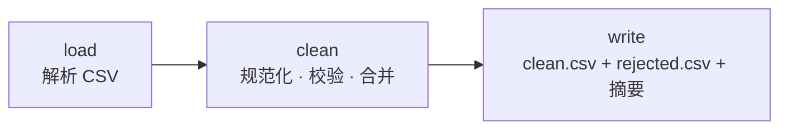

# 17 · CSV 联系人清洗

[English](README.md) · **简体中文**

> 清洗一份杂乱的联系人 CSV：修正空格和大小写、统一邮箱和电话格式、合并重复项，输出一份干净的文件，以及一份附带原因的"被拒绝行"清单。

| 难度 | 用时 | 凭证 | 用到的功能 |
|---|---|---|---|
| ⭐⭐ 进阶 | 10 分钟 | 无 | 文件处理、真正的 CSV 解析器、规范化 + 校验 + 去重、两个输出文件 |



## 你会学到

- **正确地**解析 CSV：带逗号的引号字段、转义引号（`""`）、Windows 换行符、Excel 的 BOM 和空行
- 按**含义**而不是精确的表头文字识别列（`E-mail`、`email`、`Email Address` 都可以）
- 数据清洗三件套：**规范化**（统一格式）、**校验**（拒绝并给出原因）、**去重**（合并，不丢数据）
- 绝不悄悄丢弃数据：被拒绝的行单独写进一个文件

## 运行

使用杂乱的示例文件 [`contacts.csv`](contacts.csv)：

```bash
npx lobster run examples/17-csv-contact-cleaner/workflow.json
```

使用你自己导出的文件（来自 Gmail、Outlook、CRM……）：

```bash
npx lobster run --file examples/17-csv-contact-cleaner/workflow.json \
  --args-json '{"input_file":"~/Downloads/contacts.csv","output_dir":"~/Desktop/cleaned"}'
```

## 示例输出

```
🧹 Cleaned 10 rows → 6 contacts
• merged 2 duplicate(s) by email
• fixed 3 names, 2 emails, 6 phone numbers
• rejected 2 row(s):
   line 5: invalid email “alan.turing@bletchley”
   line 7: missing name

Clean file: /Users/me/openclaw-cookbook-output/contacts/contacts.clean.csv
Rejected:   /Users/me/openclaw-cookbook-output/contacts/contacts.rejected.csv
```

`contacts.clean.csv`：

```csv
name,email,phone,company,city,notes
Ada Lovelace,ada@example.com,+442079460958,"Analytical Engines, Ltd",London,
Grace Hopper,grace@navy.example,5550102030,US Navy,Arlington,
"Lin, Mei",mei.lin@example.cn,13800138000,"Example ""Tech"" Co",Shanghai,
Linus Torvalds,linus@kernel.example,,Linux Foundation,Portland,phone unreadable: not available
```

清洗前，文件的表头是 ` Full Name , E-mail`，`ada lovelace` 和 `Ada Lovelace` 是两行，`  Grace   Hopper ` 有多余空格，同一个人的电话写成 `(555) 010-2030` 和 `+1 555 010 2030` 两种格式，文件开头还有 Excel 的 BOM。

## 工作原理

| 步骤 | 作用 |
|---|---|
| `load` | 一个逐字符解析的小型 CSV 解析器（处理引号、`""`、`\r\n`、BOM）。跳过空行，并保留原始行号，方便报错。 |
| `clean` | 按模式找出姓名/邮箱/电话/公司/城市列。**规范化：** 合并多余空格；全大写或全小写的姓名转为首字母大写（`McDonald` 这样的混合大小写保持不变）；邮箱转小写；电话只保留数字（以及开头的 `+`），去掉英式的 `(0)`。**校验：** 必须有姓名和格式正确的邮箱。**合并：** 邮箱相同的行会合并，用后面行的数据补全空字段。 |
| `write` | 带正确引号写出两个 CSV 文件，并打印摘要。 |

## 扩展思路

- 按国家格式化电话号码（E.164），加一个 `default_country` 参数，例如 `138 0013 8000` + CN → `+8613800138000`。
- 对邮箱不同但姓名和公司相同的疑似重复项做标记，留给人工确认，而不是直接合并。
- 把干净的文件导入你的 CRM 或 Google 通讯录，或用 `curl` 上传到某个 API。

## 常见问题

| 现象 | 解决办法 |
|---|---|
| `Could not find name/email columns` | 把表头改成 `name`、`email` 之类的名字，或在 `clean` 中扩展匹配模式。 |
| 带重音或中文的名字显示乱码 | 把 CSV 存为 UTF-8（Excel：*另存为 → CSV UTF-8*）。 |
| 正确的邮箱被拒绝 | 校验规则故意写得很简单（`x@y.zz`）。需要时可以放宽 `clean` 中的正则表达式。 |
