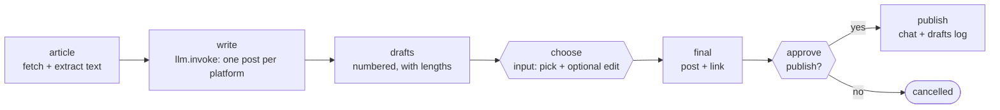

# 18 · Blog Post → Social Posts

**English** · [简体中文](README.zh-CN.md)

> Turn an article into ready-to-publish social posts. An LLM drafts one per platform, **you pick one and optionally edit it**, then **approve** before it's published to a chat channel and logged.

| Difficulty | Time | Credentials | Features used |
|---|---|---|---|
| ⭐⭐⭐ Advanced | 15 min | An LLM (see [recipe 05](../05-ai-news-digest/#before-you-start-connect-an-llm)) | web page text extraction, `input` **and** `approval` in one run, args inside prompts |



## What you'll learn

- Extracting the readable text of a web page (title, description, paragraphs) without a browser
- Two different kinds of pause in **one** workflow: an `input` step ("which one, and any edits?") and then an `approval` step ("publish this exact text?")
- Showing **character counts** next to drafts, so you notice when one is too long for a platform
- Adding the link in code, never via the LLM, so it's always correct

## Run it

```bash
npx lobster run --mode tool --file examples/18-blog-to-social-posts/workflow.json \
  --args-json '{"url":"https://blog.rust-lang.org/2026/08/21/enabling-next-solver-on-nightly/"}'
```

1. The run pauses with `needs_input` and the numbered drafts. Answer with:

   ```bash
   npx lobster resume --token <resumeToken> --response-json '{"pick":3}'
   ```

   or with your own wording: `'{"pick":1,"edited_text":"Your text here"}'`.

2. It pauses again with `needs_approval`, showing the exact final post. Answer with `npx lobster resume --token <resumeToken> --approve yes`.

**In OpenClaw chat** (OpenClaw ≥ 2026.10.1, which supports input steps), this feels natural: *"Make social posts for `<url>` with the Lobster workflow `~/openclaw-cookbook/examples/18-blog-to-social-posts/workflow.json`."* → you get drafts → *"Take 3, but drop the hashtags"* → you see the final post → *"Publish."*

Set `notify_channel` / `notify_target` to publish to a team channel (Slack, Feishu, Telegram…). Without them, approved posts are only logged to `social-posts.md`.

## Example output

Drafts (real output, DeepSeek `deepseek-flash`):

```
Drafts for: Enabling the next-generation trait solver on nightly | Rust Blog

[1] X (307 characters with link)
Rust's next-gen trait solver is now default on nightly after ~4 years of work — the compiler's biggest
change since 1.0. It fixes 200+ issues and makes some crates (like datafusion) compile 8x faster. ...

[2] LinkedIn (1498 characters with link)
Rust developers should try the latest nightly: the next-generation trait solver is now enabled by default. ...

[3] Mastodon (398 characters with link)
Rust's next-gen trait solver is now enabled by default on nightly! 🎉 After ~4 years of work, ...
#rustlang #opensource
```

Note the **307 characters** on draft 1: too long for X. That's exactly why the counts are shown. Pick another one, or edit it.

After approval: `✅ Published to slack and saved to ~/openclaw-cookbook-output/social-posts.md`.

## How it works

| Step | What it does |
|---|---|
| `article` | `curl` + a Node script: removes `<script>`/`<style>`, reads `og:title` / `<title>` and `og:description`, keeps `<p>` paragraphs longer than 40 characters (max 6,000 characters). Fails clearly if it finds too little text (e.g. a page that needs JavaScript). |
| `write` | `llm.invoke` with the article as input. `${platforms}` (an arg) is put into the prompt, so you can ask for other platforms or styles. The schema asks for `{posts: [{platform, text}]}`. |
| `drafts` | Numbered drafts with character counts **including** the link, as a list of lines (they become the input step's `subject`). |
| `choose` | `input` step: `{pick: integer ≥ 1, edited_text?: string}`, default `{pick: 1}`. |
| `final` | Picks the draft (or your edit), appends the URL, and checks the number is valid. |
| `approve` | `approval` step whose items are the final post's lines, so you approve the exact text. |
| `publish` | Appends to the drafts log and, if a channel is set, sends it with `openclaw message send`. |

## Ideas to extend

- Post for real: replace `openclaw message send` with your platform's API (`curl` + a token from an environment variable), still behind the approval.
- Make an image: ask for an image prompt in the schema and generate it with OpenClaw's image tools.
- Feed it from recipe 11: run it for each new article in your RSS reading list.

## Troubleshooting

| Symptom | Fix |
|---|---|
| `Could not find enough article text` | The page is built with JavaScript, or blocks bots. Try the article's AMP or "print" version, or paste the text into a file and adapt `article` to read it. |
| `There is no draft number N` | Pick a number from the list, then run again (the answer is checked after the input step). |
| Facts in the drafts are wrong | The prompt says "only use facts from the article", but always read before approving. That's what the approval step is for. |
