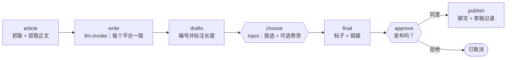

# 18 · 博客文章 → 社交媒体帖子

[English](README.md) · **简体中文**

> 把一篇文章变成可直接发布的社交媒体帖子。LLM 为每个平台写一版草稿，**你来挑选并可以修改**，**审批**后才发布到聊天渠道并记录下来。

| 难度 | 用时 | 凭证 | 用到的功能 |
|---|---|---|---|
| ⭐⭐⭐ 高级 | 15 分钟 | 一个 LLM（见[食谱 05](../05-ai-news-digest/README.zh-CN.md#开始之前接入-llm)） | 网页正文提取、同一次运行中先 `input` **再** `approval`、在提示词中使用参数 |



## 你会学到

- 不用浏览器，提取网页的可读正文（标题、描述、段落）
- 在**同一个**工作流中使用两种暂停：先是 `input` 步骤（"选哪个？要不要改？"），再是 `approval` 步骤（"就发布这段文字吗？"）
- 在草稿旁边显示**字符数**，这样某个平台超长时你一眼就能发现
- 链接由代码添加、从不交给 LLM，所以一定是正确的

## 运行

```bash
npx lobster run --mode tool --file examples/18-blog-to-social-posts/workflow.json \
  --args-json '{"url":"https://blog.rust-lang.org/2026/08/21/enabling-next-solver-on-nightly/"}'
```

1. 运行会以 `needs_input` 暂停，并给出编号的草稿。回答：

   ```bash
   npx lobster resume --token <resumeToken> --response-json '{"pick":3}'
   ```

   或者用你自己的措辞：`'{"pick":1,"edited_text":"你的文字"}'`。

2. 它会再次以 `needs_approval` 暂停，展示最终要发布的帖子原文。用 `npx lobster resume --token <resumeToken> --approve yes` 回答。

**在 OpenClaw 聊天中**（需要 OpenClaw ≥ 2026.10.1，支持 input 步骤），整个过程非常自然：*"用 Lobster 工作流 `~/openclaw-cookbook/examples/18-blog-to-social-posts/workflow.json` 为 `<网址>` 写社交媒体帖子。"* → 你收到草稿 → *"用第 3 个，把话题标签去掉"* → 你看到最终帖子 → *"发布。"*

设置 `notify_channel` / `notify_target` 就能发布到团队频道（Slack、飞书、Telegram……）。不设置的话，审批通过的帖子只会记录到 `social-posts.md`。

## 示例输出

草稿（真实输出，DeepSeek `deepseek-flash`）：

```
Drafts for: Enabling the next-generation trait solver on nightly | Rust Blog

[1] X (307 characters with link)
Rust's next-gen trait solver is now default on nightly after ~4 years of work — the compiler's biggest
change since 1.0. It fixes 200+ issues and makes some crates (like datafusion) compile 8x faster. ...

[2] LinkedIn (1498 characters with link)
Rust developers should try the latest nightly: the next-generation trait solver is now enabled by default. ...

[3] Mastodon (398 characters with link)
Rust's next-gen trait solver is now enabled by default on nightly! 🎉 After ~4 years of work, ...
#rustlang #opensource
```

注意草稿 1 的 **307 个字符**：超过了 X 的长度限制。这正是显示字符数的意义所在：换一个，或者修改它。

审批后：`✅ Published to slack and saved to ~/openclaw-cookbook-output/social-posts.md`。

想要中文帖子？把 `platforms` 参数改成例如 `"微博（140 字以内）, 小红书（活泼，带 emoji）, 微信朋友圈（简短）"`，并在提示词里要求用中文写。

## 工作原理

| 步骤 | 作用 |
|---|---|
| `article` | `curl` + 一段 Node 脚本：去掉 `<script>`/`<style>`，读取 `og:title` / `<title>` 和 `og:description`，保留超过 40 个字符的 `<p>` 段落（最多 6000 字符）。如果找到的正文太少（例如需要 JavaScript 才能显示的页面），会给出明确的错误。 |
| `write` | 以文章为输入调用 `llm.invoke`。`${platforms}`（一个参数）会被放进提示词，所以你可以要求其他平台或风格。schema 要求返回 `{posts: [{platform, text}]}`。 |
| `drafts` | 编号的草稿，字符数**包含**链接，按行组成列表（会成为 input 步骤的 `subject`）。 |
| `choose` | `input` 步骤：`{pick: ≥ 1 的整数, edited_text?: 字符串}`，默认 `{pick: 1}`。 |
| `final` | 选出草稿（或你的修改版），附上网址，并检查编号是否有效。 |
| `approve` | `approval` 步骤，items 是最终帖子的各行，所以你审批的就是要发布的原文。 |
| `publish` | 追加到草稿记录；如果设置了渠道，就用 `openclaw message send` 发送。 |

## 扩展思路

- 真正发布：把 `openclaw message send` 换成你所用平台的 API（`curl` + 来自环境变量的令牌），仍然放在审批之后。
- 生成配图：在 schema 中要求一段图片提示词，再用 OpenClaw 的图片工具生成。
- 和食谱 11 连起来：为 RSS 阅读清单中的每篇新文章运行它。

## 常见问题

| 现象 | 解决办法 |
|---|---|
| `Could not find enough article text` | 页面是用 JavaScript 渲染的，或拦截了程序访问。试试文章的 AMP 或"打印"版本，或者把正文粘贴到文件里，再修改 `article` 让它读取文件。 |
| `There is no draft number N` | 从列表中选一个编号，然后重新运行（答案在 input 步骤之后才检查）。 |
| 草稿中的事实有误 | 提示词要求"只使用文章中的事实"，但发布前一定要读一遍，这正是审批步骤的意义。 |
