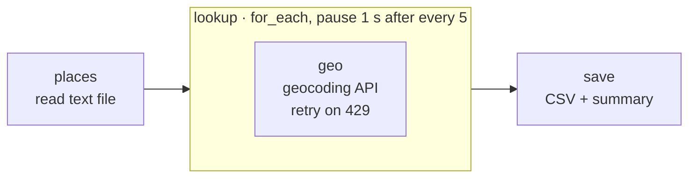

# 19 · Batch Geocoder

**English** · [简体中文](README.zh-CN.md)

> Turn a list of place names into coordinates, country and timezone with the free Open-Meteo geocoding API, politely rate-limited, and save the result as CSV.

| Difficulty | Time | Credentials | Features used |
|---|---|---|---|
| ⭐⭐ Intermediate | 10 min | None | `for_each` with **`batch_size` + `pause_ms`**, handling HTTP 429, "not found" as data, CSV output |



## What you'll learn

- **Rate limiting** big jobs: `batch_size: 5, pause_ms: 1000` pauses one second after every five lookups
- Handling **HTTP 429 Too Many Requests** by waiting and trying again
- Treating "not found" as a normal result, so one bad entry doesn't stop the batch
- Letting users add hints in their input (`Springfield, US` restricts the search to one country)

## Run it

With the sample [`places.txt`](places.txt):

```bash
npx lobster run examples/19-batch-geocoder/workflow.json
```

With your own list, place names in Chinese:

```bash
npx lobster run --file examples/19-batch-geocoder/workflow.json \
  --args-json '{"input_file":"~/Desktop/stores.txt","language":"zh"}'
```

`places.txt` format: one place per line, `#` for comments, and an optional `, XX` country code.

**In OpenClaw chat** this takes longer than the tool's default 20 s, so ask for more time: *"…with timeoutMs 120000"*.

## Example output

```
📍 Geocoded 11 of 12 places → /Users/me/openclaw-cookbook-output/places.geocoded.csv
• Berlin → 柏林, 德国 (52.524, 13.411)
• Shanghai → 上海, 中国 (31.222, 121.458)
• São Paulo → 圣保罗, 巴西 (-23.547, -46.636)
• Springfield, US → 斯普林菲尔德, 美国 (37.215, -93.298)
…
❓ Not found: Xyzzy Nowhereville
```

```csv
query,found,name,region,country,lat,lon,timezone,population
Berlin,true,Berlin,State of Berlin,Germany,52.52437,13.41053,Europe/Berlin,3426354
"Springfield, US",true,Springfield,Missouri,United States,37.21533,-93.29824,America/Chicago,170188
Xyzzy Nowhereville,false,,,,,,,
```

12 places take about 30 seconds: two one-second pauses plus the lookups.

## How it works

| Step | What it does |
|---|---|
| `places` | Reads the file, skips blanks and `#` comments, and splits off an optional country code. |
| `lookup` | `for_each` with `batch_size: 5` and `pause_ms: 1000`: Lobster waits 1 s before items 6, 11, 16… |
| `geo` | Calls `geocoding-api.open-meteo.com/v1/search` with `name`, `count=1`, `language` and (if given) `countryCode`. On `429` it waits 2 s, then 4 s, and tries again. Returns `{found: true, name, region, country, lat, lon, timezone, population}` or `{found: false}`. |
| `save` | Writes the CSV with proper quoting and prints a summary listing every place that wasn't found. |

> **Why not just loop as fast as possible?** Free APIs share capacity between everyone. Going slow is polite, and it's usually *faster* overall, because you avoid being blocked.

## Ideas to extend

- Add the weather for each place (Open-Meteo forecast API, no key), turning this into a "weather for all our offices" report.
- Draw a map: write GeoJSON instead of CSV and drop it on [geojson.io](https://geojson.io).
- Geocode full addresses with a provider that supports them (most need a free key; pass it through an environment variable).

## Troubleshooting

| Symptom | Fix |
|---|---|
| The wrong "Springfield" | Add a country code (`Springfield, US`). For more precision you need an address geocoder. |
| `error: HTTP 429` in results | You're over the free limit. Raise `pause_ms` or lower `batch_size` in the `lookup` step. |
| Times out in chat | Pass `timeoutMs` in the lobster tool call (e.g. 120000), or run it from the terminal / cron. |
