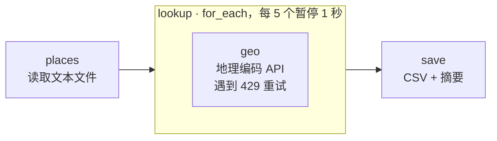

# 19 · 批量地理编码

[English](README.md) · **简体中文**

> 用免费的 Open-Meteo 地理编码 API，把一串地名转换成经纬度、国家和时区，礼貌地控制请求频率，并把结果保存为 CSV。

| 难度 | 用时 | 凭证 | 用到的功能 |
|---|---|---|---|
| ⭐⭐ 进阶 | 10 分钟 | 无 | 带 **`batch_size` + `pause_ms`** 的 `for_each`、处理 HTTP 429、把"找不到"当作数据、CSV 输出 |



## 你会学到

- 给大批量任务**限速**：`batch_size: 5, pause_ms: 1000` 表示每查 5 个就暂停 1 秒
- 遇到 **HTTP 429 Too Many Requests** 时等待后重试
- 把"找不到"当作正常结果，一条错误数据不会中断整批任务
- 允许用户在输入中加提示（`Springfield, US` 把搜索限定在某个国家）

## 运行

使用示例 [`places.txt`](places.txt)：

```bash
npx lobster run examples/19-batch-geocoder/workflow.json
```

使用你自己的列表，地名以中文显示：

```bash
npx lobster run --file examples/19-batch-geocoder/workflow.json \
  --args-json '{"input_file":"~/Desktop/stores.txt","language":"zh"}'
```

`places.txt` 格式：每行一个地名，`#` 开头为注释，可选的 `, XX` 为国家代码。

**在 OpenClaw 聊天中**，运行时间会超过工具默认的 20 秒，所以请要求更长的超时：*"……timeoutMs 设为 120000"*。

## 示例输出

```
📍 Geocoded 11 of 12 places → /Users/me/openclaw-cookbook-output/places.geocoded.csv
• Berlin → 柏林, 德国 (52.524, 13.411)
• Shanghai → 上海, 中国 (31.222, 121.458)
• São Paulo → 圣保罗, 巴西 (-23.547, -46.636)
• Springfield, US → 斯普林菲尔德, 美国 (37.215, -93.298)
…
❓ Not found: Xyzzy Nowhereville
```

```csv
query,found,name,region,country,lat,lon,timezone,population
Berlin,true,Berlin,State of Berlin,Germany,52.52437,13.41053,Europe/Berlin,3426354
"Springfield, US",true,Springfield,Missouri,United States,37.21533,-93.29824,America/Chicago,170188
Xyzzy Nowhereville,false,,,,,,,
```

12 个地名大约需要 30 秒：两次 1 秒的暂停，加上查询时间。

## 工作原理

| 步骤 | 作用 |
|---|---|
| `places` | 读取文件，跳过空行和 `#` 注释，拆出可选的国家代码。 |
| `lookup` | `for_each`，`batch_size: 5`、`pause_ms: 1000`：Lobster 会在第 6、11、16……个之前等待 1 秒。 |
| `geo` | 调用 `geocoding-api.open-meteo.com/v1/search`，参数为 `name`、`count=1`、`language`，以及（如果有）`countryCode`。遇到 `429` 时先等 2 秒、再等 4 秒后重试。返回 `{found: true, name, region, country, lat, lon, timezone, population}` 或 `{found: false}`。 |
| `save` | 带正确引号写出 CSV，并打印摘要，列出所有没找到的地名。 |

> **为什么不尽可能快地循环？** 免费 API 的容量是大家共享的。慢一点是礼貌，而且总体上往往*更快*，因为不会被封禁。

## 扩展思路

- 为每个地点加上天气（Open-Meteo 天气预报 API，无需 Key），变成一份"各办公室天气"报告。
- 画地图：输出 GeoJSON 而不是 CSV，然后拖到 [geojson.io](https://geojson.io) 上。
- 用支持详细地址的服务做地址解析（大多需要免费 Key，请通过环境变量传入）。

## 常见问题

| 现象 | 解决办法 |
|---|---|
| 找到了错误的 "Springfield" | 加上国家代码（`Springfield, US`）。需要更精确的话要用地址级的地理编码服务。 |
| 结果中出现 `error: HTTP 429` | 超出了免费额度。在 `lookup` 步骤中调大 `pause_ms` 或调小 `batch_size`。 |
| 在聊天中超时 | 在 lobster 工具调用中传入 `timeoutMs`（例如 120000），或改在终端 / 定时任务中运行。 |
