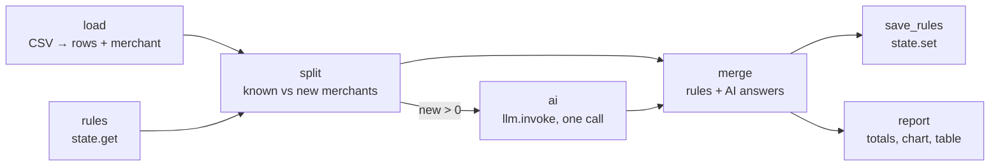

# 20 · Expense Categorizer

**English** · [简体中文](README.zh-CN.md)

> Categorise bank transactions from a CSV export and get a monthly spending report. Merchants seen before are categorised by **saved rules**; only new merchants go to the LLM, in **one batched call**, under a **cost limit**.

| Difficulty | Time | Credentials | Features used |
|---|---|---|---|
| ⭐⭐⭐ Advanced | 15 min | An LLM (see [recipe 05](../05-ai-news-digest/#before-you-start-connect-an-llm)) | batching LLM calls, learning rules with `state`, `cost_limit`, Markdown reports |



## What you'll learn

- **Batch** LLM work: one call for 16 merchants instead of 20 calls for 20 transactions
- **Learn and reuse**: save the LLM's answers as rules, so next month only *new* merchants cost anything
- Put a hard **budget** on a workflow with `cost_limit`
- **Don't trust the label blindly**: only allowed category names are accepted, anything else becomes "Other"

## Run it

With the sample [`transactions.csv`](transactions.csv) (20 transactions, September 2026):

```bash
npx lobster run examples/20-expense-categorizer/workflow.json
```

Run it again: this time every transaction is categorised by saved rules, and **no LLM call** is made.

With your bank's export (needs `date`, `description`, `amount` columns; negative = money out):

```bash
npx lobster run --file examples/20-expense-categorizer/workflow.json \
  --args-json '{"input_file":"~/Downloads/october.csv","currency":"CNY","categories":"Groceries, Dining, Transport, Rent, Bills, Shopping, Health, Fun, Travel, Salary, Transfers, Other"}'
```

## Example output

Real output (DeepSeek `deepseek-flash`):

```
💸 Spent 2,624.12 EUR · income 4,200.00 EUR · left 1,575.88 EUR
• Housing: 1,350.00 EUR (51%)
• Savings & transfers: 500.00 EUR (19%)
• Travel: 212.00 EUR (8%)
• Groceries: 182.25 EUR (7%)
• Transport: 121.05 EUR (5%)
• Utilities: 75.00 EUR (3%)

20 transactions: 0 categorised by saved rules, 16 new merchant(s) sent to the LLM.
Report: /Users/me/openclaw-cookbook-output/spending-report.md
```

Second run: `20 transactions: 20 categorised by saved rules, 0 new merchant(s) sent to the LLM.`

`spending-report.md` (excerpt):

| Category | Amount | Share | |
|---|---:|---:|---|
| Housing | 1,350.00 EUR | 51% | ████████████████████ |
| Savings & transfers | 500.00 EUR | 19% | ███████ |
| Travel | 212.00 EUR | 8% | ███ |
| Groceries | 182.25 EUR | 7% | ███ |

## How it works

| Step | What it does |
|---|---|
| `load` | Reads the CSV and derives a **merchant key** from each description: upper-case, without digits and noise words, first two words. `REWE SAGT DANKE 4411` → `REWE`, `UBER *TRIP HELP.UBER.COM` → `UBER TRIP`. |
| `rules` | `state.get` loads `{rules: {merchant: category}}` from earlier runs. |
| `split` | Separates known merchants from new ones. New ones are sent once each, even if they appear many times. |
| `ai` | `when: "$split.json.unknownMerchants > 0"`: **one** `llm.invoke` call with `--temperature 0`, returning `{items: [{i, category}]}`. The allowed categories come from the `categories` arg. |
| `merge` | Applies rules and AI answers. Unknown category names become `Other`; merchants the LLM skipped stay unlearned and are asked again next time. Records how each row was categorised (`rule`, `ai`, `fallback`). |
| `save_rules` | `state.set` stores the updated rules. |
| `report` | Totals, a category table with a text bar chart, and every transaction, written to Markdown. |

### The cost limit

```json
"cost_limit": { "max_usd": 0.05, "action": "stop" }
```

Lobster adds up the cost of every `llm.invoke` in the run and stops it with `Cost limit exceeded: $… > $0.05 limit` as soon as the total goes over the limit (`"action": "warn"` only warns). The call that crosses the line has already been paid for, so set the limit a little below what you can afford. It needs to know the model's price: Lobster has a built-in table for well-known models, and for others you set `LOBSTER_LLM_PRICING_JSON`, e.g. for DeepSeek:

```bash
export LOBSTER_LLM_PRICING_JSON='{"deepseek-flash":{"input":0.14,"output":0.28}}'
```

(USD per million tokens.) For a model with no known price, Lobster records the cost as $0 and warns on stderr, so the limit can't protect you. Set the price.

## Ideas to extend

- Fix a wrong category forever: edit `~/.lobster/state/cookbook-expense-rules.json` (it's plain JSON), and the next run uses your correction.
- Monthly budget alerts: compare each category with a limit (`budgets` arg) and notify when one is exceeded.
- Compare months: save each month's totals with `state.set` and show the change.

## Troubleshooting

| Symptom | Fix |
|---|---|
| `CSV needs date, description and amount columns` | Rename your bank export's headers, or adapt `load`. |
| Two different shops share one rule | Their first two words are the same. Make the merchant key longer in `load` (e.g. three words). |
| Everything is `Other` with the mock LLM | The mock invents placeholder labels. Use a real model to see real categories. |
| `Cost limit exceeded` | Raise `max_usd`, or send fewer new merchants at once. |
