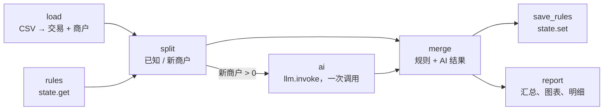

# 20 · 消费记录自动分类

[English](README.md) · **简体中文**

> 给银行导出的 CSV 交易记录自动分类，并生成月度消费报告。见过的商户用**已保存的规则**分类，只有新商户才交给 LLM，而且是**一次批量调用**，并设有**费用上限**。

| 难度 | 用时 | 凭证 | 用到的功能 |
|---|---|---|---|
| ⭐⭐⭐ 高级 | 15 分钟 | 一个 LLM（见[食谱 05](../05-ai-news-digest/README.zh-CN.md#开始之前接入-llm)） | 批量调用 LLM、用 `state` 学习规则、`cost_limit`、Markdown 报告 |



## 你会学到

- **批量**处理 LLM 任务：16 个商户一次调用，而不是 20 笔交易调用 20 次
- **学习并复用**：把 LLM 的答案保存为规则，下个月只有*新*商户才会产生费用
- 用 `cost_limit` 给工作流设置硬性**预算**
- **不盲目相信标签**：只接受允许的类别名称，其他一律归为 "Other"

## 运行

使用示例 [`transactions.csv`](transactions.csv)（2026 年 9 月的 20 笔交易）：

```bash
npx lobster run examples/20-expense-categorizer/workflow.json
```

再运行一次：这次所有交易都由已保存的规则分类，**不会调用 LLM**。

使用你的银行导出文件（需要 `date`、`description`、`amount` 三列；负数表示支出）：

```bash
npx lobster run --file examples/20-expense-categorizer/workflow.json \
  --args-json '{"input_file":"~/Downloads/october.csv","currency":"CNY","categories":"买菜, 餐饮, 交通, 房租, 水电网, 购物, 医疗, 娱乐, 旅行, 工资, 转账, 其他"}'
```

## 示例输出

真实输出（DeepSeek `deepseek-flash`）：

```
💸 Spent 2,624.12 EUR · income 4,200.00 EUR · left 1,575.88 EUR
• Housing: 1,350.00 EUR (51%)
• Savings & transfers: 500.00 EUR (19%)
• Travel: 212.00 EUR (8%)
• Groceries: 182.25 EUR (7%)
• Transport: 121.05 EUR (5%)
• Utilities: 75.00 EUR (3%)

20 transactions: 0 categorised by saved rules, 16 new merchant(s) sent to the LLM.
Report: /Users/me/openclaw-cookbook-output/spending-report.md
```

第二次运行：`20 transactions: 20 categorised by saved rules, 0 new merchant(s) sent to the LLM.`

`spending-report.md`（节选）：

| Category | Amount | Share | |
|---|---:|---:|---|
| Housing | 1,350.00 EUR | 51% | ████████████████████ |
| Savings & transfers | 500.00 EUR | 19% | ███████ |
| Travel | 212.00 EUR | 8% | ███ |
| Groceries | 182.25 EUR | 7% | ███ |

## 工作原理

| 步骤 | 作用 |
|---|---|
| `load` | 读取 CSV，并从每条描述中提取**商户键**：转大写、去掉数字和无意义的词、取前两个词。`REWE SAGT DANKE 4411` → `REWE`，`UBER *TRIP HELP.UBER.COM` → `UBER TRIP`。 |
| `rules` | `state.get` 读取以前保存的 `{rules: {商户: 类别}}`。 |
| `split` | 区分已知商户和新商户。新商户即使出现多次也只发送一次。 |
| `ai` | `when: "$split.json.unknownMerchants > 0"`：**一次** `llm.invoke` 调用，`--temperature 0`，返回 `{items: [{i, category}]}`。允许的类别来自 `categories` 参数。 |
| `merge` | 应用规则和 AI 的答案。不认识的类别名改为 `Other`；LLM 漏掉的商户不会被学习，下次会重新询问。并记录每一行是怎么分类的（`rule`、`ai`、`fallback`）。 |
| `save_rules` | `state.set` 保存更新后的规则。 |
| `report` | 汇总、带文字条形图的分类表，以及所有交易明细，写入 Markdown。 |

### 费用上限

```json
"cost_limit": { "max_usd": 0.05, "action": "stop" }
```

Lobster 会累加本次运行中每次 `llm.invoke` 的费用，一旦总额超过上限，就以 `Cost limit exceeded: $… > $0.05 limit` 停止运行（`"action": "warn"` 只发出警告）。越过上限的那一次调用已经付费，所以上限请设得比你能接受的金额略低。它需要知道模型的价格：Lobster 内置了常见模型的价格表，其他模型请设置 `LOBSTER_LLM_PRICING_JSON`，例如 DeepSeek：

```bash
export LOBSTER_LLM_PRICING_JSON='{"deepseek-flash":{"input":0.14,"output":0.28}}'
```

（单位：美元 / 百万 token。）对于价格未知的模型，Lobster 会把费用记为 0 美元并在 stderr 中警告，这时上限保护不了你。请设置价格。

## 扩展思路

- 永久修正分错的类别：编辑 `~/.lobster/state/cookbook-expense-rules.json`（普通 JSON 文件），下次运行就会使用你的修正。
- 月度预算提醒：把每个类别和一个上限（`budgets` 参数）比较，超出时发通知。
- 对比各月：用 `state.set` 保存每个月的汇总，并显示变化。

## 常见问题

| 现象 | 解决办法 |
|---|---|
| `CSV needs date, description and amount columns` | 修改银行导出文件的表头，或调整 `load` 步骤。 |
| 两家不同的店共用了一条规则 | 它们的前两个词相同。在 `load` 中把商户键改长一些（例如取三个词）。 |
| 用模拟模型时全部是 `Other` | 模拟模型会编造占位标签。换成真实模型才能看到真正的分类。 |
| `Cost limit exceeded` | 调高 `max_usd`，或每次少发送一些新商户。 |
